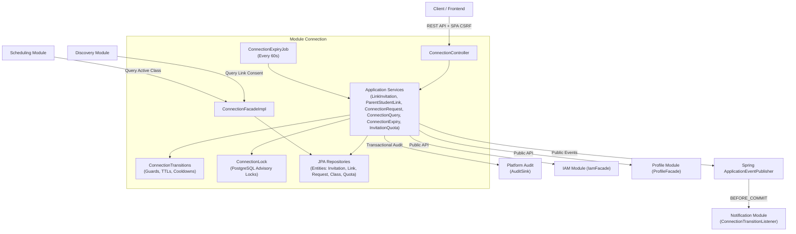
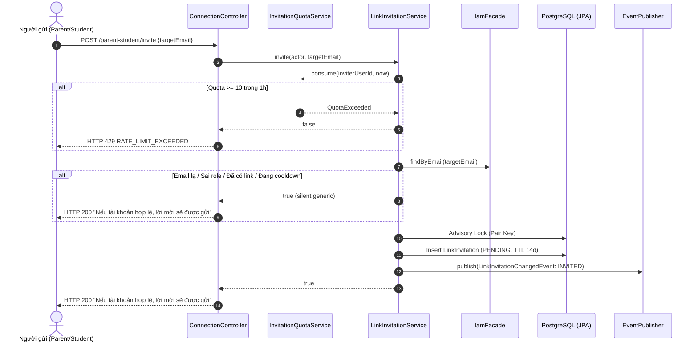
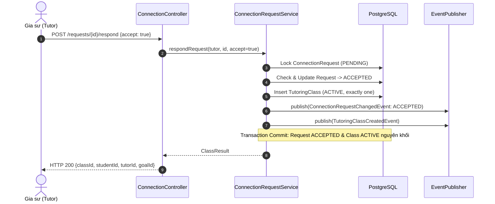
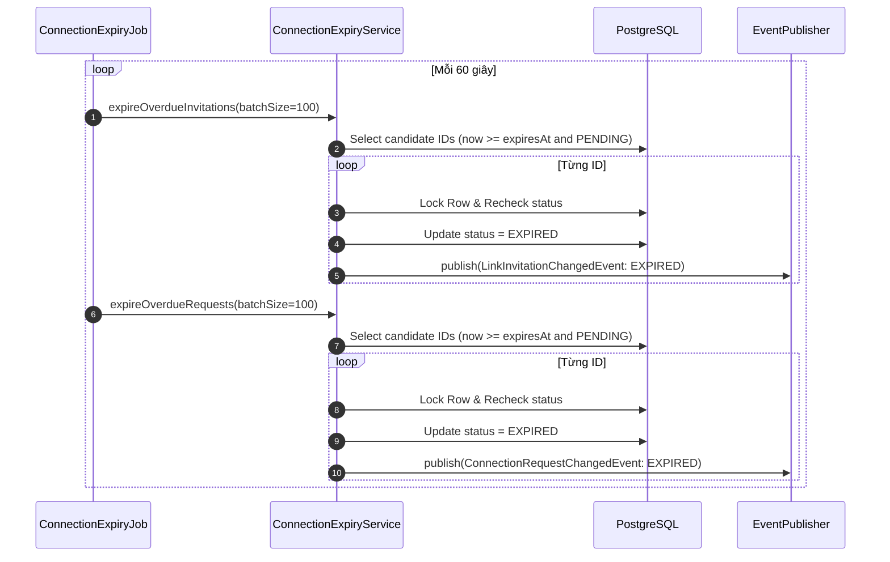

# Connection Module Flow & Runtime Architecture

Module `backend/modules/connection` triển khai toàn bộ luồng nghiệp vụ UC3.1–UC3.5, tuân thủ các quy tắc nghiệp vụ BR-26–BR-38 trong [SRS Edufit](../SRS%20Edufit.docx), [SADS](../software-architecture-design-specification.md) và [ADR-002](../ADR-002-multi-module-architecture.md).

---

## 1. Kiến trúc Tổng thể & Ranh giới Module

Module Connection vận hành như một dịch vụ độc lập trong Monolith, giao tiếp với bên ngoài thuần túy qua Public APIs và Spring Application Events (in-memory transactional events):



---

## 2. Luồng Nghiệp vụ Chi tiết

### 2.1. Luồng Lời mời & Chấp thuận Liên kết Phụ huynh - Học sinh (UC3.1 & UC3.2)

1. **Gửi lời mời (`POST /api/v1/connections/parent-student/invite`)**:
   - Nhận `targetEmail`. Cả `PARENT` và `STUDENT` đều có thể chủ động mời vai trò đối diện.
   - Kiểm tra quota người dùng: Tối đa 10 lần thử trong 1 giờ (`InvitationQuotaService` dưới row lock). Vượt quá trả về HTTP 429 `RATE_LIMIT_EXCEEDED`.
   - Tra cứu email qua `IamFacade`:
     - Nếu tài khoản không tồn tại, sai vai trò, tự mời chính mình, đã có link `CONFIRMED`, hoặc đang trong thời gian cooldown 7 ngày: Trả về **HTTP 200 generic** (`"Nếu tài khoản hợp lệ, lời mời sẽ được gửi"`), ngăn chặn hoàn toàn việc dò quét email (BR-28).
   - Lấy advisory pair lock `(LEAST(u1, u2), GREATEST(u1, u2))`:
     - Nếu đã có lời mời `PENDING` theo bất kỳ hướng nào: Trả về HTTP 200 generic.
     - Tạo lời mời mới với status `PENDING`, thời hạn `expiresAt = now + 14 ngày`.
     - Xuất bản sự kiện `LinkInvitationChangedEvent` (action: `INVITED`).



2. **Phản hồi lời mời (`POST /api/v1/connections/parent-student/respond`)**:
   - Chỉ người được mời (`invitedUserId`) có quyền phản hồi.
   - Khóa bản ghi lời mời bằng `PESSIMISTIC_WRITE` (sử dụng `FreshConnectionRowRepository`).
   - Kiểm tra trạng thái: Nếu đã hết hạn (`now >= expiresAt`), tự động chuyển sang `EXPIRED`, commit và trả về HTTP 409 `CONFLICT_DETECTED`.
   - Nếu `accept = false`:
     - Chuyển status sang `DECLINED`, thiết lập `reinviteAfter = now + 7 ngày` (BR-29 cooldown).
   - Nếu `accept = true`:
     - Kiểm tra nếu đã có link `CONFIRMED` tồn tại: Lời mời đóng thành `WITHDRAWN`, trả về HTTP 409.
     - Chuyển status lời mời sang `ACCEPTED`.
     - Tạo bản ghi `ParentStudentLink` mới với status `CONFIRMED` ngay trong cùng transaction.
     - Xuất bản sự kiện `LinkInvitationChangedEvent` và `ParentStudentLinkChangedEvent`.

---

### 2.2. Luồng Thu hồi Liên kết Phụ huynh - Học sinh (UC3.3)

1. **Thực thi thu hồi (`DELETE /api/v1/connections/parent-student/links/{id}`)**:
   - Người gọi hợp lệ: Chỉ `STUDENT` sở hữu liên kết hoặc `ADMIN`. `PARENT` hoàn toàn không có quyền tự thu hồi (HTTP 403 `FORBIDDEN_ACCESS`).
   - Nếu là `ADMIN`, bắt buộc phải cung cấp lý do thu hồi (`reason` không được để trống). Với `STUDENT`, `reason` là tùy chọn.
   - Khóa hàng liên kết `PESSIMISTIC_WRITE`. Kiểm tra status phải là `CONFIRMED`.
   - Chuyển status sang `REVOKED`, cập nhật `revokedAt = now`, `revokedBy = actorUserId`, `revokeReason = reason`.
   - **Ghi nhận Audit & Thông báo**:
     - Ghi nhận `AuditRecord` chứa snapshot đầy đủ cả hai tài khoản, thời điểm và lý do thu hồi vào bảng `audit_log` trong cùng transaction.
     - Xuất bản sự kiện `ParentStudentLinkChangedEvent` (`action = REVOKED`).
     - Listener `ConnectionTransitionListener` gửi thông báo cho các bên liên quan trước khi transaction commit (`BEFORE_COMMIT`).
   - **Hiệu lực tức thì**: Ngay sau khi transaction hoàn tất, toàn bộ quyền truy cập dữ liệu học sinh của phụ huynh bị cắt đứt hoàn toàn trên mọi endpoint. Dữ liệu lịch sử của học sinh được bảo tồn nguyên vẹn.

```mermaid
sequenceDiagram
    autonumber
    actor Actor as Student / Admin
    participant Ctrl as ConnectionController
    participant Svc as ParentStudentLinkService
    participant DB as PostgreSQL
    participant Audit as AuditSink
    participant Notif as NotificationListener

    Actor->>Ctrl: DELETE /parent-student/links/{id} {reason}
    Ctrl->>Svc: revokeLink(actor, id, reason)
    Svc->>DB: Lock ParentStudentLink (CONFIRMED)
    Svc->>DB: Update Link (REVOKED, revoked_at, reason)
    Svc->>Audit: record(REVOKE_LINK, parentId, studentId, reason)
    Svc->>Notif: onApplicationEvent(ParentStudentLinkChangedEvent: REVOKED)
    Note over Svc,DB: Transaction Commit: Link REVOKED, Audit & Notifications lưu đồng thời
    Svc-->>Ctrl: void
    Ctrl-->>Actor: HTTP 200 OK
```

---

### 2.3. Luồng Yêu cầu Gia sư & Chấp thuận Tạo lớp (UC3.4 & UC3.5)

1. **Gửi yêu cầu gia sư (`POST /api/v1/connections/requests`)**:
   - Người gửi: `STUDENT` sở hữu mục tiêu hoặc `PARENT` có liên kết `CONFIRMED` với học sinh tại thời điểm gửi.
   - Xác thực nghiệp vụ:
     - Mục tiêu học tập (`goalId`) phải ở trạng thái `ACTIVE` qua `ProfileFacade`.
     - Gia sư (`tutorId`) phải có tài khoản `ACTIVE`, hồ sơ `VERIFIED`, và có giảng dạy môn học + cấp lớp khớp chính xác với mục tiêu (`ProfileFacade.hasTeachingSubjectAndLevel`).
     - Không có lớp học `ACTIVE` giữa học sinh và gia sư này (BR-34).
     - Không có yêu cầu `PENDING` nào khác giữa cặp học sinh - gia sư này (Partial Unique Index `uq_connection_request_pending`).
     - Số lượng yêu cầu `PENDING` hiện tại của học sinh không vượt quá 5 yêu cầu (sau khi đã loại trừ các yêu cầu quá hạn).
     - Khung giờ mong muốn (`desiredSlots`) không rỗng, thỏa mãn định dạng quy định; lời nhắn (`message`) không quá 500 ký tự.
   - Lưu `ConnectionRequest` với status `PENDING`, `expiresAt = now + 7 ngày`.
   - Xuất bản `ConnectionRequestChangedEvent` (action: `CREATED`).

2. **Gia sư phản hồi yêu cầu (`POST /api/v1/connections/requests/{id}/respond`)**:
   - Người gọi: Phải là chính gia sư được yêu cầu (`tutorId == actor.tutorProfileId`).
   - Khóa yêu cầu `PESSIMISTIC_WRITE`. Nếu đã quá hạn 7 ngày, chuyển sang `EXPIRED`, trả về HTTP 409.
   - Nếu `accept = false`:
     - Chuyển status sang `REJECTED`, lưu `rejectReason` (tối đa 300 ký tự). Không tạo lớp.
   - Nếu `accept = true`:
     - Kiểm tra lại tính hợp lệ của mục tiêu học tập (vẫn `ACTIVE`, quyền sở hữu không đổi).
     - Chuyển status yêu cầu sang `ACCEPTED`.
     - Tạo đúng một lớp học `TutoringClass` mới với status `ACTIVE` ngay trong cùng transaction.
     - Xuất bản đồng thời `ConnectionRequestChangedEvent` (`ACCEPTED`) và `TutoringClassCreatedEvent`.
     - Thông báo kết quả cho học sinh; nếu phụ huynh gửi yêu cầu và vẫn còn liên kết `CONFIRMED` thì phụ huynh cũng nhận được thông báo.



---

### 2.4. Luồng Tự động Quét dọn Hết hạn (FR-13)

- **Cơ chế hai tầng (Two-Tier Expiry)**:
  1. **On-Access Expiry**: Khi người dùng hoặc hệ thống truy cập một lời mời hoặc yêu cầu đã quá hạn, logic `ConnectionExpiryService` tự động chuyển trạng thái sang `EXPIRED` ngay lập tức, giải phóng slot và thông báo cho các bên.
  2. **Background Scheduled Expiry (`ConnectionExpiryJob`)**: Chạy định kỳ mỗi 60 giây để xử lý các bản ghi quá hạn mà không có người dùng truy cập.
- **Quy trình quét nền**:
  - Quét theo từng batch có giới hạn (100 items/batch).
  - Khóa từng bản ghi theo thứ tự định sẵn để tránh deadlock giữa các luồng/instance.
  - Chuyển trạng thái sang `EXPIRED` trong một transaction độc lập ngắn.
  - Bắn sự kiện chuyển trạng thái để gửi thông báo giải phóng cho các bên liên quan.



---

## 3. Quản lý Đồng thời và Toàn vẹn Dữ liệu (Concurrency & Integrity)

| Kịch bản đua (Race Condition) | Giải pháp kỹ thuật bảo vệ | Kết quả đảm bảo |
|---|---|---|
| **Mời hai chiều đồng thời giữa cùng cặp** | PostgreSQL Advisory Lock trên `(LEAST, GREATEST)` + Partial Unique Index `uq_link_invitation_pending` | Đúng 1 lời mời `PENDING` được tạo |
| **Gửi lời mời đồng thời vượt quota 10** | Row Lock `PESSIMISTIC_WRITE` trên bảng `connection_invite_quota` | Quota không bao giờ vượt quá 10/giờ |
| **Đồng thời chấp nhận lời mời (Double Accept)** | Row Lock trên `link_invitation` + Partial Unique Index `uq_parent_student_confirmed` | Đúng 1 liên kết `CONFIRMED` được tạo, thread thứ hai nhận 409 |
| **Chấp nhận vs Từ chối lời mời đồng thời** | Row Lock trên `link_invitation` với reload fresh row | Trạng thái cuối cùng là đơn nhất (`ACCEPTED` hoặc `DECLINED`) |
| **Gửi yêu cầu thứ 5 và thứ 6 đồng thời** | Advisory Lock trên `studentId` + Lock đếm yêu cầu `PENDING` | Đúng 1 yêu cầu được tạo, tổng số pending giữ đúng 5 |
| **Gia sư chấp nhận yêu cầu 2 lần đồng thời** | Row Lock trên `connection_request` + Partial Unique Index `uq_class_student_tutor_active` | Đúng 1 lớp học `ACTIVE` được tạo, yêu cầu `ACCEPTED` |
| **Chấp nhận vs Hủy yêu cầu đồng thời** | Row Lock trên `connection_request` với recheck trước khi đổi trạng thái | Phân định dứt điểm: Hoặc `ACCEPTED` (có lớp) hoặc `CANCELLED` (không có lớp) |
| **Học sinh thu hồi liên kết khi phụ huynh đang gửi yêu cầu** | Transaction kiểm tra `hasConfirmedParentLink` ngay trước khi insert request | Yêu cầu phụ huynh bị từ chối ngay lập tức (HTTP 403), không deadlock |
