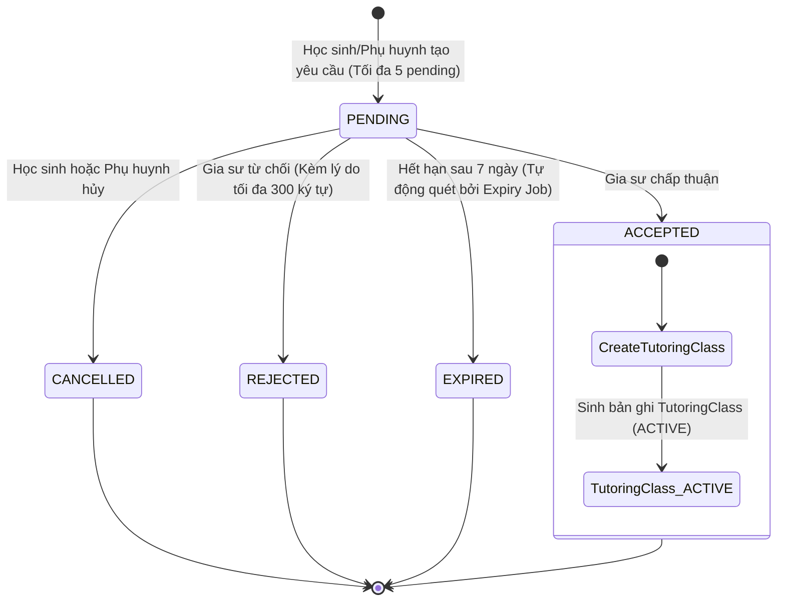
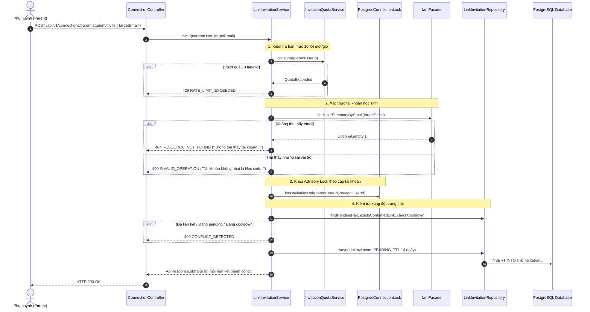

# KẾ HOẠCH HIỆN THỰC HÓA & GIẢI TRÌNH KIẾN TRÚC PHÂN HỆ CONNECTION (KẾT NỐI PHỤ HUYNH - HỌC SINH & GIA SƯ)
**Tài liệu Kỹ thuật Chuẩn Quốc tế Dành cho Thành viên Dự án & Đánh giá Mã Nguồn (Code Review)**

> **Phiên bản:** 1.0  
> **Phân hệ phụ trách:** `modules/connection` (EduFit Backend & Frontend Integration)  
> **Áp dụng cho:** Nhánh `feat/connection` tích hợp vào nền tảng EduFit  
> **Tài liệu đối chiếu:**  
> - [ADR-001: Tech Stack](file:///c:/University/Semester%205/SWP391/Edufit/EduFit/docs/ADR-001-tech-stack.md) & [ADR-002: Multi-Module Architecture](file:///c:/University/Semester%205/SWP391/Edufit/EduFit/docs/ADR-002-multi-module-architecture.md)  
> - [Backend Module Structure Guide (Loại 1 - Pragmatic Layered kết hợp Policy)](file:///c:/University/Semester%205/SWP391/Edufit/EduFit/docs/backend-module-structure-guide.md)  
> - [Software Architecture Design Specification (Mục 7 - Connection API)](file:///c:/University/Semester%205/SWP391/Edufit/EduFit/docs/software-architecture-design-specification.md)  
> - [SRS Edufit (UC3.1, UC3.2, UC3.3, UC3.4, UC3.5; BR-26 đến BR-38)](file:///c:/University/Semester%205/SWP391/Edufit/EduFit/docs/SRS%20Edufit.docx)  
> - [Master Test Plan & In-Development Testing Specification (Mục 7.2)](file:///c:/University/Semester%205/SWP391/Edufit/EduFit/docs/in-development-testing-specification.md)  

---

## 1. Mục Tiêu & Bối Cảnh (Goal Description)

Phân hệ **Connection (Quản lý Kết nối & Ủy quyền Học tập)** là "Trục Xương sống Quản trị Mối quan hệ" (Relationship & Consent Engine) của nền tảng EduFit. Phân hệ đóng vai trò cầu nối pháp lý, sự đồng thuận gia đình và thiết lập hợp đồng học tập thực tế giữa 3 chủ thể: **Phụ huynh (Parent)**, **Học sinh (Student)** và **Gia sư (Tutor)**.

Phân hệ đảm nhiệm 3 mục tiêu chiến lược cốt lõi:

1. **Xác lập Quan hệ Ủy quyền & Đồng thuận Gia đình (Parent-Student Consent - UC3.1, UC3.2, UC3.3):**
   - Thiết lập liên kết chính thức giữa Phụ huynh và Học sinh (`ParentStudentLink`). Khi và chỉ khi liên kết ở trạng thái `CONFIRMED`, Phụ huynh mới được cấp quyền hợp pháp để theo dõi tiến độ, xem mục tiêu học tập và thay mặt con gửi yêu cầu tìm gia sư.
   - Quản lý vòng đời lời mời gia đình (`LinkInvitation`) với cơ chế kiểm soát chống thư rác (Anti-Spam Quota: tối đa 10 lời mời/giờ) và thời gian sống có hạn (TTL 14 ngày).
   - Học sinh và Phụ huynh có thể thu hồi liên kết (`REVOKED`) thuộc chính mình. Quản trị viên (Admin) có thể thu hồi khi nhập lý do; mọi thao tác đều được ghi audit để đối soát.

2. **Khởi tạo & Điều phối Yêu cầu Học tập đến Gia sư (Tutor Connection Request - UC3.4, UC3.5):**
   - Học sinh hoặc Phụ huynh (đã có liên kết `CONFIRMED`) gửi yêu cầu kết nối học tập (`ConnectionRequest`) dựa trên Mục tiêu học tập đang hoạt động (`ACTIVE Goal`) và hồ sơ Gia sư đã được kiểm duyệt (`VERIFIED Tutor`).
   - Ràng buộc giới hạn tải: Mỗi học sinh chỉ được duy trì tối đa **5 yêu cầu PENDING** cùng lúc để tránh tình trạng "rải hồ sơ" tràn lan gây nhiễu cho đội ngũ gia sư.
   - Khi Gia sư chấp nhận (`accept = true`), hệ thống kích hoạt giao dịch nguyên tử (Atomic Transaction): Chuyển yêu cầu sang `ACCEPTED`, đồng thời tự động sản sinh một thực thể Lớp học dạy kèm (`TutoringClass` ở trạng thái `ACTIVE`) làm đầu vào trực tiếp cho phân hệ Lập lịch (`Scheduling`) và Tiến độ (`Progress`).

3. **Bảo đảm Hiệu năng & Ranh giới Bảo mật Nghiêm ngặt (Performance & Privacy Guardrails):**
   - Triệt tiêu hoàn toàn vấn nạn N+1 Query thông qua các cơ chế nạp dữ liệu hàng loạt (Batch Hydration) từ `ProfileFacade` và `IamFacade`.
   - Bảo vệ tuyệt đối thông tin nhạy cảm của người học (BR-37 Privacy Whitelist): Hộp thư của gia sư hoàn toàn không để lộ email, số điện thoại, mật khẩu băm, hay các mục tiêu học tập khác ngoài phạm vi yêu cầu.
   - Tương thích 100% với giao diện Frontend hiện có thông qua chế độ kiểm tra khung giờ 2 mức (`legacy-compatible` mặc định và `strict-v1`).

---

## 2. Giải Thích Chi Tiết: Từ Định Nghĩa Đến Cơ Chế Hoạt Động

### 2.1. Vòng Đời Lời Mời Gia Đình & Cơ Chế Phòng Vệ Tranh Chấp 2 Chiều (UC3.1, UC3.2)

#### Khái niệm & Rủi ro thực tế:
Phụ huynh và Học sinh có thể cùng lúc mở ứng dụng và gửi lời mời kết nối cho nhau, hoặc bấm liên tục nút mời gây ra tình trạng tạo nhiều bản ghi mồ côi (Race Condition). Nếu không có cơ chế khóa, hệ thống có thể tạo ra 2 lời mời `PENDING` đối chiều nhau hoặc nhiều liên kết `CONFIRMED` trùng lặp cho cùng một cặp tài khoản.

#### Cơ chế phòng vệ 2 tầng (Two-Tier Defense):
```
[Client Request: POST /api/v1/connections/parent-student/invite]
                               │
                               ▼
┌─────────────────────────────────────────────────────────────────────────────┐
│ 1. TẦNG KHÓA ỨNG DỤNG (PostgreSQL Advisory Lock)                            │
│    Advisory Lock theo cặp (Math.min(a, b), Math.max(a, b))                  │
│    ➔ Tuần tự hóa tuyệt đối mọi yêu cầu gửi/nhận giữa 2 tài khoản            │
│    ➔ Chặn đứng Race Condition gửi lời mời đối chiều song song               │
└──────────────────────────────┬──────────────────────────────────────────────┘
                               │
                               ▼
┌─────────────────────────────────────────────────────────────────────────────┐
│ 2. TẦNG CƠ SỞ DỮ LIỆU (PostgreSQL Partial Unique Indexes)                   │
│    - uq_link_invitation_pending: Chỉ 1 lời mời PENDING giữa cặp user        │
│    - uq_parent_student_confirmed: Chỉ 1 liên kết CONFIRMED duy nhất         │
│    ➔ Đảm bảo toàn vẹn dữ liệu ở cấp độ ổ đĩa                                │
└─────────────────────────────────────────────────────────────────────────────┘
```

#### Quy tắc chuyển đổi trạng thái Lời mời (State Transitions):
* **PENDING $\rightarrow$ ACCEPTED:** Người nhận chấp thuận $\rightarrow$ Lời mời chuyển `ACCEPTED`, đồng thời sinh ra bản ghi `ParentStudentLink` (`CONFIRMED`).
* **PENDING $\rightarrow$ DECLINED:** Người nhận từ chối $\rightarrow$ Kích hoạt thời gian chờ (Cooldown) **7 ngày**. Trong 7 ngày này, người gửi không thể gửi lại lời mời cho người nhận đó.
* **PENDING $\rightarrow$ WITHDRAWN:** Người gửi chủ động rút lại lời mời, HOẶC hệ thống tự động đóng lời mời khi phát hiện hai người đã có một liên kết `CONFIRMED` khác (System Closure).
* **PENDING $\rightarrow$ EXPIRED:** Hết hạn sau **14 ngày** nếu không có phản hồi $\rightarrow$ Job tự động dọn dẹp chuyển sang `EXPIRED`.

---

### 2.2. Tối Ưu Hóa UX: Bỏ "Anti-Enumeration Phòng Thủ Quá Đà", Ném Lỗi Tường Minh

#### Bất cập của cơ chế cũ:
Trước đây, để ngăn chặn kẻ xấu dò quét xem một email có tồn tại trên hệ thống hay không (Anti-Enumeration), API gửi lời mời luôn trả về thông điệp thành công giả: `"Nếu tài khoản hợp lệ, lời mời sẽ được gửi"` (HTTP 200), kể cả khi email không tồn tại, sai vai trò hoặc đang bị khóa.
Điều này dẫn đến **Trải nghiệm người dùng tồi tệ (Silent Failure)**: Phụ huynh gõ nhầm 1 ký tự trong email của con nhưng vẫn thấy báo thành công, sau đó ngồi chờ con chấp thuận trong vô vọng.

#### Quyết định điều chỉnh chuẩn Sản phẩm:
Vì API này **bắt buộc đăng nhập (Authenticated)** và **đã có Rate Limit 10 lần/giờ** (kẻ xấu không thể dò quét số lượng lớn), hệ thống chuyển sang trả về mã lỗi HTTP tường minh:
1. **Không tìm thấy email:** Trả về HTTP 404 `RESOURCE_NOT_FOUND` $\rightarrow$ *"Không tìm thấy tài khoản với email này. Vui lòng kiểm tra lại."*
2. **Email thuộc tài khoản sai vai trò:** Trả về HTTP 400 `INVALID_OPERATION` $\rightarrow$ *"Tài khoản đối phương không phải vai trò Học sinh/Phụ huynh."*
3. **Tự mời chính mình:** Trả về HTTP 400 `INVALID_OPERATION` $\rightarrow$ *"Không thể gửi lời mời liên kết cho chính mình."*
4. **Đã có liên kết từ trước:** Trả về HTTP 409 `CONFLICT_DETECTED` $\rightarrow$ *"Hai tài khoản đã được liên kết với nhau từ trước."*
5. **Đang có lời mời chờ duyệt:** Trả về HTTP 409 `CONFLICT_DETECTED` $\rightarrow$ *"Đã có lời mời đang chờ phản hồi giữa hai tài khoản."*
6. **Đang trong thời gian Cooldown:** Trả về HTTP 409 `CONFLICT_DETECTED` $\rightarrow$ *"Lời mời vừa bị từ chối gần đây. Vui lòng thử lại sau thời gian chờ."*

---

### 2.3. Vòng Đời Yêu Cầu Học Tập & Tính Nguyên Tử Khi Tạo Lớp Học (UC3.4, UC3.5)



#### Tính nguyên tử tuyệt đối (All-or-Nothing Transaction):
Khi Gia sư bấm chấp nhận (`POST /api/v1/connections/requests/{id}/respond` với `accept = true`):
1. Khóa bi quan bản ghi (`PESSIMISTIC_WRITE`) để chặn việc chấp nhận 2 lần đồng thời.
2. Kiểm tra lại tính hợp lệ: Mục tiêu học tập (`Goal`) vẫn đang `ACTIVE`, Gia sư vẫn `VERIFIED`.
3. Cập nhật trạng thái `ConnectionRequest` sang `ACCEPTED`.
4. Tạo mới thực thể `TutoringClass` với trạng thái `ACTIVE`.
5. Phát sự kiện miền `TutoringClassCreatedEvent` và `ConnectionRequestChangedEvent`.
6. Toàn bộ các bước trên được bọc trong **1 Transaction `@Transactional` duy nhất**. Nếu có bất kỳ lỗi nào xảy ra (ví dụ: vi phạm ràng buộc unique class trên PostgreSQL), toàn bộ thay đổi sẽ được rollback 100%, không bao giờ có chuyện Request đổi thành `ACCEPTED` nhưng Lớp học lại không được tạo.

---

### 2.4. Triệt Tiêu N+1 Query & Bảo Vệ Quyền Riêng Tư (BR-37 Privacy Whitelist)

#### Thách thức:
Khi Gia sư xem danh sách yêu cầu (`GET /api/v1/connections/requests`), mỗi yêu cầu cần hiển thị tên mục tiêu học tập, môn học, lớp, hạn chót và vai trò người gửi. Nếu truy vấn tuần tự từng dòng, hệ thống sẽ thực thi $1 + 3N$ câu truy vấn vào CSDL.

#### Kiến trúc Batch Hydration trong ranh giới Transaction:
1. Truy vấn danh sách $N$ yêu cầu kết nối từ bảng `connection_request`.
2. Trích xuất danh sách $N$ `goalId` và $N$ `senderUserId`.
3. Gọi duy nhất 1 câu truy vấn batch sang `ProfileFacade.findGoalsForConnection(goalIds)`.
4. Gọi duy nhất 1 câu truy vấn batch sang `IamFacade.findUserSummariesByIds(senderIds)`.
5. Ghép nối dữ liệu trong bộ nhớ RAM và trả về `TutorInboxResponse`.
* **Kết quả:** Số lượng câu truy vấn là hằng số $O(1)$ (luôn là 3 queries), bất kể danh sách có 1, 20 hay 100 yêu cầu.
* **Bảo vệ dữ liệu (BR-37):** DTO `TutorInboxResponse` chỉ chứa các trường thông tin học tập cần thiết; hoàn toàn loại bỏ email, số điện thoại, mật khẩu băm, hay các thông tin cá nhân ngoài luồng của học sinh.

---

## 3. Bản Đồ Tích Hợp Đa Phân Hệ (System Architecture & Workflows)

### 3.1. Sơ Đồ Trình Tự: Mời Liên Kết Phụ Huynh & Học Sinh (Invite Sequence)



---

### 3.2. Ma Trận Phân Định Trách Nhiệm Giữa Các Module (Module Boundary RACI Matrix)

| Hành động Nghiệp vụ | `connection` | `iam` | `profile` | `scheduling` | `notification` | `audit` |
| :--- | :---: | :---: | :---: | :---: | :---: | :---: |
| **Quản lý lời mời & liên kết Phụ huynh - Học sinh** | **A / R** | C | C | I | I | I |
| **Xác thực vai trò & trạng thái tài khoản người dùng** | C | **A / R** | I | I | I | I |
| **Xác thực Mục tiêu học tập & Hồ sơ Gia sư** | C | I | **A / R** | I | I | I |
| **Tạo và chuyển đổi trạng thái Yêu cầu kết nối** | **A / R** | I | C | I | I | I |
| **Tạo lớp học dạy kèm (`TutoringClass`)** | **A / R** | I | I | C (Sprint 3) | I | I |
| **Cung cấp `ConnectionFacade.findActiveClass`** | **A / R** | I | I | C (Sprint 3) | I | I |
| **Ghi nhận lịch sử thu hồi liên kết của Admin** | R | I | I | I | I | **A / R** |
| **Gửi thông báo chuông khi có sự kiện thay đổi** | C | I | I | I | **A / R** | I |

*(Ghi chú: A = Accountable/Chịu trách nhiệm chính; R = Responsible/Thực thi; C = Consulted/Tham vấn; I = Informed/Nhận thông báo)*

---

## 4. Giải Phẫu Từng File & Lý Do Tồn Tại (File Anatomy & Architectural Rationale)

```
backend/modules/connection/
├── pom.xml                                              # Quản lý dependencies (Chỉ phụ thuộc shared, iam, profile)
└── src/
    ├── main/java/vn/edufit/connection/
    │   ├── api/                                         # Public API công khai dành cho các module khác (ADR-002)
    │   │   ├── ConnectionFacade.java                    # Interface công khai: hasConfirmedParentLink, findActiveClass
    │   │   └── event/                                   # Domain Events công khai (Record bất biến)
    │   │       ├── ConnectionRequestChangedEvent.java   # Bắn khi request đổi trạng thái (Pending, Accepted, Cancelled...)
    │   │       ├── LinkInvitationChangedEvent.java      # Bắn khi lời mời đổi trạng thái (Created, Accepted, Expired...)
    │   │       ├── ParentStudentLinkChangedEvent.java   # Bắn khi liên kết bị thu hồi (Revoked)
    │   │       └── TutoringClassCreatedEvent.java       # Bắn khi lớp học mới được tạo thành công
    │   ├── application/
    │   │   ├── policy/                                  # Chứa các quy tắc nghiệp vụ thuần túy (Pure Java POJO)
    │   │   │   ├── ConnectionTransitions.java           # Thời hạn TTL, Cooldown, Quota window, máy trạng thái
    │   │   │   └── ConnectionRequestInput.java          # Bộ phân tích và kiểm tra cú pháp khung giờ (Slots validation)
    │   │   ├── port/                                    # Cổng giao tiếp hạ tầng trừu tượng
    │   │   │   └── ConnectionLock.java                  # Interface định nghĩa khóa đồng thời (Advisory Lock)
    │   │   ├── dto/                                     # Data Transfer Objects nội bộ tầng Application
    │   │   │   ├── ClassResult.java                     # Kết quả tạo lớp học
    │   │   │   ├── ConnectionRequestResult.java         # Kết quả truy vấn yêu cầu của người học
    │   │   │   ├── InvitationResult.java                # Kết quả lời mời liên kết
    │   │   │   ├── PageResponse.java                    # DTO phân trang chuẩn hóa
    │   │   │   ├── ParentStudentLinkResult.java         # Kết quả liên kết gia đình
    │   │   │   ├── TransitionResult.java                # Sealed interface đóng gói kết quả chuyển đổi (Success / Conflict)
    │   │   │   └── TutorInboxResult.java                # Kết quả hộp thư đến của gia sư (BR-37 compliant)
    │   │   └── service/                                 # Nhạc trưởng điều phối Use Cases & Ranh giới Transaction
    │   │       ├── ConnectionFacadeImpl.java            # Triển khai ConnectionFacade phục vụ các module ngoài
    │   │       ├── ConnectionRequestService.java        # Quản lý vòng đời yêu cầu kết nối & tạo lớp học nguyên tử
    │   │       ├── LinkInvitationService.java           # Quản lý gửi, nhận, từ chối, rút lại lời mời phụ huynh
    │   │       ├── ParentStudentLinkService.java        # Quản lý thu hồi liên kết và ghi audit log
    │   │       ├── ConnectionQueryService.java          # Truy vấn danh sách, phân trang, batch hydrate metadata
    │   │       ├── ConnectionExpiryService.java         # Xử lý hết hạn lời mời và yêu cầu định kỳ
    │   │       └── InvitationQuotaService.java          # Quản lý hạn mức 10 lời mời/giờ cho mỗi tài khoản
    │   ├── infra/
    │   │   ├── locking/
    │   │   │   └── PostgresConnectionLock.java          # Hiện thực hóa ConnectionLock bằng PostgreSQL Advisory Lock
    │   │   ├── persistence/
    │   │   │   ├── entity/                              # JPA Entities đại diện cho các bảng CSDL
    │   │   │   │   ├── ConnectionInviteQuota.java       # Bảng connection_invite_quota (bộ đếm hạn mức theo giờ)
    │   │   │   │   ├── ConnectionRequest.java           # Bảng connection_request (yêu cầu kết nối gia sư)
    │   │   │   │   ├── LinkInvitation.java              # Bảng link_invitation (lời mời liên kết gia đình)
    │   │   │   │   ├── ParentStudentLink.java           # Bảng parent_student_link (liên kết chính thức)
    │   │   │   │   └── TutoringClass.java               # Bảng tutoring_class (hợp đồng lớp học đang hoạt động)
    │   │   │   └── repository/                          # Spring Data JPA Repositories
    │   │   │       ├── ConnectionInviteQuotaRepository.java
    │   │   │       ├── ConnectionRequestRepository.java
    │   │   │       ├── LinkInvitationRepository.java
    │   │   │       ├── ParentStudentLinkRepository.java
    │   │   │       ├── TutoringClassRepository.java
    │   │   │       ├── FreshConnectionRowRepository.java    # Interface khóa bi quan và tải lại bản ghi tươi mới
    │   │   │       └── FreshConnectionRowRepositoryImpl.java# Xóa bộ nhớ đệm EntityManager để tránh xung đột cache
    │   │   └── scheduling/
    │   │       └── ConnectionExpiryJob.java             # Background Cron Job tự động quét và đánh dấu hết hạn
    │   └── web/                                         # Tầng tiếp nhận HTTP REST API
    │       ├── ConnectionController.java                # REST Controller cung cấp toàn bộ endpoints /api/v1/connections
    │       ├── ConnectionWriteExceptionHandler.java     # Bắt lỗi vi phạm ràng buộc ghi và chuyển thành HTTP 409
    │       ├── request/                                 # Request DTOs nhận từ Client kèm Bean Validation
    │       │   ├── CreateRequestBody.java               # Payload tạo yêu cầu (goalId, tutorId, desiredSlots, message)
    │       │   ├── InviteBody.java                      # Payload mời liên kết (targetEmail)
    │       │   ├── RequestRespondBody.java              # Payload gia sư phản hồi (accept: Boolean, reason)
    │       │   ├── RespondBody.java                     # Payload phản hồi lời mời (invitationId, accept: Boolean)
    │       │   └── RevokeBody.java                      # Payload thu hồi liên kết (reason)
    │       └── response/                                # Response DTOs trả về cho Client bọc trong ApiResponse<T>
    │           ├── ClassResponse.java
    │           ├── InvitationResponse.java
    │           ├── LinkResponse.java
    │           ├── RequestResponse.java
    │           └── TutorInboxResponse.java
    └── test/resources/testdata/                         # Dữ liệu phục vụ kiểm thử tham số hóa (Data-Driven Testing)
        ├── connection-request-matrix.csv                # Ma trận phân quyền và trạng thái yêu cầu
        └── link-invitation-rules.csv                    # Ma trận phân quyền và trạng thái lời mời gia đình
```

---

## 5. User Review Required (Những Điểm Cần Nhóm Thống Nhất Trước Khi Review Code)

> [!IMPORTANT]
> **Điểm 1: Thống nhất loại bỏ Anti-Enumeration trong API mời liên kết gia đình**
> - Nhóm thống nhất chuyển từ việc "luôn trả về 200 generic message" sang ném lỗi chi tiết: 404 (Không tìm thấy email), 400 (Sai vai trò hoặc tự mời chính mình), 409 (Đã liên kết / Đang chờ duyệt / Đang cooldown).
> - Tính bảo mật vẫn được bảo đảm 100% nhờ cổng kiểm soát hạn mức **Rate Limiting 10 lần/giờ**.

> [!IMPORTANT]
> **Điểm 2: Thống nhất cơ chế kiểm tra khung giờ 2 chế độ (Slot Validation Rollout)**
> - Mặc định giữ `edufit.connection.slots.validation-mode: legacy-compatible` để tương thích hoàn toàn với chuỗi tiếng Việt do Frontend gửi lên (`Thứ 2 · 18:00–19:00`).
> - Khi Frontend hoàn tất chuẩn hóa sang định dạng quốc tế (`strict-v1`, ví dụ: `MONDAY 18:00-19:00`), nhóm chỉ cần đổi cấu hình trong `application.yml` mà không phải viết lại code backend.

> [!IMPORTANT]
> **Điểm 3: Quyền thu hồi liên kết Phụ huynh - Học sinh (UC3.3)**
> - Học sinh và Phụ huynh đều có thể thu hồi liên kết của chính mình; Admin có thể thu hồi khi nhập lý do. Yêu cầu thu hồi liên kết của người khác nhận HTTP 403 `FORBIDDEN`. Quyết định này cho phép phụ huynh quản lý trực tiếp danh sách con đã liên kết, đồng thời giới hạn thao tác theo quyền sở hữu.

---

## 6. Lộ Trình Tích Hợp Với Các Phân Hệ Khác (Cross-Module Roadmap)

> [!NOTE]
> **1. Bàn giao tích hợp phân hệ Lập lịch (`Scheduling`):**
> - Phân hệ `scheduling` hiện đang dùng `MockConnectionValidationAdapter` để phát triển độc lập (ADR-002 Decoupled Development).
> - Phía Connection đã sẵn sàng cung cấp `ConnectionFacade.findActiveClass(studentId, tutorId)`. Khi nhóm phụ trách Scheduling hoàn thiện, chỉ cần thay thế Mock Adapter bằng Adapter thật gọi vào Facade này.

> [!NOTE]
> **2. Đồng bộ thông báo với phân hệ Thông báo (`Notification`):**
> - `ConnectionTransitionListener` trong module `notification` đã được cài đặt sẵn sàng với pha `@TransactionalEventListener(phase = TransactionPhase.BEFORE_COMMIT)`.
> - Bất kỳ khi nào một lời mời, liên kết hoặc yêu cầu đổi trạng thái, thông báo chuông sẽ được ghi nhận ngay trước khi giao dịch CSDL commit.

---

## 7. Kế Hoạch Kiểm Thử Toàn Diện & Ma Trận Xử Lý Đồng Thời (Concurrency Matrix)

Phân hệ Connection sở hữu bộ kiểm thử đồ sộ nhất dự án với **45 kịch bản giao dịch thực tế trên PostgreSQL 17 thật qua Testcontainers**:

1. **Double Invite đối chiều:** Phụ huynh và học sinh đồng thời mời nhau $\rightarrow$ Advisory Lock + Partial Unique Index đảm bảo chỉ đúng 1 lời mời `PENDING` được tạo.
2. **Hạn mức 10/11 đồng thời:** 2 luồng đồng thời gọi mời ở lượt thứ 10/11 $\rightarrow$ Khóa dòng đảm bảo luồng 10 thành công, luồng 11 bị chặn với HTTP 429.
3. **Double Accept lời mời:** 2 luồng đồng thời chấp nhận lời mời $\rightarrow$ Đúng 1 liên kết `CONFIRMED` được tạo, luồng sau nhận Conflict.
4. **Accept vs Decline lời mời:** 1 luồng chấp nhận, 1 luồng từ chối song song $\rightarrow$ Kết thúc dứt khoát ở `ACCEPTED` hoặc `DECLINED`, không có trạng thái lấp lửng.
5. **Yêu cầu thứ 5 và thứ 6 đồng thời:** Học sinh có 4 yêu cầu, gửi đồng thời 2 yêu cầu đến 2 gia sư khác nhau $\rightarrow$ Đúng 1 yêu cầu được tạo (thứ 5), yêu cầu thứ 6 bị chặn, tổng pending giữ đúng 5.
6. **Double Accept yêu cầu gia sư:** Gia sư đồng thời chấp nhận 2 lần $\rightarrow$ Row lock + Class Unique Constraint đảm bảo chỉ đúng 1 lớp `ACTIVE` được tạo.
7. **Accept vs Cancel yêu cầu:** Gia sư chấp nhận trong khi học sinh hủy yêu cầu $\rightarrow$ Kết thúc dứt khoát: hoặc `ACCEPTED` (có 1 lớp) hoặc `CANCELLED` (không có lớp).
8. **Revoke vs Create Request:** Học sinh thu hồi liên kết khi phụ huynh đang tạo yêu cầu $\rightarrow$ Không deadlock, liên kết kết thúc ở `REVOKED`, yêu cầu của phụ huynh bị từ chối với HTTP 403.

---

## 8. Bộ Câu Hỏi Bảo Vệ Đồ Án Chuyên Sâu (Defense Q&A)

Dưới đây là 4 câu hỏi vấn đáp chuyên sâu mà hội đồng giảng viên phản biện thường đặt ra cho phân hệ Kết nối & Ủy quyền (Connection & Engagement System):

> **Q1: "Tại sao nhóm lại sử dụng PostgreSQL Advisory Lock kết hợp với Row-level Lock thay vì chỉ dựa vào `@Transactional` thông thường của Spring?"**  
> **Trả lời chuẩn kiến trúc:**  
> `@Transactional` của Spring chỉ định nghĩa ranh giới giao dịch (Transaction Boundary) chứ không tự động ngăn chặn hiện tượng chạy đua (Race Condition) ở mức độ ứng dụng. Trong bài toán lời mời đối chiều (Phụ huynh mời Học sinh và Học sinh cùng lúc mời Phụ huynh), hai giao dịch chạy song song ở mức cô lập `READ COMMITTED` đều sẽ thấy chưa có bản ghi nào và cùng thực hiện lệnh `INSERT`. Nếu chỉ dựa vào bắt lỗi Unique Constraint của Database, hệ thống sẽ phát sinh lỗi hệ thống không kiểm soát và lãng phí tài nguyên kết nối. Bằng cách sử dụng **PostgreSQL Advisory Lock** với định danh chuẩn hóa `lockInvitationPair(min(a,b), max(a,b))`, hệ thống tuần tự hóa ngay từ đầu mọi thao tác giữa hai tài khoản, bảo đảm tính xác thực và triệt tiêu nguy cơ Deadlock ở tầng CSDL.

> **Q2: "Phụ huynh được thu hồi liên kết trong trường hợp nào?"**
> **Trả lời chuẩn kiến trúc:**  
> Phụ huynh chỉ được thu hồi liên kết khi `parentUserId` của bản ghi trùng tài khoản đang đăng nhập; học sinh chỉ được thu hồi liên kết gắn với hồ sơ của mình. Admin được thu hồi sau khi nhập lý do. Mọi lần thu hồi đều ghi `audit_log` và phát sự kiện thông báo cho hai bên để phục vụ đối soát.

> **Q3: "Làm thế nào để hệ thống giải quyết triệt để vấn nạn N+1 Query khi Gia sư mở hộp thư đến chứa hàng trăm yêu cầu kết nối?"**  
> **Trả lời chuẩn kiến trúc:**  
> Hệ thống áp dụng mô hình **Batch Hydration trong ranh giới Transaction nội bộ**: Thay vì gọi vòng lặp $N$ lần sang các Facade bên ngoài (gây ra $1 + 3N$ câu truy vấn), tầng Service gom toàn bộ $N$ `goalId` và $N$ `senderUserId` lại, sau đó thực hiện đúng 2 lời gọi batch duy nhất: `profileFacade.findGoalsForConnection(goalIds)` và `iamFacade.findUserSummariesByIds(senderIds)`. Hai phương thức này sử dụng mệnh đề `WHERE id IN (...)` ở tầng JPA, giúp số lượng câu truy vấn luôn cố định ở con số $O(1)$ (chính xác là 3 câu truy vấn SQL). Đồng thời, hệ thống tắt hoàn toàn Open Session In View (`spring.jpa.open-in-view = false`) để đảm bảo không có bất kỳ câu truy vấn lười (Lazy Query) nào bị rò rỉ ra ngoài tầng Controller.

> **Q4: "Khi Gia sư chấp nhận yêu cầu kết nối, làm thế nào hệ thống đảm bảo việc chuyển trạng thái yêu cầu sang ACCEPTED và việc tạo thực thể Lớp học TutoringClass luôn đồng nhất 100%?"**  
> **Trả lời chuẩn kiến trúc:**  
> Hệ thống áp dụng **mô hình Giao dịch Nguyên tử (All-or-Nothing Atomic Transaction)**: Toàn bộ quy trình xác thực mục tiêu, khóa dòng bi quan `PESSIMISTIC_WRITE`, đổi trạng thái yêu cầu sang `ACCEPTED`, và lưu thực thể `TutoringClass` đều nằm trong cùng một phương thức có chú thích `@Transactional`. Nếu có bất kỳ sự cố nào xảy ra (ví dụ: vi phạm ràng buộc duy nhất `uq_class_student_tutor_active` do gia sư bấm đúp chuột), Spring và Hibernate sẽ tự động kích hoạt rollback toàn bộ giao dịch về điểm ban đầu. Không bao giờ tồn tại trạng thái không nhất quán như yêu cầu đã `ACCEPTED` nhưng lớp học chưa được tạo, hoặc lớp học được tạo nhưng yêu cầu vẫn `PENDING`.
