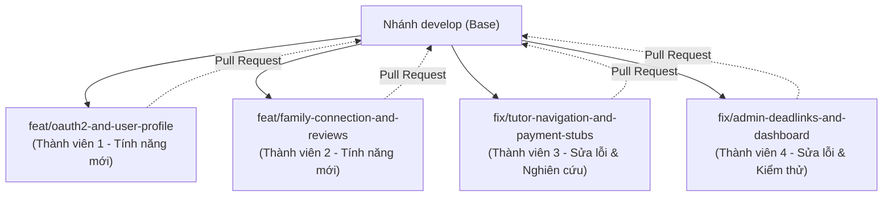

# KẾ HOẠCH PHÂN CÔNG CÔNG VIỆC DỰ ÁN EDUFIT (4 THÀNH VIÊN ĐỘC LẬP)

> **Mô hình làm việc:** Phân nhánh Git độc lập theo lát cắt dọc nghiệp vụ (Vertical Slice).  
> **Nguyên tắc mô tả:** Nêu rõ **Hiện trạng thực tế** (đang thiếu/lỗi gì) và **Yêu cầu cần đạt** (kết quả bàn giao). Các thành viên chủ động phương án triển khai kỹ thuật cụ thể.

---

## 1. TỔNG QUAN PHÂN NHÁNH VÀ MIỀN NGHIỆP VỤ

| Thành viên | Tên nhánh chuẩn Git | Bản chất công việc | Miền nghiệp vụ phụ trách chính |
|---|---|---|---|
| **Thành viên 1** | `feat/oauth2-and-user-profile` | **Thêm tính năng** (`feat`) | Xác thực bên thứ 3 (Google/Zalo), Quản trị tài khoản & Hồ sơ |
| **Thành viên 2** | `feat/family-connection-and-reviews` | **Thêm tính năng** (`feat`) | Xây dựng giao diện Liên kết Phụ huynh - Học sinh, Đánh giá gia sư |
| **Thành viên 3** | `fix/tutor-navigation-and-payment-stubs` | **Sửa lỗi & Tài liệu** (`fix`) | Sửa lỗi điều hướng gia sư, vá lỗi 404 Payment, nghiên cứu nghiệp vụ |
| **Thành viên 4** | `fix/admin-deadlinks-and-dashboard` | **Sửa lỗi & Kiểm thử** (`fix`) | Sửa lỗi 404 Admin KYC, chuẩn hóa KPI thực tế, viết kiểm thử E2E |

---

## 2. GÓI NHIỆM VỤ CHI TIẾT THEO TỪNG THÀNH VIÊN

### THÀNH VIÊN 1: XÁC THỰC BÊN THỨ 3, ĐỊNH DANH & HỒ SƠ CÁ NHÂN
> **Tên nhánh:** `feat/oauth2-and-user-profile`

#### Nhiệm vụ 1.1: Đăng nhập bằng bên thứ 3 (Google OAuth2 ưu tiên 1, Zalo OAuth ưu tiên 2)
- **Hiện trạng:**
  - Nút đăng nhập Google/Facebook tại [SocialAuthButtons.tsx](file:///c:/University/Semester%205/SWP391/Edufit/EduFit/frontend/src/features/auth/components/SocialAuthButtons.tsx) đang gắn hộp thoại `alert` tạm thời.
  - Backend chưa cấu hình OAuth2 Client; cơ sở dữ liệu chưa có bảng ánh xạ định danh mạng xã hội; bảng tài khoản hiện bắt buộc phải có mật khẩu và vai trò ngay từ đầu.
- **Cần thực hiện:**
  - **Ưu tiên 1:** Tích hợp thành công đăng nhập bằng tài khoản Google. Lưu trữ phiên đăng nhập bằng Cookie phiên (`EDUFIT_SESSION`) đồng bộ với hệ thống hiện tại.
  - Xử lý luồng đăng nhập lần đầu: Cho phép người dùng đăng nhập bằng Google được chọn vai trò (Học sinh / Phụ huynh / Gia sư) trước khi hoàn tất đăng ký.
  - **Ưu tiên 2:** Mở rộng tích hợp Zalo OAuth theo đặc tả trong [SRS Edufit.docx](file:///c:/University/Semester%205/SWP391/Edufit/EduFit/docs/SRS%20Edufit.docx).

#### Nhiệm vụ 1.2: Quản lý người dùng cho Quản trị viên (Admin User Operations)
- **Hiện trạng:**
  - Các mục "Quản lý học viên" (`/admin/learners`) và "Quản lý gia sư" (`/admin/tutors-management`) trên Sidebar của Admin đang bị lỗi 404 (chưa có trang).
  - Backend chưa có API cho Admin tìm kiếm danh sách người dùng và cập nhật trạng thái tài khoản.
- **Cần thực hiện:**
  - Cung cấp API và giao diện trang quản lý người dùng cho Admin: Xem danh sách tài khoản theo vai trò, tìm kiếm theo tên/email, thực hiện khóa (`LOCKED`) hoặc kích hoạt lại tài khoản vi phạm.

#### Nhiệm vụ 1.3: Tải ảnh đại diện (Avatar Upload)
- **Hiện trạng:**
  - Hệ thống lưu trữ hiện chỉ phục vụ tải bằng cấp kiểm duyệt gia sư (KYC). Hồ sơ người dùng chỉ hiển thị chữ cái viết tắt hoặc ảnh tĩnh mặc định.
- **Cần thực hiện:**
  - Hỗ trợ người dùng tải lên và cập nhật ảnh đại diện cá nhân trong trang [AccountSettingsTab.tsx](file:///c:/University/Semester%205/SWP391/Edufit/EduFit/frontend/src/features/settings/components/AccountSettingsTab.tsx).

---

### THÀNH VIÊN 2: LIÊN KẾT GIA ĐÌNH, ĐÁNH GIÁ & THÔNG BÁO THỜI GIAN THỰC
> **Tên nhánh:** `feat/family-connection-and-reviews`

#### Nhiệm vụ 2.1: Giao diện Liên kết Phụ huynh - Con cái (UC3.1 – UC3.3)
- **Hiện trạng:**
  - Backend tại [ConnectionController.java](file:///c:/University/Semester%205/SWP391/Edufit/EduFit/backend/modules/connection/src/main/java/vn/edufit/connection/web/ConnectionController.java) đã có sẵn toàn bộ API (mời, chấp nhận, từ chối, xem danh sách, hủy liên kết).
  - Tuy nhiên, tệp [connectionApi.ts](file:///c:/University/Semester%205/SWP391/Edufit/EduFit/frontend/src/features/connection/api/connectionApi.ts) ở Frontend chưa viết các hàm gọi API này, và đường dẫn `/parent/children` đang bị 404 (chưa có giao diện).
- **Cần thực hiện:**
  - Bổ sung các hàm gọi API liên kết phụ huynh - con cái vào thư viện client Frontend.
  - Xây dựng trang `/parent/children`: Hiển thị danh sách các con đã liên kết, chức năng gửi lời mời liên kết tới email của con, và chức năng hủy liên kết.
  - Xây dựng thông báo/hộp thoại trên Cổng Học sinh để học sinh có thể bấm "Đồng ý" hoặc "Từ chối" khi nhận được lời mời từ phụ huynh.

#### Nhiệm vụ 2.2: Màn hình Quản lý Đánh giá cho Gia sư (UC6.2)
- **Hiện trạng:**
  - Backend tại [ReviewController.java](file:///c:/University/Semester%205/SWP391/Edufit/EduFit/backend/modules/review/src/main/java/vn/edufit/review/web/ReviewController.java) đã có API lấy thống kê sao và danh sách nhận xét của gia sư.
  - Frontend chỉ mới hiển thị đánh giá ở trang công khai `/tutors/[id]`, gia sư chưa có trang riêng để theo dõi phản hồi của học viên trong khu vực quản trị của mình.
- **Cần thực hiện:**
  - Xây dựng trang `/tutor/reviews`: Hiển thị biểu đồ phân bổ điểm sao (1 - 5 sao), điểm trung bình và danh sách các nhận xét từ học sinh.

#### Nhiệm vụ 2.3: Bộ đếm thông báo tự động & Dọn dẹp nút chức năng chờ
- **Hiện trạng:**
  - Chuông thông báo trên thanh tiêu đề [TopHeader.tsx](file:///c:/University/Semester%205/SWP391/Edufit/EduFit/frontend/src/shared/ui/TopHeader.tsx) chỉ tải dữ liệu 1 lần khi mở trang, không tự cập nhật khi có thông báo mới.
  - Một số nút "Nhắn tin" trên Dashboard của Học sinh và Phụ huynh không có phản hồi khi bấm.
- **Cần thực hiện:**
  - Thiết lập chu kỳ tự động kiểm tra thông báo mới (định kỳ 60 giây theo đặc tả FR-30) để cập nhật số lượng thông báo chưa đọc.
  - Rà soát và vô hiệu hóa hoặc chuyển hướng hợp lý các nút "Nhắn tin" chưa có tính năng để tránh gây nhầm lẫn khi nghiệm thu.

---

### THÀNH VIÊN 3: NGHIÊN CỨU NGHIỆP VỤ HỌC PHÍ, LỊCH SỬ DẠY & LUỒNG GIA SƯ
> **Tên nhánh:** `fix/tutor-navigation-and-payment-stubs`

#### Nhiệm vụ 3.1: Đề án Nghiên cứu Chuyên sâu Nghiệp vụ Thanh toán / Học phí (Core Research)
> [!IMPORTANT]
> Tạm thời **chưa viết code** chức năng thanh toán trực tuyến. Tập trung nghiên cứu và lập tài liệu đặc tả nghiệp vụ hoàn chỉnh để bảo vệ quyền lợi hai bên.

- **Hiện trạng:**
  - Đồ án đã loại bỏ tích hợp cổng thanh toán trực tuyến thực tế (theo Jira D5), nhưng tài liệu [SRS Edufit.docx](file:///c:/University/Semester%205/SWP391/Edufit/EduFit/docs/SRS%20Edufit.docx) vẫn yêu cầu quản lý nhật ký học phí từng buổi.
  - Hiện chưa có quy chế rõ ràng về: Cơ chế bảo vệ phụ huynh khi gia sư vắng mặt, cơ chế bảo vệ quyền lợi gia sư khi dạy xong, cách xử lý hủy buổi đột xuất và đối soát học phí.
- **Cần thực hiện:**
  - Lập **Tài liệu Nghiệp vụ Quản lý Học phí & Bảo vệ Quyền lợi (Tuition Policy & Dispute Specification)** gồm các nội dung cốt lõi:
    1. *Mô hình vận hành:* Quy định luồng thanh toán (theo từng buổi / theo gói tuần / theo tháng) và hình thức xác nhận (chuyển khoản đối soát mô phỏng).
    2. *Chính sách bảo vệ 2 bên:* Điều kiện giải ngân/xác nhận buổi học hoàn thành (điểm danh, chữ ký học sinh, thời hạn khiếu nại 24h).
    3. *Quy tắc phạt & hủy lịch:* Tỷ lệ hoàn tiền nếu gia sư hủy lịch sát giờ hoặc học sinh nghỉ không báo trước.
    4. *Thiết kế luồng màn hình (Wireframe/Mockup flow):* Đề xuất các bước giao diện cho giai đoạn triển khai tiếp theo.

#### Nhiệm vụ 3.2: Xử lý hiển thị tạm thời các menu Payment trên giao diện
- **Hiện trạng:**
  - Các đường dẫn `/student/payments`, `/parent/billing`, `/tutor/earnings` trên thanh điều hướng [Sidebar.tsx](file:///c:/University/Semester%205/SWP391/Edufit/EduFit/frontend/src/shared/ui/Sidebar.tsx) đang dẫn tới trang 404 Not Found.
- **Cần thực hiện:**
  - Tạm thời gắn nhãn badge `Sắp ra mắt` hoặc ẩn hợp lý các liên kết thanh toán trên Sidebar trong thời gian nhóm hoàn thiện đề án nghiên cứu, đảm bảo người dùng và hội đồng chấm không gặp lỗi 404.

#### Nhiệm vụ 3.3: Giao diện Lịch sử Giảng dạy của Gia sư (UC5.5) & Sửa lỗi điều hướng
- **Hiện trạng:**
  - Backend đã có API tại [ProgressDashboardController.java](file:///c:/University/Semester%205/SWP391/Edufit/EduFit/backend/modules/progress/src/main/java/vn/edufit/progress/web/ProgressDashboardController.java), Frontend SDK đã có hàm `progressApi.getTeachingHistory()`, nhưng chưa có trang giao diện `/tutor/history`.
  - Trên [TutorDashboardView.tsx](file:///c:/University/Semester%205/SWP391/Edufit/EduFit/frontend/src/features/dashboard/components/tutor/TutorDashboardView.tsx#L71), liên kết "Xem hàng đợi yêu cầu học viên" đang trỏ nhầm về chính nó (`/tutor/dashboard`).
- **Cần thực hiện:**
  - Xây dựng trang `/tutor/history`: Bảng hiển thị danh sách các buổi học đã dạy, trạng thái điểm danh, ghi chú buổi học và bộ lọc theo lớp/học viên.
  - Sửa lại liên kết điều hướng trên Dashboard gia sư trỏ đúng về `/tutor/requests`.

---

### THÀNH VIÊN 4: CỔNG QUẢN TRỊ ADMIN, DANH MỤC & ĐẢM BẢO CHẤT LƯỢNG (QA)
> **Tên nhánh:** `fix/admin-deadlinks-and-dashboard`

#### Nhiệm vụ 4.1: Khắc phục lỗi Hàng đợi Kiểm duyệt Admin (Admin KYC Dead Link)
- **Hiện trạng:**
  - Giao diện hàng đợi duyệt bằng cấp thực tế nằm ở `/admin/verification-queue`, nhưng nút bấm trên thẻ [AdminKycQueueCard.tsx](file:///c:/University/Semester%205/SWP391/Edufit/EduFit/frontend/src/features/dashboard/components/admin/AdminKycQueueCard.tsx#L41) lại trỏ nhầm vào `/admin/kyc-queue` dẫn đến lỗi 404.
- **Cần thực hiện:**
  - Cập nhật đường dẫn trỏ chính xác về `/admin/verification-queue`, kiểm tra luồng duyệt/từ chối hồ sơ gia sư hoạt động trơn tru.

#### Nhiệm vụ 4.2: Quản trị Danh mục Môn học & Cấp lớp (Admin Catalogs)
- **Hiện trạng:**
  - Menu `/admin/catalogs` đang bị 404. Hệ thống mới chỉ có API đọc danh mục công khai, Admin chưa có nơi để quản lý (thêm/sửa/ẩn) môn học và cấp lớp.
- **Cần thực hiện:**
  - Xây dựng API và giao diện trang `/admin/catalogs`: Cho phép Admin xem danh sách môn học, khối lớp, thêm mới môn học và chuyển đổi trạng thái hiển thị.

#### Nhiệm vụ 4.3: Chuẩn hóa Số liệu Dashboard Admin & Nhật ký kiểm toán (Audit Logs)
- **Hiện trạng:**
  - Các số liệu tổng quan trên [AdminDashboardView.tsx](file:///c:/University/Semester%205/SWP391/Edufit/EduFit/frontend/src/features/dashboard/components/admin/AdminDashboardView.tsx) và [AdminKpiGrid.tsx](file:///c:/University/Semester%205/SWP391/Edufit/EduFit/frontend/src/features/dashboard/components/admin/AdminKpiGrid.tsx) đang sử dụng dữ liệu tĩnh (mock). Thẻ khiếu nại trỏ về `/admin/disputes` (404).
  - Hệ thống đã có bảng `audit_log` ghi nhận hoạt động nhưng chưa có API để Admin truy vấn xem lại nhật ký.
- **Cần thực hiện:**
  - Cung cấp API thống kê thực tế từ cơ sở dữ liệu (tổng số người dùng, số lớp đang hoạt động, số hồ sơ chờ duyệt).
  - Điều chỉnh hoặc loại bỏ thẻ tranh chấp giả lập; mở API tra cứu nhật ký kiểm toán hệ thống.

#### Nhiệm vụ 4.4: Kiểm thử tích hợp tự động toàn hệ thống (Automated Verification)
- **Hiện trạng:**
  - Dự án có kiểm thử đơn vị backend nhưng chưa có kịch bản kiểm thử luồng người dùng xuyên suốt 4 vai trò (Admin, Gia sư, Phụ huynh, Học sinh).
- **Cần thực hiện:**
  - Thiết lập kịch bản kiểm thử tự động (E2E Test) kiểm chứng các luồng trọng yếu: Đăng ký/Đăng nhập $\rightarrow$ Gửi yêu cầu kèm cặp $\rightarrow$ Gia sư chấp nhận $\rightarrow$ Tạo lịch học $\rightarrow$ Điểm danh buổi học.

---

## 3. QUY TRÌNH PHỐI HỢP & TIÊU CHUẨN BÀN GIAO (PULL REQUEST CHECKLIST)

Mọi thành viên khi hoàn thành nhiệm vụ trên nhánh của mình cần tuân thủ quy tắc sau trước khi tạo Pull Request vào `develop`:

1. **Kiểm tra biên dịch & Kiểm thử máy:**
   - Phía Backend: Chạy `./mvnw clean test` (hoặc lệnh tương đương) bảo đảm **Build Success** và 0 lỗi kiểm thử.
   - Phía Frontend: Chạy `npm run lint` và `npm run build` bảo đảm không có lỗi cú pháp TypeScript và biên dịch trang thành công.
2. **Không để lại liên kết chết (Zero Dead Links):**
   - Mọi nút bấm, menu thuộc phạm vi phụ trách không được dẫn tới trang HTTP 404.
3. **Đối chiếu bàn giao:**
   - Trong nội dung Pull Request, liệt kê rõ các mục đã thực hiện theo đúng kế hoạch phân công ở trên.
