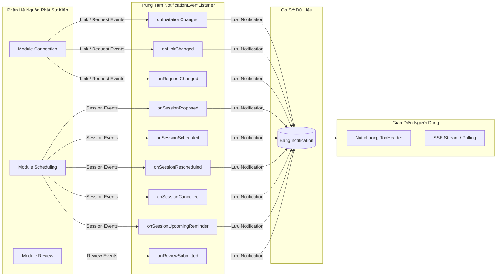
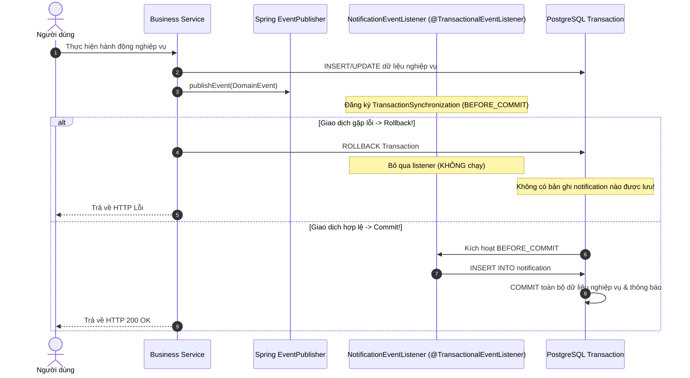
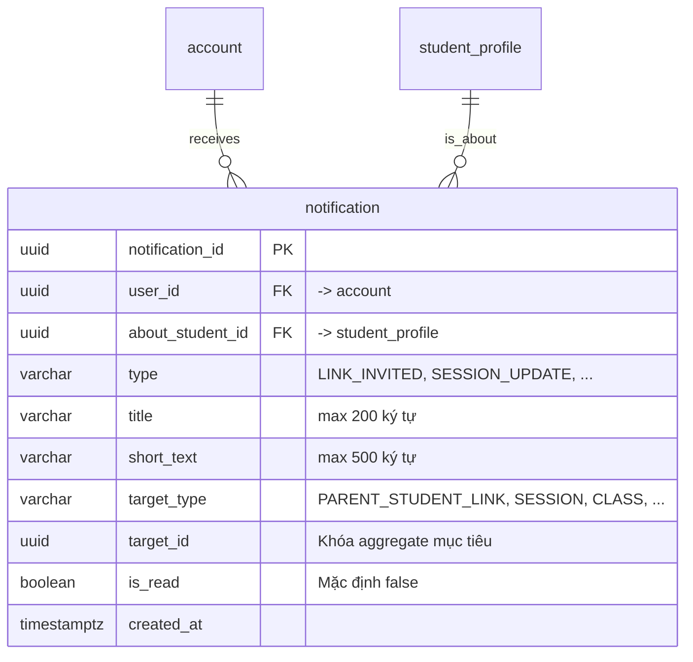

# KẾ HOẠCH HIỆN THỰC HÓA & GIẢI TRÌNH KIẾN TRÚC PHÂN HỆ NOTIFICATION (TRUNG TÂM THÔNG BÁO TẬP TRUNG)
**Tài liệu Kỹ thuật Chuẩn Quốc tế Dành cho Thành viên Dự án & Đánh giá Mã Nguồn (Code Review)**

> **Phiên bản:** 1.0  
> **Phân hệ phụ trách:** `modules/notification` (EduFit Backend & Frontend Integration)  
> **Áp dụng cho:** Nhánh `feat/sprint3-progress-integration` tích hợp vào nền tảng EduFit  
> **Tài liệu đối chiếu:**  
> - [ADR-001: Tech Stack](file:///c:/University/Semester%205/SWP391/Edufit/EduFit/docs/ADR-001-tech-stack.md) & [ADR-002: Multi-Module Architecture](file:///c:/University/Semester%205/SWP391/Edufit/EduFit/docs/ADR-002-multi-module-architecture.md)  
> - [Backend Module Structure Guide (Loại 1 - Layered Service & Event Listener Hub)](file:///c:/University/Semester%205/SWP391/Edufit/EduFit/docs/backend-module-structure-guide.md)  
> - [Software Architecture Design Specification (Mục 11 - Notification API & SSE)](file:///c:/University/Semester%205/SWP391/Edufit/EduFit/docs/software-architecture-design-specification.md)  
> - [SRS Edufit (UC7.1, UC7.2, UC7.3; FR-30, FR-31; BR-63 đến BR-66)](file:///c:/University/Semester%205/SWP391/Edufit/EduFit/docs/SRS%20Edufit.docx)  
> - [Master Test Plan & In-Development Testing Specification (Mục 7.7)](file:///c:/University/Semester%205/SWP391/Edufit/EduFit/docs/in-development-testing-specification.md)  
> - [V1.07__create_review_and_notification_tables.sql](file:///c:/University/Semester%205/SWP391/Edufit/EduFit/backend/app/src/main/resources/db/migration/review/V1.07__create_review_and_notification_tables.sql)

---

## 1. Mục Tiêu & Bối Cảnh (Goal Description)

Phân hệ **Notification (Hệ thống Thông báo Người dùng Đa Kênh)** là "Trục Phản hồi Tức thời & Kết nối Trải nghiệm" (Event Hub & Real-Time Engagement Engine) của nền tảng EduFit. Phân hệ đóng vai trò trung tâm tiếp nhận toàn bộ các biến động trạng thái từ các phân hệ nghiệp vụ khác, chuyển hóa thành các bản ghi thông báo cá nhân hóa và chuyển phát kịp thời đến người dùng trên giao diện web.

Phân hệ đảm nhiệm 3 mục tiêu chiến lược cốt lõi:

1. **Thu Nhận Sự Kiện Miền Toàn Diện (Comprehensive Domain Event Ingestion):**
   - Đóng vai trò là Subscriber tập trung lắng nghe các Sự kiện Miền (`Domain Events`) phát ra từ 3 phân hệ chính:
     - **`Connection`**: Lời mời liên kết gia đình (`LinkInvitationChangedEvent`), thu hồi liên kết (`ParentStudentLinkChangedEvent`), yêu cầu kết nối gia sư (`ConnectionRequestChangedEvent`).
     - **`Scheduling`**: Đề xuất giờ học (`SessionProposedEvent`), chốt lịch (`SessionScheduledEvent`), đổi lịch (`SessionRescheduledEvent`), hủy lịch (`SessionCancelledEvent`), nhắc nhở trước giờ học 2h/24h (`SessionUpcomingReminderEvent`).
     - **`Review`**: Nhận đánh giá chất lượng mới từ học sinh/phụ huynh (`ReviewSubmittedEvent`).

2. **Bảo Đảm Tính Toàn Vẹn Giao Dịch & Chống Thông Báo "Ma" (Zero-Ghost Notifications via Transactional Listeners):**
   - Áp dụng cơ chế `@TransactionalEventListener(phase = TransactionPhase.BEFORE_COMMIT)`:
     - Thông báo chỉ được tạo và lưu xuống cơ sở dữ liệu khi giao dịch nghiệp vụ gốc đang ở trạng thái chuẩn bị commit thành công.
     - **Triệt tiêu hoàn toàn thông báo "ma" (Ghost Notifications)**: Nếu giao dịch nghiệp vụ xảy ra lỗi hoặc bị rollback (`tx.setRollbackOnly()`), Spring IoC sẽ tự động hủy bỏ listener và tuyệt đối không tạo bản ghi thông báo rác cho người dùng.

3. **Cung Cấp Trải Nghiệm Tương Tác Thời Gian Thực (Real-Time UX on Frontend):**
   - Cung cấp API đếm nhanh số lượng thông báo chưa đọc (`unread-count`) với độ trễ thấp thông qua Composite Index tối ưu hóa.
   - Hỗ trợ đánh dấu đã đọc từng thông báo (`PATCH /notifications/{id}/read`) hoặc đánh dấu tất cả đã đọc (`PATCH /notifications/read-all`).
   - Cung cấp luồng phát sự kiện Server-Sent Events (`GET /notifications/stream`) để đẩy thông báo trực tiếp đến nút chuông trên thanh điều hướng `TopHeader.tsx`.

---

## 2. Giải Thích Chi Tiết: Từ Định Nghĩa Đến Cơ Chế Hoạt Động

### 2.1. Ma Trận Đón Nhận Sự Kiện Miền (Event Ingestion Matrix)



### Chi tiết các loại thông báo (`type`):

| Phân hệ nguồn | Tên Sự kiện Miền | Mã loại (`type`) | Tiêu đề thông báo | Đối tượng nhận |
| :--- | :--- | :--- | :--- | :--- |
| **Connection** | `LinkInvitationChangedEvent` (`PENDING`) | `LINK_INVITED` | Lời mời liên kết | Người được mời (Học sinh/Phụ huynh) |
| **Connection** | `LinkInvitationChangedEvent` (`ACCEPTED`) | `LINK_CONFIRMED` | Liên kết đã xác nhận | Người gửi lời mời |
| **Connection** | `LinkInvitationChangedEvent` (`DECLINED`) | `LINK_DECLINED` | Lời mời đã bị từ chối | Người gửi lời mời |
| **Connection** | `LinkInvitationChangedEvent` (`EXPIRED`) | `LINK_EXPIRED` | Lời mời đã hết hạn | Người gửi lời mời |
| **Connection** | `ParentStudentLinkChangedEvent` (`REVOKED`) | `LINK_REVOKED` | Liên kết đã thu hồi | Phụ huynh & Học sinh |
| **Connection** | `ConnectionRequestChangedEvent` (`PENDING`) | `CONNECTION_REQUESTED` | Yêu cầu kết nối mới | Gia sư & Học sinh |
| **Connection** | `ConnectionRequestChangedEvent` (`ACCEPTED`) | `CONNECTION_ACCEPTED` | Yêu cầu đã được chấp nhận | Học sinh & Phụ huynh |
| **Connection** | `ConnectionRequestChangedEvent` (`REJECTED`) | `CONNECTION_REJECTED` | Yêu cầu đã bị từ chối | Học sinh & Phụ huynh |
| **Connection** | `ConnectionRequestChangedEvent` (`CANCELLED`) | `CONNECTION_CANCELLED` | Yêu cầu đã bị hủy | Gia sư & Học sinh |
| **Connection** | `ConnectionRequestChangedEvent` (`EXPIRED`) | `CONNECTION_EXPIRED` | Yêu cầu đã hết hạn | Gia sư & Học sinh |
| **Scheduling** | `SessionProposedEvent` | `SESSION` | Đề xuất buổi học mới | Người nhận đề xuất (Tutor hoặc Student) |
| **Scheduling** | `SessionScheduledEvent` | `SESSION_UPDATE` | Buổi học đã chốt lịch | Cả Gia sư và Học sinh |
| **Scheduling** | `SessionRescheduledEvent` | `SESSION_UPDATE` | Lịch học đã thay đổi | Cả Gia sư và Học sinh |
| **Scheduling** | `SessionCancelledEvent` | `SESSION_UPDATE` | Buổi học đã bị hủy | Cả Gia sư và Học sinh |
| **Scheduling** | `SessionUpcomingReminderEvent`| `SESSION_UPDATE` | Nhắc nhở buổi học sắp tới | Cả Gia sư và Học sinh |
| **Review** | `ReviewSubmittedEvent` | `REVIEW_RECEIVED` | Đánh giá mới từ học sinh | Gia sư được đánh giá |

---

### 2.2. Cơ Chế Phòng Vệ Transactional: Loại Bỏ Ghost Notifications

Khi một giao dịch nghiệp vụ (ví dụ: tạo lớp học hoặc hủy buổi học) gặp lỗi trong lúc xử lý và kích hoạt rollback:



---

## 3. Cấu Trúc Lược Đồ Cơ Sở Dữ Liệu (Database Schema)

Lược đồ bảng `notification` được định nghĩa trong file migration [`V1.07__create_review_and_notification_tables.sql`](file:///c:/University/Semester%205/SWP391/Edufit/EduFit/backend/app/src/main/resources/db/migration/review/V1.07__create_review_and_notification_tables.sql):



### Chỉ mục tối ưu hóa hiệu năng (Index Design):
```sql
CREATE INDEX IF NOT EXISTS idx_notification_user_unread 
ON notification (user_id, is_read, created_at);
```
- **Ý nghĩa:** Phục vụ truy vấn đếm số lượng chưa đọc (`COUNT(*) WHERE user_id = ? AND is_read = false`) với tốc độ $O(\log N)$ cực nhanh.
- Phục vụ truy vấn phân trang danh sách thông báo mới nhất theo người dùng.

---

## 4. Kiến Trúc Phân Tầng Chi Tiết (Layered Architecture)

Module `notification` đóng vai trò là Event Consumer và cung cấp REST API truy vấn:

```
vn.edufit.notification/
├── application/
│   ├── listener/
│   │   └── NotificationEventListener.java <-- Đón nhận các Domain Events từ Connection, Scheduling, Review
│   └── service/
│       └── NotificationService.java       <-- Nghiệp vụ đánh dấu đã đọc, đếm số chưa đọc, phân trang
├── infra/
│   ├── adapter/
│   │   └── JpaNotificationSink.java       <-- Hiện thực Shared Kernel NotificationSink
│   └── persistence/
│       ├── entity/
│       │   └── Notification.java          <-- JPA Entity bảng notification
│       └── repository/
│           └── NotificationRepository.java<-- Spring Data JPA với Index tối ưu
└── web/
    ├── NotificationController.java        <-- REST Endpoints & SSE Stream
    └── response/
        ├── NotificationResponse.java      <-- DTO chi tiết thông báo
        ├── NotificationListResponse.java  <-- DTO danh sách phân trang
        ├── UnreadCountResponse.java       <-- DTO số lượng chưa đọc { count: 3 }
        ├── MarkReadResponse.java          <-- DTO phản hồi đánh dấu đã đọc
        └── MarkAllReadResponse.java       <-- DTO phản hồi đánh dấu tất cả
```

---

## 5. Danh Sách REST Endpoints (API Specification)

Tất cả các endpoints trong phân hệ `notification` đều **yêu cầu người dùng đăng nhập** (`Authenticated`). Dữ liệu trả về được tự động bảo vệ theo định danh `CurrentUser.getUserId()`.

### 5.1. Tra Cứu Thông Báo & Số Lượng Chưa Đọc
- **`GET /api/v1/notifications`**: Lấy danh sách thông báo của người dùng đăng nhập.
  - *Tham số Query:* `unreadOnly` (boolean, optional), `page` (default 0), `size` (default 20).
  - *Response:* HTTP 200 `NotificationListResponse(notifications, unreadCount, page, totalPages)`.
- **`GET /api/v1/notifications/unread-count`**: Đếm nhanh số lượng thông báo chưa đọc.
  - *Mục đích:* Dùng cho badge đỏ trên chuông thông báo `TopHeader.tsx`.
  - *Response:* HTTP 200 `UnreadCountResponse { "unreadCount": 5 }`.

### 5.2. Đánh Dấu Trạng Thái Đã Đọc
- **`PATCH /api/v1/notifications/{id}/read`**: Đánh dấu 1 thông báo cụ thể là đã đọc.
  - *Bảo mật:* Chặn IDOR - Người dùng chỉ được đánh dấu thông báo thuộc quyền sở hữu của chính mình.
  - *Response:* HTTP 200 `MarkReadResponse { "notificationId": "...", "isRead": true }`.
- **`PATCH /api/v1/notifications/read-all`**: Đánh dấu toàn bộ thông báo của người dùng là đã đọc.
  - *Response:* HTTP 200 `MarkAllReadResponse { "updatedCount": 5 }`.

### 5.3. Luồng Thông Báo Thời Gian Thực (Server-Sent Events)
- **`GET /api/v1/notifications/stream`**: Mở kênh SSE nhận thông báo thời gian thực từ Backend.
  - *Header:* `Content-Type: text/event-stream`.

---

## 6. Kế Hoạch Kiểm Thử & Kiểm Chứng Tự Động (Quality Gates)

| Nhóm Kiểm Thử | Suite / Lớp Kiểm Thử | Mục Tiêu & Kịch Bản Được Thẩm Định |
| :--- | :--- | :--- |
| **Domain Event Ingestion Test** | `NotificationEventListenerTest` | Tiếp nhận an toàn các sự kiện miền từ `Connection`, `Scheduling`, `Review`; xử lý an toàn `BaseDomainEvent` đa hình. |
| **Transactional Rollback Defense** | `ConnectionTransactionPostgresTest` | Kiểm thử thực tế trên PostgreSQL Testcontainers: khi giao dịch bị `setRollbackOnly()`, `BEFORE_COMMIT` listener không được phép gọi lưu thông báo. |
| **Notification Service Logic** | `NotificationServiceTest` | Đánh dấu đã đọc đơn lẻ, đánh dấu tất cả, đếm số lượng chưa đọc, kiểm tra phân trang. |
| **Entity Mapping & Persistence** | `NotificationEntityTest` | Ánh xạ ORM, giá trị mặc định `is_read = false`, kiểm tra khóa ngoại tài khoản. |
| **REST Controller MockMvc Test** | `NotificationControllerTest` | Kiểm tra HTTP Status 200, 401 (chưa đăng nhập), 403/404 khi truy cập thông báo của người khác. |
