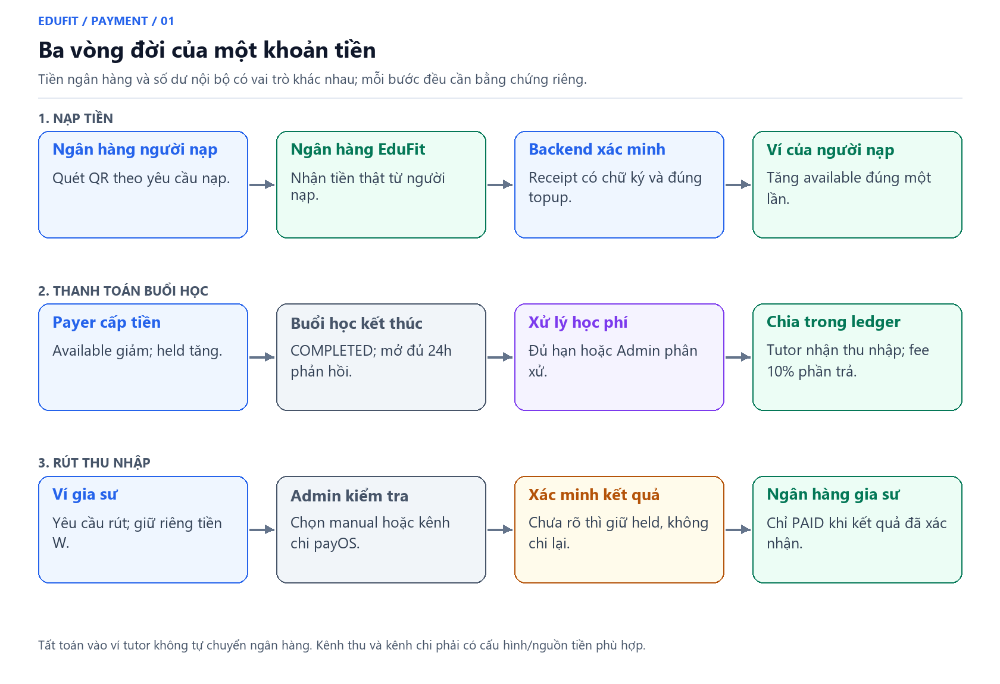
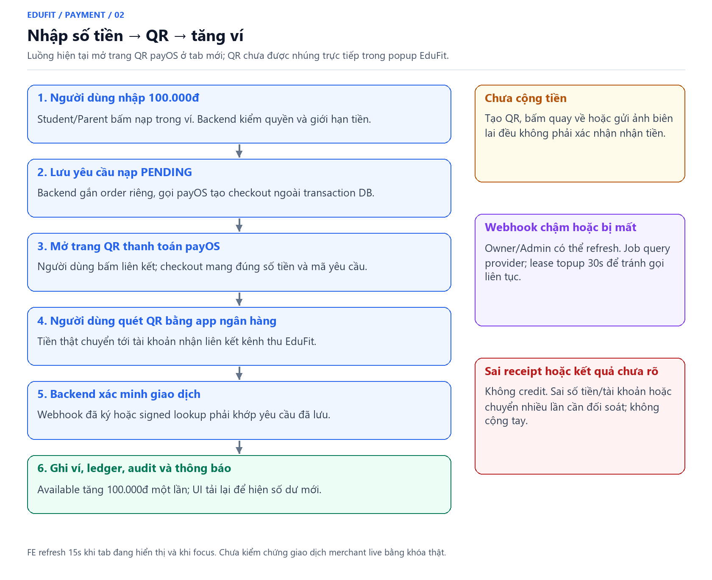
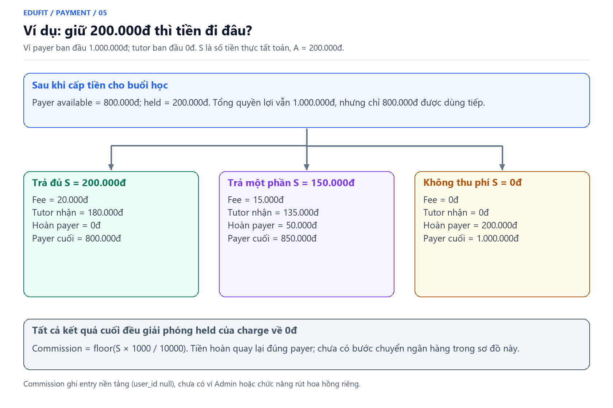
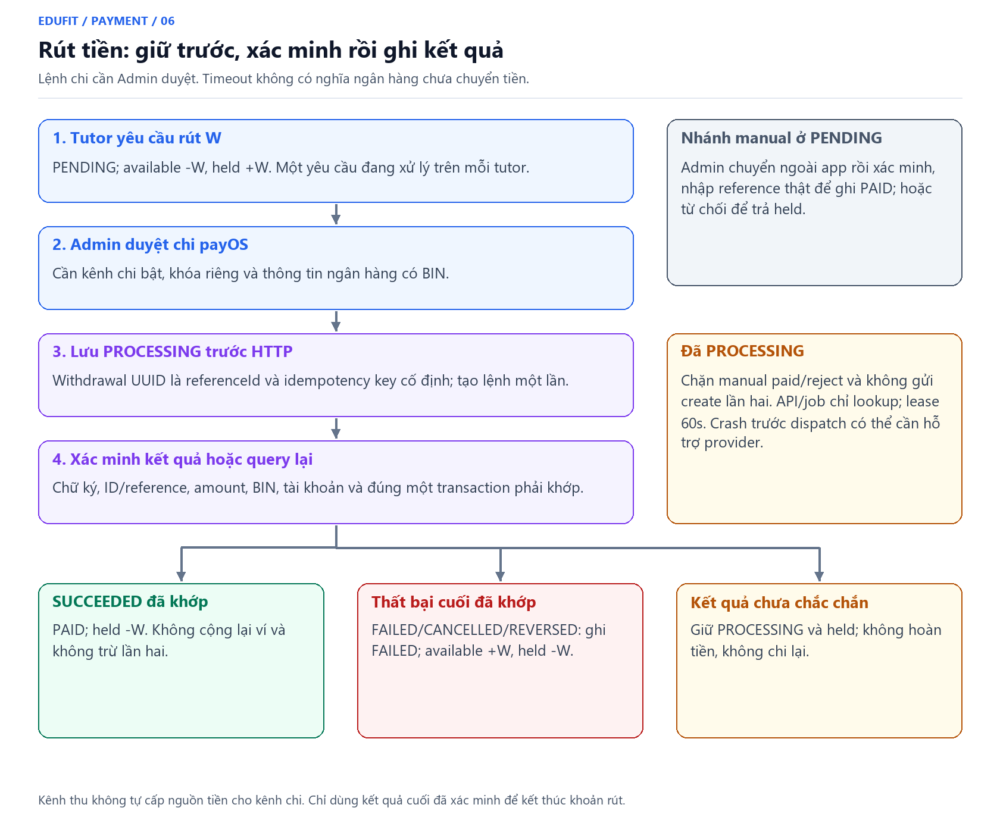
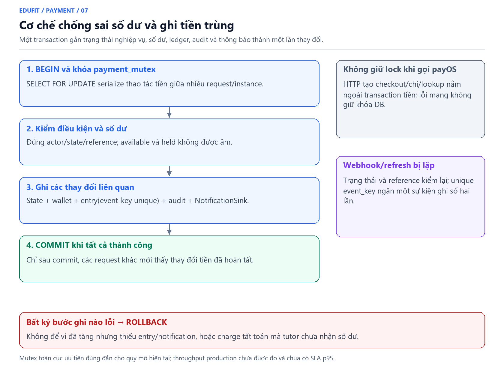

# Payment: giải thích luồng, quy tắc và cơ chế xử lý tiền

> Cập nhật 26/10/2026: [quy tắc hiện hành và trải nghiệm Payment](payment-usability.md). Xác nhận không tất toán sớm; đủ 24h phản hồi mới tự thu; hết 48h tranh chấp chuyển Admin và tiếp tục giữ tiền.

**Cập nhật:** 26/10/2026, nhánh `feat/payment`. Đối chiếu code có trong `cd8c018` (code nghiệp vụ từ `3966d54`). Tài liệu mô tả chức năng hiện có; các giới hạn được ghi riêng, không coi cấu hình merchant và giao dịch thật là đã kiểm chứng.

Đọc tài liệu này để hiểu tiền đi đâu, ai được thao tác, khi nào hệ thống thu phí và vì sao một giao dịch được giữ lại. [Tài liệu kiến trúc](payment_implementation_plan.md) giải thích từng file/schema; [API](api-contract.md), [setup payOS](payos-setup.md) và [runbook](runbook.md) phục vụ tích hợp/vận hành.

## 1. Tổng quan: một Payment gồm ba luồng riêng



*Hình 01. Tách nạp tiền ngân hàng, phân bổ số dư nội bộ và rút tiền ngân hàng. [Bản SVG](images/payment-overview.svg).*

| Luồng | Tiền thật tại ngân hàng | Số dư trong EduFit | Điều kiện ghi nhận |
|---|---|---|---|
| Nạp ví | Người nạp chuyển vào tài khoản nhận liên kết EduFit | Tăng available của đúng người nạp | Receipt/query payOS hợp lệ hoặc Admin xác minh manual |
| Cấp tiền buổi học | Không phát sinh chuyển ngân hàng mới | Chuyển available sang held của payer | Đúng quyền, giá và đủ số dư |
| Tất toán buổi học | Không tự chuyển ngân hàng cho tutor | Giảm held, cộng tutor, ghi commission và trả phần dư payer | Đủ 24h phản hồi không có vấn đề hoặc quyết định Admin hợp lệ |
| Rút thu nhập | Chuyển từ nguồn tiền chi tới ngân hàng tutor | Giữ tiền lúc yêu cầu, kết thúc held khi xác minh kết quả | Admin manual review hoặc duyệt chi payOS |

**Ví dụ:** học sinh nạp 1.000.000đ, học một buổi 200.000đ. Khi cấp tiền, 200.000đ được giữ trong ví học sinh. Khi tất toán đủ, ví tutor tăng 180.000đ và ledger EduFit ghi 20.000đ hoa hồng. Ngân hàng tutor chỉ nhận tiền sau một yêu cầu rút riêng.

Ví nội bộ là dữ liệu số dư trong DB; ngân hàng giữ tiền thật. Nguồn tiền kênh thu và nguồn chi cần được người vận hành quản lý/đối soát; code không tự điều chuyển nguồn tiền giữa hai kênh.

## 2. Từ điển nghiệp vụ và cách đọc số dư

| Khái niệm | Giải thích |
|---|---|
| Payer | Tài khoản Student/Parent đã cấp tiền cho buổi; là chủ khoản tiền cần hoàn |
| Learner side | Student của buổi hoặc Parent payer còn confirmed link; một phía xác nhận việc học, không mặc định quyền đề xuất tiền |
| Tutor side | Gia sư của buổi; phía xác nhận còn lại |
| Available | Số dư chưa dành cho nghĩa vụ nào, được dùng tiếp theo quyền nghiệp vụ |
| Held | Tiền dành cho học phí/yêu cầu rút; vẫn được theo dõi trong ví nhưng không dùng lại |
| Charge | Khoản học phí của một session: giá, payer, tutor, fee snapshot, state và báo cáo |
| Topup | Yêu cầu nạp, gắn order và receipt; tạo yêu cầu chưa làm tăng ví |
| Withdrawal | Yêu cầu rút, gắn người thụ hưởng và kết quả ngân hàng |
| Settlement | Tất toán charge vào ledger, không đồng nghĩa chuyển khoản ngân hàng |
| Refund trong tài liệu này | Giải phóng tiền giữ về available của payer; chưa phải bank refund |
| Reconciliation/đối soát | So dữ liệu ngoài hệ thống với yêu cầu đã lưu trước khi kết luận ghi tiền |
| Ledger/entry | Lịch sử từng thay đổi tiền, có event key và reference để truy vết |

Available và held đều không âm. Held không chỉ dành cho tranh chấp: ngay khi cấp tiền hoặc tạo yêu cầu rút, khoản đó đã được giữ. Việc mở tranh chấp giữ nguyên khoản đã dành, không trừ thêm một lần học phí.

## 3. Luồng nạp ví qua payOS/QR



*Hình 02. Tạo QR chưa cộng ví; xác minh receipt mới ghi tiền. [Bản SVG](images/payment-topup-flow.svg).*

### 3.1. Người dùng nhìn thấy gì?

1. Student/Parent vào trang ví, nhập số tiền, ví dụ 100.000đ.
2. Bấm nạp. Backend tạo topup riêng và yêu cầu payOS tạo checkout.
3. EduFit hiển thị **Mở trang QR thanh toán payOS**. Bấm liên kết để mở tab mới; hiện chưa có QR payOS nhúng trong popup EduFit.
4. Kiểm tra số tiền/tài khoản trên checkout và dùng app ngân hàng quét QR.
5. Sau xác minh, ví tăng đúng số tiền và có lịch sử/thông báo.

Kênh thu phải có khóa hợp lệ và tài khoản ngân hàng liên kết đúng. Chỉ điền một API Key là chưa đủ: cần Client ID, API Key, Checksum Key, tài khoản nhận và frontend URL; xem [setup](payos-setup.md).

### 3.2. Backend làm gì?

| Bước | Dữ liệu/trạng thái | Vì sao cần? |
|---|---|---|
| Kiểm actor và amount | Student/Parent, VND nguyên 10.000..100.000.000 | Không cho mọi role tự nạp hoặc gửi tiền thập phân |
| Tạo topup | ID, order riêng, owner, amount, provider, PENDING, expires_at | Có yêu cầu nội bộ trước khi nhận kết quả ngoài |
| Tạo checkout | Gọi payOS ngoài transaction/lock DB | Mạng chậm không giữ khóa tiền |
| Xác minh response tạo checkout | Chữ ký, URL HTTPS đúng host payOS, link ID, order/amount/VND, tài khoản nhận hợp lệ | Chấp nhận tài khoản ảo do payOS cấp cho đúng đơn |
| Lưu checkout | Gắn URL, link ID và tài khoản nhận vào topup | Ghép receipt về đúng yêu cầu và đúng tài khoản riêng của đơn |
| Nhận bằng chứng thanh toán | Webhook hoặc lookup response có chữ ký | Không tin trạng thái do trình duyệt báo |
| Credit | PAID + available + entry + audit + notification | Ghi cùng transaction và chỉ một lần |

Nếu tạo checkout bị lỗi sau khi đã lưu PENDING, không có credit. Không mặc định tạo lại nhiều yêu cầu sẽ là cùng một order: topup create chưa có client idempotency key, mỗi yêu cầu có thể tạo order mới.

### 3.3. Khi nào receipt đủ điều kiện cộng ví?

- **Webhook:** chữ ký hợp lệ; tìm được order; provider PAYOS; đúng amount, VND, tài khoản nhận, payment link ID và reference.
- **Lookup phục hồi:** response đã ký; đúng order/amount; status PAID; amountPaid khớp; đúng một transaction với account/amount/reference/link phù hợp. Đường này hiện không có bước currency riêng như webhook.
- **Tài khoản nhận:** từ V1.18 dùng snapshot checkout đã ký, so với `accountNumber` hoặc `virtualAccountNumber` của receipt. Không yêu cầu tài khoản ảo trùng ngân hàng gốc; không lấy tài khoản webhook tự khai làm giá trị chuẩn. Hàng cũ NULL dùng tài khoản gốc làm fallback; đơn cũ dùng tài khoản ảo thiếu snapshot có thể cần đối soát hỗ trợ. `PAYMENT_BANK_ACCOUNT` vẫn giữ tài khoản gốc đã liên kết. Xem [FAQ payOS về tài khoản ảo](https://payos.vn/docs/cau-hoi-thuong-gap/) và [API](https://payos.vn/docs/api/).
- Giao dịch mẫu đăng ký webhook có chữ ký nhưng không khớp order: ACK, không credit cho tài khoản nào.
- QR hết hạn hiển thị không đủ để kết luận tiền chưa đến hoặc đã hoàn ngân hàng. Code chưa đồng bộ mọi trạng thái hủy/hết hạn provider về topup CANCELLED.

### 3.4. Webhook mất/chậm thì sao?

Webhook là thông báo từ server payOS tới backend EduFit. Localhost trên máy bạn không nhận được cuộc gọi từ payOS nếu chưa có public HTTPS/tunnel đúng path.

Ngoài webhook, owner/Admin có thể bấm **Kiểm tra tiền đã chuyển**; job cũng query provider. Lease topup 30s lưu trong DB hạn chế API/job/instance cùng query liên tục. Kết quả hợp lệ vẫn đi qua cùng một hàm credit, vì vậy webhook và lookup tới cùng lúc không được cộng hai lần.

FE refresh ví mỗi 15s khi tab đang hiển thị và khi quay lại tab. Có thể có độ trễ hiển thị dù giao dịch đã commit; tải lại UI không phải hành động ghi tiền.

### 3.5. Nếu chỉ dùng QR thủ công?

Khi thiếu payOS nhưng đủ BIN/tài khoản/tên người nhận, hệ thống có thể tạo QR manual. Người nạp chuyển tiền; Admin xem giao dịch ngân hàng thật, nhập reference duy nhất rồi xác nhận. QR manual không tự nghe biến động ngân hàng.

Khoản PAYOS không được manual-confirm để bỏ qua đối soát. Sai amount, tài khoản, nhiều lần chuyển hoặc kết quả chưa rõ phải xử lý đối soát, không cộng tay bằng SQL.

## 4. Giữ tiền và phản hồi việc học


Cấp tiền giữ A từ available sang held của đúng payer; snapshot giá và phí 10%. Cấp tiền khi SCHEDULED/COMPLETED, trước max(endAt,outcomeRecordedAt)+24h. Một charge/một payer; chưa có gate bắt cấp tiền trước khi học.

Khi Scheduling ghi COMPLETED, backend mở/lưu/thông báo cửa sổ phản hồi trong cùng transaction. reviewStartedAt = max(endAt, lúc ghi nhận/mở cửa sổ); reviewDeadline = reviewStartedAt+24h. Ghi nhận muộn vẫn có đủ 24 giờ. Job fallback mở cửa sổ từ lúc quan sát, không thu ngay vì endAt đã cũ; event lặp không reset hạn.

Xác nhận đã học/Ghi nhận đã dạy chỉ ghi việc học; cả hai xác nhận cũng chưa tất toán. Đến reviewDeadline, không khiếu nại, nguồn COMPLETED: job tất toán kể cả chưa ai xác nhận. Khi pending, sau endAt vẫn được báo vấn đề nếu tutor chưa ghi hoàn thành. Backend khóa và kiểm giờ server; đúng deadline từ chối mở mới.

Hủy/vắng mặt khi chưa có case hoàn held theo chính sách hiện có. Khi đã có case, mọi state DISPUTED/AWAITING_ADMIN/ADMIN_REVIEW giữ tiền dù nguồn đổi trạng thái. Dời lịch không reset reviewStartedAt đã mở; auto-settlement vẫn kiểm endAt hiện hành.

## 5. Hồ sơ vấn đề và quyết định Admin


Chọn loại vấn đề, mô tả 1..2000 ký tự, bằng chứng văn bản/đường dẫn tối đa 4000. Mỗi buổi chỉ một case; mở trùng nhận case hiện tại. Khoản giữ không bị trừ thêm. Hạn hai bên giải quyết = openedAt+48h.

Student của buổi có thể xác nhận, báo vấn đề và bổ sung thông tin; **chỉ payer và tutor đề xuất mức tiền** 0..A và lý do tối đa 4000 ký tự trước 48h. Mỗi participant được thêm 20 phản hồi, mỗi phản hồi tối đa 4000 ký tự; messageId chặn retry trùng. Parent payer vẫn phải còn confirmed link.

| Điều kiện | Kết quả |
|---|---|
| Hai mức khớp trước 48h | AWAITING_ADMIN, tiếp tục held |
| Đủ 48h chưa khớp | ADMIN_REVIEW, tiếp tục held; không tự hoàn |
| Admin quyết định S>0 | SETTLED: tutor +S-fee, payer hoàn A-S, fee=floor(10%S) |
| Admin quyết định S=0 | REFUNDED: hoàn toàn bộ A, không phí |

Admin xem đầy đủ hồ sơ và nhập lý do; UI xem lại số hoàn/tutor/fee rồi xác nhận. Resolve mới cho phép phân xử mức 0..A sau endAt dựa bằng chứng, kể cả nguồn chưa COMPLETED; auto-settlement không có quyền này. Review cũ chỉ duyệt đúng mức thống nhất, vẫn cần COMPLETED nếu >0. Chưa có appeal/reopen terminal.

Ví dụ mở case 19:30 ngày 26/10 → hạn phản hồi 19:30 ngày 28/10. Đến hạn còn lệch chuyển Admin và giữ tiền. Admin quyết định sau hạn vẫn được; không bên nào được hưởng tiền chỉ vì bên kia im lặng. [Quy tắc đầy đủ và các giới hạn](payment-usability.md).

## 6. Tính phí, hoàn phần dư và ví dụ ledger



*Hình 05. Hoa hồng chỉ tính trên phần thực tất toán. [Bản SVG](images/payment-settlement-examples.svg).*

Đặt A là số tiền đã giữ; S là số tiền cuối cùng được trả. Tỷ lệ hiện tại 1000 basis points = 10%, snapshot vào charge:

```text
commission = floor(S * 1000 / 10000)
tutorIncome = S - commission
payerRefund = A - S
```

Phí làm tròn xuống VND; tutor nhận phần còn lại sau đúng mức phí đó, không tính riêng một phép làm tròn 90% gây mất đồng. Dùng long/bigint và số nguyên, không dùng floating point.

Ví dụ ban đầu payer available 1.000.000đ, tutor 0đ; charge A=200.000đ:

| Thời điểm/kết quả | Payer available | Payer held | Tutor tăng | Commission | Hoàn từ held |
|---|---:|---:|---:|---:|---:|
| Sau cấp tiền | 800.000 | 200.000 | 0 | 0 | 0 |
| Tất toán đủ S=200.000 | 800.000 | 0 | 180.000 | 20.000 | 0 |
| Tất toán một phần S=150.000 | 850.000 | 0 | 135.000 | 15.000 | 50.000 |
| Admin hoàn toàn bộ/S=0 | 1.000.000 | 0 | 0 | 0 | 200.000 |

Ba dòng kết quả là ba kịch bản thay thế, không phải ba giao dịch nối tiếp. Phí đi vào entry commission với user_id=null, chưa có wallet Admin hoặc chức năng rút commission riêng. Chưa có trang cấu hình đổi tỷ lệ runtime; code hiện gán 1000 bps khi fund.

## 7. Rút thu nhập tutor ra ngân hàng



*Hình 06. Kết quả chưa rõ phải giữ tiền, không tự chi lại. [Bản SVG](images/payment-payout-flow.svg).*

### 7.1. Yêu cầu rút

Chỉ Tutor được tạo withdrawal. Lưu ngân hàng/BIN, số tài khoản, chủ tài khoản một lần ở Tài khoản nhận tiền. Lần sau chỉ nhập W từ 10.000..100.000.000đ hoặc Rút toàn bộ, xem người nhận đã che số và xác nhận. Backend đọc tài khoản theo owner + ID phiên bản; lưu snapshot người nhận vào withdrawal. Đổi tài khoản không đổi snapshot yêu cầu đang chờ. Available đủ mới giữ W và lưu PENDING. Mỗi tutor chỉ một PENDING/PROCESSING; gửi lại cùng dữ liệu có thể nhận lại yêu cầu đang có, không giữ thêm tiền.

### 7.2. Hai cách Admin xử lý

**Manual:** chỉ khi PENDING, Admin chuyển ngoài app và xác minh kết quả cuối rồi ghi paid với reference thật; hoặc từ chối để trả held. Đánh dấu paid không phải một API tự gửi ngân hàng.

**payOS:** cần bật kênh chi, credentials riêng, BIN và nguồn tiền phù hợp. Admin duyệt và nhập note; backend:

1. Lưu PROCESSING, thời điểm dispatch, reference cố định trước HTTP.
2. Dùng withdrawal UUID cho referenceId/x-idempotency-key.
3. Gọi create ngoài khóa; approve đồng thời/lặp không gửi thêm lệnh.
4. Kiểm response ký và dữ liệu người thụ hưởng/giao dịch; nếu chưa cuối thì lookup bằng ID/reference.

### 7.3. Bảng quyết định kết quả

| Kết quả đã kiểm | State nội bộ | Available/held tutor |
|---|---|---|
| SUCCEEDED, đúng reference/amount/BIN/account | PAID | Available không tăng; held-W |
| FAILED/CANCELLED/REVERSED, đúng giao dịch | FAILED | Available+W, held-W |
| RECEIVED/PROCESSING/ON_HOLD | PROCESSING | Giữ nguyên held |
| Timeout/response mất/chữ ký sai/mismatch/chưa tìm thấy | PROCESSING | Giữ nguyên held; cần lookup/hỗ trợ |

Không coi HTTP 200/create thành công là tiền đã tới ngân hàng. Job chỉ lookup, không retry create. Lease payout 60s dùng chung API/job. Khi PROCESSING, chặn manual paid/reject để tránh vừa chuyển tiền thật vừa hoàn ví.

Crash giữa lúc lưu PROCESSING và provider nhận lệnh có thể làm không tìm thấy giao dịch. Cần đối chiếu với provider, không tự reset/send lệnh khác/chuyển manual. Chưa có UI tự giải quyết an toàn trường hợp này. Legacy thiếu BIN dùng manual hoặc từ chối để tutor gửi lại.

## 8. Cơ chế kỹ thuật bảo vệ tiền



*Hình 07. Thành công cùng nhau hoặc rollback cùng nhau. [Bản SVG](images/payment-atomic-ledger.svg).*

### 8.1. Transaction và mutex DB

Mọi thay đổi tiền đi qua PaymentStore.locked(), mở transaction và khóa một hàng payment_mutex bằng SELECT FOR UPDATE. Các request/instance cùng DB phải chờ lượt, nên không đồng thời cùng tiêu một số dư dựa trên giá trị cũ. DB check còn ngăn available/held âm.

Trong vùng khóa: kiểm lại state/quyền/số dư, ghi state và bút toán liên quan, audit/notification rồi commit. Lỗi giữa chừng rollback transaction, không để tutor có thu nhập nhưng payer vẫn giữ khoản cũ.

Mutex toàn cục đơn giản nhưng giảm throughput; chưa có bằng chứng tải production/SLA p95. Không mô tả cơ chế này như khóa in-memory chỉ có tác dụng trong một instance.

### 8.2. Idempotency không chỉ là disable button

Webhook có thể gửi lại, người dùng refresh hoặc hai job có thể chạy gần nhau. Ứng dụng dùng state/reference kiểm lại và payment_entry.event_key unique:

| Sự kiện | Ví dụ event key |
|---|---|
| Credit topup | topup:<topupId> |
| Giữ học phí | reserve:<sessionId> |
| Giải phóng/tất toán payer | settle-payer:<sessionId> |
| Cộng thu nhập tutor | settle-tutor:<sessionId> |
| Commission | commission:<sessionId> |
| Giữ withdrawal | withdraw-reserve:<withdrawalId> |
| Kết quả withdrawal | withdraw-result:<withdrawalId> |

Chống trùng là kiểm ở backend/DB, không dựa vào một nút FE. Với chi ngân hàng còn cần reference/idempotency key provider ổn định và không tự repost khi chưa rõ kết quả.

### 8.3. HMAC, session và CSRF

HMAC dùng checksum key xác minh dữ liệu provider đúng chữ ký; đây là xác thực tính toàn vẹn, không phải mã hóa nội dung. Chữ ký đúng vẫn chưa đủ: phải khớp order, tiền, tài khoản/link/reference với dữ liệu EduFit đã lưu.

API người dùng dùng cookie session và CSRF như hệ thống hiện tại; không có JWT Payment riêng. Actor lấy từ CurrentUser, không tin userId/role từ body. Webhook là ngoại lệ public/miễn CSRF vì gọi server-to-server; chữ ký là điều kiện bắt buộc.

HTTP provider ra ngoài transaction để tránh giữ khóa tiền khi chờ mạng. Lookup có lease DB, không chỉ throttle frontend.

### 8.4. Thông báo và ledger

Store gọi Shared NotificationSink cùng transaction ghi tiền; sink lỗi thì rollback tiền. Webhook xử lý lại sau đó vẫn phải đi qua kiểm trùng. Các type PAYMENT_* có target PAYMENT_WALLET, frontend route về ví theo role.

Ledger là log delta bổ sung bởi ứng dụng, có reference để truy vết; không có API sửa/xóa entry. Không tuyên bố đã có kế toán kép đầy đủ hoặc trigger ngăn DBA sửa dữ liệu. Không sửa balance bằng SQL như cách xử lý đối soát thường ngày.

## 9. Danh mục rule để tra cứu

Các mã PAY dưới đây là nhãn tra cứu **của tài liệu này**, không giả định chúng là mã BR gốc trong SRS.

| Mã | Quy tắc | Nguồn thực thi chính |
|---|---|---|
| PAY-01 | Ví thuộc user, không thuộc hồ sơ học sinh | PaymentStore, WalletService |
| PAY-02 | Available/held không âm | PaymentStore, constraints V1.16 |
| PAY-03 | Topup chỉ Student/Parent, tiền nguyên 10k..100m | PaymentAccess, WalletService, PaymentController |
| PAY-04 | Tạo QR/return URL không credit | WalletService, FE WalletPanel |
| PAY-05 | Receipt ký hợp lệ và khớp mới credit | PayosGateway, WalletService, ReconciliationService |
| PAY-06 | Manual cần Admin và reference thực duy nhất | WalletService, PaymentStore |
| PAY-07 | Một charge/một payer cho mỗi buổi | PaymentStore, PK payment_charge |
| PAY-08 | Fund kiểm role/link/giá/số dư/thời điểm | SessionPaymentService |
| PAY-09 | Snapshot giá và commission 1000 bps | SessionPaymentService, payment_charge |
| PAY-10 | Không thu thường trước COMPLETED/endAt | SessionCharge, SessionPaymentService |
| PAY-11 | Xác nhận việc học không tất toán sớm | SessionCharge |
| PAY-12 | reviewDeadline = reviewStartedAt+24h; COMPLETED, không khiếu nại mới tự tất toán | SessionCharge.tick |
| PAY-13 | Mở dispute sau endAt, charge còn chờ | SessionCharge.dispute |
| PAY-14 | Dispute dừng luồng auto/tất toán thường | SessionCharge |
| PAY-15 | Chỉ payer/tutor report riêng, mức 0..A, trước openedAt+48h | SessionCharge.report |
| PAY-16 | Hai mức khớp mới AWAITING_ADMIN | SessionCharge.report |
| PAY-17 | Hết 48h chưa khớp ADMIN_REVIEW, tiền tiếp tục held | SessionCharge.tick, SessionPaymentService |
| PAY-18 | Admin phân xử mức 0..A kèm lý do | SessionPaymentService.resolve |
| PAY-19 | Không timeout chỉ vì Admin duyệt lâu | SessionCharge.tick |
| PAY-20 | Fee floor(10% S), phần dư hoàn payer | SessionPaymentService.finish |
| PAY-21 | Parent revoked mất quyền buổi, giữ lịch sử ví mình | PaymentAccess, SessionPaymentService |
| PAY-22 | Hủy/vắng mặt hoàn khoản chưa khiếu nại; DISPUTED/AWAITING_ADMIN/ADMIN_REVIEW tiếp tục giữ tiền | SessionPaymentService.processDeadlines |
| PAY-23 | Chỉ tutor rút, một pending/processing | PaymentAccess, PaymentStore, V1.17 |
| PAY-24 | Withdrawal giữ tiền ngay khi tạo | PaymentStore.createWithdrawal |
| PAY-25 | Admin manual paid chỉ sau chuyển thật | WalletService.reviewWithdrawal, quy trình vận hành |
| PAY-26 | Payout lưu PROCESSING trước HTTP | PaymentPayoutService, PaymentStore |
| PAY-27 | Key/reference cố định, không create lại khi chưa rõ | PayosPayoutGateway, PaymentPayoutService |
| PAY-28 | Chỉ verified terminal mới kết thúc held | PaymentPayoutService, PaymentStore.payoutResult |
| PAY-29 | Money/entry/state/audit/notify nguyên tử, key unique | PaymentStore, NotificationSink, constraints |
| PAY-30 | Readiness không là kiểm chứng khóa/merchant live | PaymentSettings, Admin API |

Nguồn chi tiết: [SessionCharge](../../backend/modules/payment/src/main/java/vn/edufit/payment/domain/SessionCharge.java), [SessionPaymentService](../../backend/modules/payment/src/main/java/vn/edufit/payment/application/SessionPaymentService.java), [WalletService](../../backend/modules/payment/src/main/java/vn/edufit/payment/application/WalletService.java), [PaymentStore](../../backend/modules/payment/src/main/java/vn/edufit/payment/infra/PaymentStore.java), [PayoutService](../../backend/modules/payment/src/main/java/vn/edufit/payment/application/PaymentPayoutService.java), [ReconciliationService](../../backend/modules/payment/src/main/java/vn/edufit/payment/application/PaymentReconciliationService.java).

## 10. Các tình huống dễ hiểu nhầm

| Câu hỏi/tình huống | Kết quả hiện tại |
|---|---|
| Có tiền trong ví nhưng không cấp tiền buổi? | Chưa có charge/reserve; không tự lấy tiền cho buổi chưa fund |
| Cả Student và Parent đều bấm confirm? | Cùng phía learner, không thay xác nhận tutor |
| Parent khác payer muốn confirm? | Có thể đọc nếu link hợp lệ, không thao tác tài chính learner thay payer |
| Parent payer mất link khi tiền còn giữ? | Mất quyền buổi; khi hoàn tiền vẫn trả đúng payer cũ |
| Tutor có số dư nhưng rút ngân hàng tự động chưa bật? | Có thể gửi yêu cầu; Admin xử lý manual, không tự gửi API chi |
| Nạp thành công nhưng người dùng đóng tab payOS? | Backend vẫn nhận receipt/query; không cần quay lại trang để credit |
| PAYOS_PAYOUT_ENABLED=false? | Tắt dispatch provider, không tắt ledger thu nhập nội bộ |
| Một khoản rút PROCESSING rất lâu? | Tiền vẫn held, lookup/hỗ trợ provider; không tự hoàn hoặc chi lần hai |
| Muốn Student/Parent rút phần nạp dư về ngân hàng? | Chưa có workflow đó trong bản hiện tại |
| Muốn đổi fee trên Admin? | Chưa có UI/config runtime; cần triển khai riêng |

## 11. Ảnh, cách tái tạo và giới hạn kiểm chứng

Ảnh được tạo xác định bằng [script Python](../../scripts/render-payment-diagrams.py), không dùng ảnh chụp một giao dịch thật. PNG dùng để đọc/nhúng; SVG là bản vector có thể chỉnh sửa. Từ repo root, với Python/Pillow và font Segoe UI:

```powershell
python scripts/render-payment-diagrams.py
```

Script kiểm khung chữ và box không chồng nhau; ảnh được xem lại trực quan sau render. Không gọi payOS, không tạo giao dịch hoặc sửa DB. Môi trường ngoài Windows cần đặt PAYMENT_DIAGRAM_FONT_DIR tới folder có segoeui.ttf/segoeuib.ttf.

BE/FE đã có bằng chứng kiểm thử trong [verification-report](verification-report.md). Merchant, webhook public, khóa thu/chi và giao dịch live vẫn cần cấu hình/kiểm chứng riêng; không suy ra rằng ảnh diagram chứng minh dòng tiền thật đã chạy.
