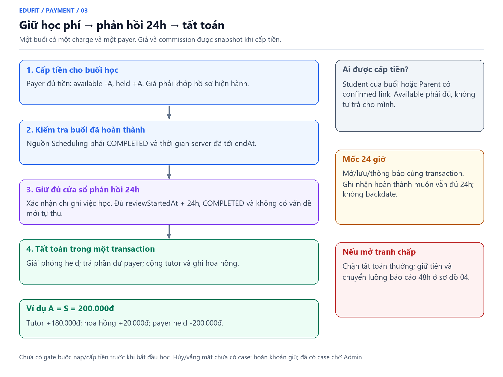
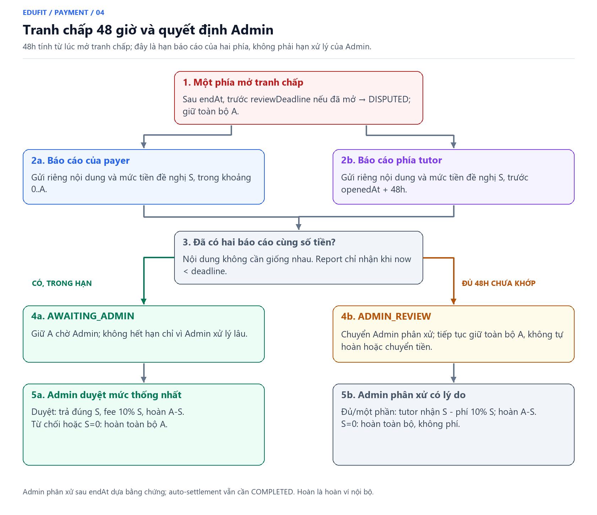

# Payment: phản hồi buổi học, hồ sơ vấn đề và thu nhập

Cập nhật **26/10/2026**, nhánh `feat/payment`. Đây là quy tắc hiện hành, thay các điểm xác nhận sớm và hết 48h tự hoàn trong bản 25/10. Phần nạp payOS và tài khoản nhận tiền đã lưu tiếp tục hoạt động theo contract cũ.

## 1. Người dùng thao tác ở đâu?

Ví hiển thị số dư, nạp/rút và lịch sử. Danh sách buổi học hiển thị trạng thái, hạn phản hồi và bước tiếp theo; bấm **Xem chi tiết buổi học** mới mở các thao tác. Thông báo dẫn tới đúng buổi, không chỉ dẫn chung về ví.

| Vai trò | Chi tiết buổi học |
|---|---|
| Student | `/student/payments/sessions/{id}` |
| Parent | `/parent/billing/sessions/{id}` |
| Tutor | `/tutor/earnings/sessions/{id}` |
| Admin | `/admin/disputes/{id}` |

Gia sư thấy **Thu nhập chờ**, **Có thể rút**, **Đang rút**. Thu nhập chờ là tổng dự kiến sau phí của các charge chưa kết thúc, kể cả đang tranh chấp; chưa phải cam kết được nhận toàn bộ. Chỉ số dư khả dụng được rút. Ngân hàng mặc định lưu một lần; mỗi yêu cầu rút giữ snapshot người nhận như V1.20.

## 2. Đủ 24 giờ phản hồi, không tất toán sớm



Sau endAt, tutor ghi nhận hoàn thành qua API Scheduling hiện có. Sự kiện `SessionOutcomeRecordedEvent` mở cửa sổ phản hồi cho charge đã cấp tiền. Hệ thống lưu:

```text
reviewStartedAt = max(endAt, thời điểm backend ghi nhận/mở cửa sổ)
reviewDeadline = reviewStartedAt + 24 giờ
```

Ghi thời điểm và lưu thông báo cùng transaction. Ghi nhận hoàn thành muộn vẫn có đủ 24 giờ; fallback job không lùi cửa sổ về quá khứ. Phát lại event, tải lại trang hoặc chạy job không kéo dài cửa sổ đã mở. Nếu chưa có charge, lúc cấp tiền cho buổi COMPLETED sẽ mở cửa sổ; API cấp tiền chỉ chấp nhận trước `max(endAt,outcomeRecordedAt) + 24h`.

- **Xác nhận đã học / Ghi nhận đã dạy** chỉ ghi nhận việc học, không chuyển tiền. Hai phía đã xác nhận vẫn có quyền báo vấn đề trước hạn.
- Không bắt buộc bấm xác nhận để tự tất toán. Khi đủ hạn, nguồn COMPLETED, không có vấn đề được báo: job tất toán vào ví tutor, trừ phí 10%.
- Chưa COMPLETED thì không tự thu. Có thể báo không tham gia/sự cố sau giờ kết thúc ngay cả khi tutor chưa ghi COMPLETED; tiền đang giữ chuyển hồ sơ vấn đề.
- Đúng thời điểm deadline không nhận vấn đề mới. Backend dùng thời gian server và khóa giao dịch; polling không quyết định tiền.
- Hủy/vắng mặt chưa có hồ sơ vấn đề: giữ chính sách hoàn khoản giữ. Khi đã có hồ sơ, nguồn đổi trạng thái không làm mất việc giữ tiền chờ phân xử.

Ví dụ: lịch kết thúc 19:00, tutor ghi hoàn thành 19:20 ngày 26/10 → hạn 19:20 ngày 27/10. Cả hai xác nhận lúc 19:30 ngày 26/10 vẫn chưa chuyển tiền; báo vấn đề trước hạn vẫn được.

## 3. Một hồ sơ vấn đề, 48 giờ phản hồi



Mỗi charge có một hồ sơ chung. Người có quyền tham gia chọn loại: thiếu thời lượng, không tham gia, sự cố kỹ thuật, chất lượng, hoặc khác; nhập nội dung 1..2000 ký tự, bằng chứng dạng văn bản/đường dẫn tối đa 4000 ký tự. Mở trùng trả về hồ sơ đang có, không tạo tranh chấp cạnh tranh hay trừ thêm tiền.

Hệ thống giữ nguyên toàn bộ học phí ở held của payer. Deadline giải quyết = `disputeOpenedAt + 48h`, độc lập hạn phản hồi 24h trước đó.

| Thao tác | Ai được làm? | Hiệu lực |
|---|---|---|
| Xác nhận việc học, báo vấn đề | Student của buổi, Parent payer còn confirmed link, Tutor | Không chuyển tiền |
| Bổ sung thông tin | Các participant trên | Tối đa 20 phản hồi/người/hồ sơ, 4000 ký tự/phản hồi |
| Đề xuất mức học phí 0..A và lý do | **Payer và Tutor** | Chỉ khi DISPUTED và trước 48h |
| Đọc buổi theo liên kết | Parent khác payer còn link | Không thay payer thao tác |
| Phân xử | Admin | Sau đồng thuận hoặc khi hết 48h |

Student không trả tiền có thể báo vấn đề/cung cấp bằng chứng nhưng không thay Parent chấp thuận số tiền. Parent bị thu hồi liên kết mất quyền buổi theo cơ chế hiện có; ví/lịch sử và chủ tiền hoàn vẫn thuộc payer. Trường hợp này có thể cần Admin sau hết hạn.

Hai đề xuất cùng mức → `AWAITING_ADMIN`, không cho tiếp tục sửa đề xuất. Hết 48h chưa khớp → `ADMIN_REVIEW`. **Cả hai đều tiếp tục giữ tiền; không tự hoàn hoặc chuyển tiền vì một bên im lặng.** Các bên vẫn bổ sung thông tin khi chờ Admin. Phản hồi có messageId UUID; retry cùng nội dung không tạo bản ghi/thông báo thứ hai, dùng lại ID với nội dung khác bị từ chối.

## 4. Admin quyết định có căn cứ

Admin xem loại vấn đề, nội dung/bằng chứng ban đầu, phản hồi bổ sung và hai mức đề xuất. Có thể chọn tính đủ, một phần hoặc hoàn toàn bộ; nhập lý do bắt buộc. Bản xem lại hiển thị ba số trước bước xác nhận:

```text
A = học phí đã giữ; S = học phí Admin quyết định, 0 <= S <= A
Phí EduFit = floor(S × 10%)
Gia sư nhận = S - phí
Hoàn ví payer = A - S
```

API phân xử mới cho phép Admin xử lý bằng chứng sau giờ kết thúc ngay cả khi nguồn chưa COMPLETED (ví dụ tranh cãi vắng mặt hoặc thiếu giờ); UI nhắc đối chiếu trong trường hợp này. Tự tất toán vẫn bắt buộc COMPLETED. Endpoint review cũ chỉ duyệt đúng mức đồng thuận và giữ kiểm tra COMPLETED đối với khoản >0; UI mới dùng resolve có amount và reason.

Ví dụ giữ 300.000đ, phân xử 150.000đ: hoàn payer 150.000đ, tutor nhận 135.000đ, EduFit 15.000đ. Tất cả trạng thái/số dư/entry/audit/thông báo thay đổi cùng transaction. Gửi lại quyết định sau terminal bị từ chối, không ghi tiền lần hai. Chưa có appeal/reopen hoặc tự sửa ledger cũ.

## 5. Backend event và polling

Scheduling public DTO bổ sung `outcomeRecordedAt`; giữ constructor tương thích. Payment phát `PaymentSessionChangedEvent` qua API module, Notification chỉ dùng API công khai. Listener đồng bộ trong transaction đang mở tạo thông báo cho payer, tutor và student (loại trùng); thêm Admin active khi AWAITING_ADMIN/ADMIN_REVIEW. Target `PAYMENT_SESSION`, targetId=sessionId. Nạp/rút vẫn dùng target ví.

Thông báo lưu DB cùng thời điểm mở hạn/thay đổi tiền; nếu lưu thông báo lỗi, transaction rollback. Đây chưa phải bảo đảm người dùng đã đọc hoặc nhận email/push. FE polling mỗi 15s khi tab hiển thị và refresh khi focus; có thể có độ trễ hiển thị. Chưa có SSE/WebSocket hoặc tích hợp webhook Meet/Zoom để đo giờ học trong đợt này.

## 6. Migration và vận hành

V1.21 thêm review_started_at, metadata vấn đề/kết quả, bảng payment_case_message và status ADMIN_REVIEW. Không sửa SQL đã áp dụng, không repair/clean/reset. Khởi động lại backend để Flyway áp dụng. Khoản còn chờ cũ chưa có reviewStartedAt được job mở cửa sổ mới và thông báo khi nguồn COMPLETED; không dùng endAt cũ để thu ngay. Terminal SETTLED/REFUNDED/EXPIRED và ledger cũ giữ nguyên.

Admin cần theo dõi hàng đợi phân xử: chưa có SLA tự xử lý Admin hay nhắc lặp trước hạn. Bằng chứng hiện là văn bản/đường dẫn, chưa upload file hoặc tự xác minh thời lượng. Kênh chi và giao dịch payOS thật cần cấu hình/kiểm chứng riêng; [báo cáo](verification-report.md) ghi đúng kiểm thử đã chạy.

Đọc thêm: [API](api-contract.md), [runbook](runbook.md), [schema](../edufit-schema.dbml), [task](../../tasks/payment/usability-plan.md).
