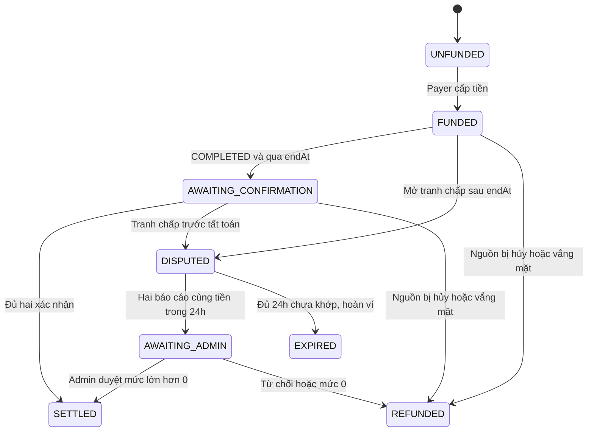
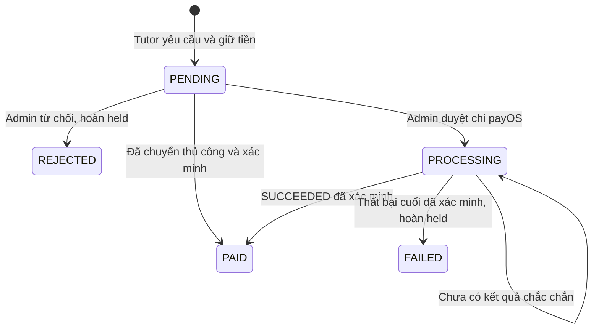
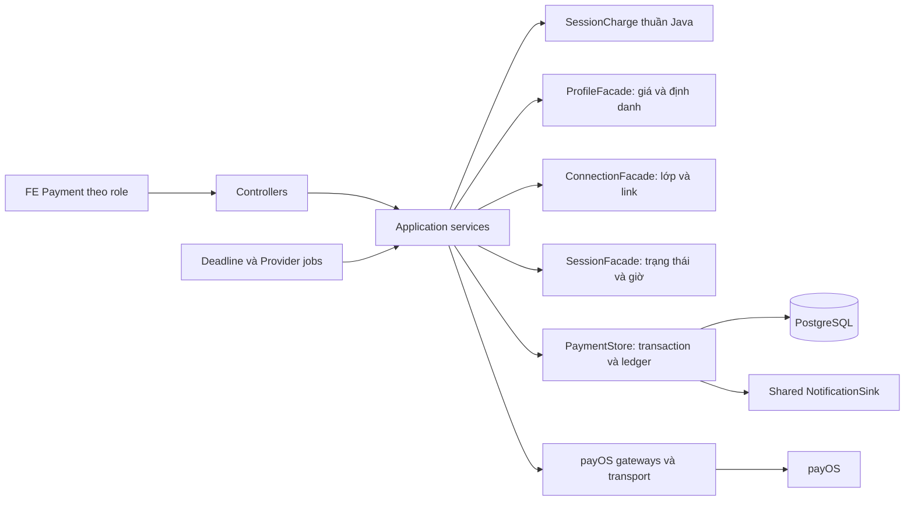
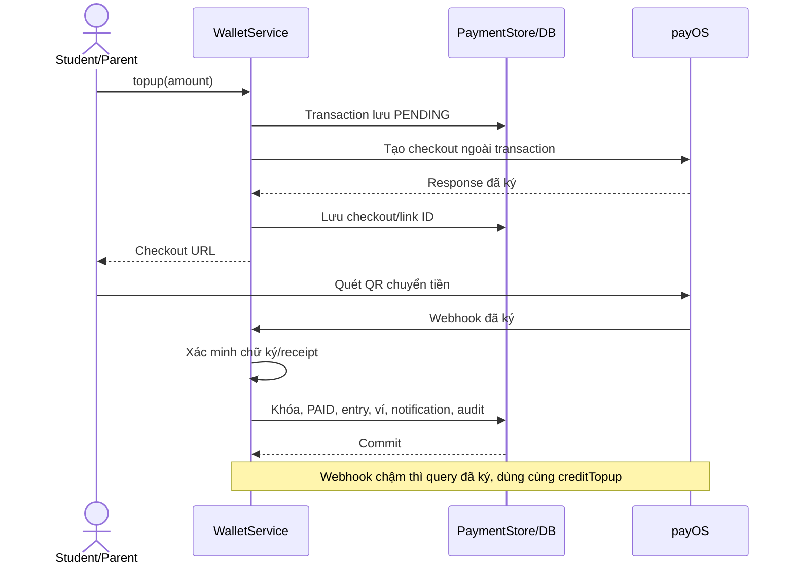
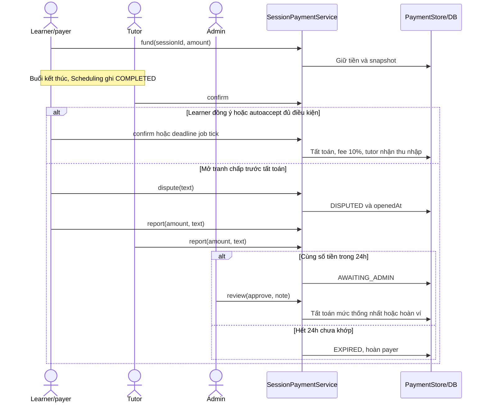
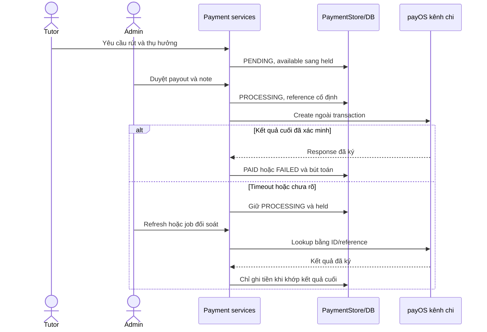

# Kế hoạch triển khai & giải trình kiến trúc chi tiết: Payment — EduFit

- **Nhánh:** `feat/payment`; base triển khai ban đầu: `develop@b1ea5cd`.
- **Ngày đối chiếu:** 24/10/2026; code tham chiếu: `3966d54`.
- **Trạng thái:** đã triển khai FE/BE và kiểm thử theo [báo cáo](verification-report.md); chưa kiểm chứng giao dịch payOS bằng merchant thật.
- **Mẫu trình bày:** bản Discovery gốc `D:/backend_discovery_implementation_plan.md`, [plan Discovery](../../tasks/plan.md) và [checklist Discovery](../../tasks/todo.md). Dùng cấu trúc giải thích, sơ đồ, file mapping, phase và bằng chứng; ví dụ mã trong mẫu không phải yêu cầu đổi kiến trúc Payment.
- **Căn cứ:** [SADS](../software-architecture-design-specification.md), [module guide](../backend-module-structure-guide.md), [schema DBML](../edufit-schema.dbml), code và yêu cầu người dùng đã chốt. Quy tắc ví mới thay thế giới hạn nghiên cứu cũ trong `docs/tuition`.

Tài liệu này giải thích **làm gì, tại sao và hoạt động thế nào**. [Task theo phase](../../tasks/payment/plan.md) mô tả phạm vi, phụ thuộc, acceptance criteria và commit; [todo](../../tasks/payment/todo.md) theo dõi trạng thái. Không coi cấu hình merchant/live test đã xong chỉ vì code đã có.

## 0. Đối chiếu hiện trạng & phạm vi thay đổi

### 0.1. Từ màn hình stub đến nghiệp vụ thanh toán

| Trước triển khai | Hiện tại trên `feat/payment` | Lý do |
|---|---|---|
| Finance stub/KPI chưa nối nghiệp vụ | Ví, sổ giao dịch, học phí từng buổi, hàng đợi Admin | Hiển thị dữ liệu backend |
| Chưa có nguồn xác nhận tiền nạp | Webhook có chữ ký, truy vấn đối soát hoặc Admin xác minh sao kê | QR/return URL không chứng minh đã nhận tiền |
| Chưa giữ riêng tiền buổi học | `available` và `held`, một charge mỗi buổi | Tránh chi cùng số dư cho nhiều nghĩa vụ |
| Chưa xử lý xác nhận/tranh chấp | State machine, autoaccept 1h, báo cáo 24h, Admin review | Không tất toán khi còn tranh chấp |
| Bản đầu chỉ rút thủ công | Manual hoặc Admin duyệt chi payOS, kênh chi riêng | Theo dõi chuyển ngân hàng và giữ tiền khi kết quả chưa rõ |
| Plan ngắn, cập nhật bằng phụ lục | Giải trình thống nhất theo mẫu Discovery | Loại mô tả payout ngoài phạm vi đã lỗi thời |

### 0.2. Bản đồ file và trách nhiệm

| Thành phần | File/nhóm file | Trách nhiệm |
|---|---|---|
| Lõi thu phí | `domain/SessionCharge.java` | State, xác nhận, báo cáo và thời hạn |
| Buổi học | `application/SessionPaymentService.java` | Quyền, giá snapshot, nguồn Scheduling, tất toán |
| Ví | `application/WalletService.java` | Nạp, rút thủ công, capabilities, Admin review |
| Phục hồi nạp | `application/PaymentReconciliationService.java` | Query provider rồi credit khi khớp |
| Chi ngân hàng | `application/PaymentPayoutService.java` | Admin dispatch, đối soát kết quả |
| Ghi sổ | `infra/PaymentStore.java` | JDBC, transaction, mutex, event key, audit, notification |
| Provider | `infra/PayosGateway.java`, `PayosPayoutGateway.java`, `PayosTransport.java` | HTTP, chữ ký và mapping thu/chi |
| HTTP/FE | `web/*`, `frontend/src/features/payment/*` | Contract và thao tác theo vai trò |

Payment hiện dùng JDBC và `PaymentStore`; application gọi adapter nội bộ, chưa phải ports/adapters hoàn toàn. Chưa có consumer nội bộ cần `PaymentFacade`. Không mô tả có `payment/api/` hoặc JPA entity Payment chỉ để giống số lượng file Discovery.

## 1. Mục tiêu & bối cảnh kỹ thuật

Payment quản lý ba vòng đời:

1. **Nạp:** ngân hàng xác nhận đã nhận → tăng ví người nạp.
2. **Học phí:** giữ tiền theo buổi → xác nhận/giải quyết tranh chấp → chia thu nhập và hoa hồng.
3. **Rút:** giữ tiền tutor → Admin chuyển thủ công hoặc duyệt chi → xác minh kết quả ngân hàng.

Thu nhập vào ví tutor là bút toán nội bộ. Chuyển ra ngân hàng là yêu cầu rút riêng, không tự chuyển ngân hàng sau mỗi buổi.

Quy tắc đã chốt: Student/Parent nạp ví cá nhân; payer cấp tiền từng buổi; hoa hồng **10% mỗi khoản thực tất toán**; hai phía xác nhận; auto learner sau kết thúc +1h khi COMPLETED; tranh chấp dừng tất toán; hai báo cáo trong 24h cùng mức tiền thì chờ Admin, chưa khớp khi hết hạn thì hoàn payer. Không có API tự cộng ví/số dư demo runtime.

## 2. Giải thích cơ chế & quyết định kiến trúc

### 2.1. Ví nội bộ khác tiền ngân hàng thế nào?

`payment_wallet` là số dư nghiệp vụ trong PostgreSQL. Ngân hàng/kênh chi giữ nguồn tiền ngoài ứng dụng. Số dư DB không tự điều chuyển tiền giữa ngân hàng; backend chỉ thay đổi khi có bằng chứng nghiệp vụ hợp lệ.

| Giá trị | Ý nghĩa |
|---|---|
| `available` | Chưa dành riêng, có thể chi theo quyền |
| `held` | Đã dành cho buổi học/yêu cầu rút, không chi tiếp |
| `payment_entry` | Lịch sử delta available/held để truy vết |
| `payment_audit` | Actor, thao tác, reference, ghi chú |

Ứng dụng ghi bổ sung entry, không có API sửa/xóa. Đây không phải cam kết có trigger cấm DBA sửa dữ liệu hoặc hệ thống kế toán kép đầy đủ.

### 2.2. Cấp tiền và snapshot giá

Giá lấy từ `ProfileFacade.findTutorById(...).pricePerSession()`. FE hiển thị; payer gửi lại `amount` để backend kiểm đúng giá hiện hành. Giá đổi thì từ chối và yêu cầu tải lại. Khi cấp tiền, lưu amount, payer, tutor user ID và `commission_bps`; thay giá hồ sơ sau đó không đổi khoản đã giữ.

Điều kiện hiện tại: Student của buổi hoặc Parent có confirmed link; nguồn buổi `SCHEDULED`/`COMPLETED`; server **trước** `endAt+1h`; đủ available; payer không phải tutor nhận tiền. `session_id` là PK nên một buổi chỉ có một charge; khoản terminal không được cấp lại bằng charge thứ hai.

Cấp tiền là thao tác riêng. Chưa có gate Scheduling bắt buộc cấp tiền trước lúc bắt đầu học, chưa có bảng hợp đồng giá theo lớp, không suy diễn giá lịch sử. Tỷ lệ hiện tại được code gán `1000` basis points và snapshot vào charge; chưa có UI/config runtime đổi hoa hồng.

### 2.3. State machine xác nhận/tranh chấp



`UNFUNDED` là view khi chưa có charge, không lưu trong bảng. Sơ đồ thể hiện luồng chính; deadline job có thể hoàn khoản chưa terminal nếu trạng thái nguồn thuộc nhóm hủy/vắng mặt.

| Quy tắc | Điều kiện áp dụng |
|---|---|
| Xác nhận chủ động | `COMPLETED`, `now >= endAt`; đủ learner và tutor mới tất toán |
| Autoaccept 1h | `now >= endAt+3600s`, COMPLETED, không tranh chấp; không thay tutor |
| Mở tranh chấp | Charge còn chờ xác nhận, `now >= endAt`, text 1–2000 ký tự |
| Báo cáo | DISPUTED, `now < openedAt+86400s`, mức 0..amount, text 1–4000 ký tự |
| Đồng thuận | Hai báo cáo riêng cùng số tiền; nội dung chữ không cần giống nhau |
| Đúng biên 24h | Không nhận báo cáo mới; chưa khớp thì hết hạn và hoàn ví |
| AWAITING_ADMIN | Giữ tiền chờ Admin, không tự hết hạn thêm |
| Admin duyệt | Đúng mức đã thống nhất; mức >0 cần nguồn COMPLETED và qua endAt |
| Admin từ chối | Lý do bắt buộc; hoàn toàn bộ held của charge |

Application tick thời hạn trước một số thao tác. Khi đã đủ điều kiện tất toán lúc xử lý request, không còn mở tranh chấp cho khoản terminal. Chưa có appeal sau tất toán.

Job fixed delay mặc định 30s, xử lý theo batch; 1h/24h là điều kiện server, không bảo đảm DB/UI đổi trạng thái đúng từng mili giây. Dời lịch dùng `endAt` hiện hành khi kiểm tra; giá và báo cáo đã lưu vẫn giữ lịch sử.

### 2.4. Công thức tiền và hoa hồng

Với `A` đã giữ, `S` thực tất toán, `B=1000` basis points:

```text
commission = floor(S * B / 10000)
tutorIncome = S - commission
payerRefund = A - S
```

| Bút toán | Delta available | Delta held |
|---|---:|---:|
| Cấp tiền payer | `-A` | `+A` |
| Kết thúc khoản payer | `+(A-S)` | `-A` |
| Tutor nhận thu nhập | `+(S-commission)` | `0` |
| Commission nền tảng | Entry `user_id=null`, `+commission` | `0` |

Giữ 200.000đ, thống nhất trả 150.000đ: payer nhận lại 50.000đ; tutor nhận 135.000đ; commission 15.000đ. Hết hạn chưa thống nhất: S=0, payer nhận lại toàn bộ, không thu phí. Commission lưu ledger; chưa có ví Admin/chức năng rút commission riêng.

Tiền là `long`/`bigint` VND nguyên, không dùng số thực tính phí. State, ví, entry, audit và thông báo liên quan được ghi cùng transaction.

### 2.5. Transaction, idempotency và đồng thời

`PaymentStore.locked()` mở transaction, khóa hàng `payment_mutex` bằng `SELECT ... FOR UPDATE`. Nhiều instance dùng cùng DB tranh cùng khóa. `payment_entry.event_key` unique là lớp bổ sung: `topup:<id>`, `settle-payer:<sessionId>`, `settle-tutor:<sessionId>`, `commission:<sessionId>`.

- Kiểm số dư và cập nhật cùng vùng khóa; DB check ngăn available/held âm.
- Charge có PK session; transaction reference và provider ID có unique constraint theo schema.
- Webhook/refresh lặp hợp lệ không cộng lần hai; duplicate khác dữ liệu bị từ chối.
- Mỗi tutor chỉ một withdrawal PENDING/PROCESSING.
- HTTP provider ở ngoài transaction/khóa để mạng chậm không chặn tất cả tiền.

Đánh đổi: mutex toàn cục giới hạn throughput. Chưa đo tải production hoặc cam kết p95 cụ thể.

### 2.6. Nạp QR/payOS và phục hồi webhook

Topup lưu PENDING rồi tạo checkout ngoài khóa; yêu cầu checkout có thời hạn 30 phút. Hết thời gian hiển thị không chứng minh tiền chưa đến/đã hoàn. Webhook là đường chính; query trạng thái là đường phục hồi; cùng kết thúc tại `creditTopup()`.

| Đường xác nhận | Kiểm trước credit |
|---|---|
| Webhook | Chữ ký; order đã lưu; PAYOS; amount; VND; link ID; tài khoản nhận; reference |
| Lookup | Response đã ký; order, amount, PAID, amountPaid; đúng một transaction; số tiền/tài khoản/reference/link khớp |
| Manual QR | Admin đối chiếu ngân hàng thật, reference duy nhất; chỉ provider MANUAL |

Không suy diễn lookup kiểm cùng mọi field webhook: lookup hiện không có bước kiểm `currency` riêng như webhook. Chuyển nhiều lần/sai tổng tiền cần hỗ trợ đối soát, không tự credit một phần. Return URL/ảnh biên lai/FE không là nguồn ghi tiền.

Webhook mẫu đã ký nhưng không khớp order được ACK, không credit. Refresh chỉ owner/Admin; lease DB 30s hạn chế lặp. Job query topup chờ khi kênh thu đã cấu hình.

### 2.7. Rút tiền và kết quả ngân hàng chưa rõ

Tạo withdrawal giữ W ngay: available -W, held +W; chưa chuyển ngân hàng.



Kênh chi có credentials/cờ bật/nguồn tiền riêng. Sau Admin duyệt:

1. Lưu PROCESSING trước HTTP. UUID withdrawal cố định là `referenceId` và `x-idempotency-key`.
2. Gửi create một lần; duyệt lặp không tạo thêm lệnh.
3. Kiểm chữ ký, provider ID/reference, số tiền, BIN, tài khoản và đúng một transaction.
4. SUCCEEDED → PAID, trừ held. FAILED/CANCELLED/REVERSED đã xác minh → FAILED, hoàn held.
5. Timeout/chữ ký sai/mismatch/chưa tìm thấy/còn xử lý → giữ PROCESSING, không hoàn hoặc tạo lệnh mới.

API/job dùng lease 60s. Job chỉ query theo provider ID/reference, không retry create. Đã dispatch thì chặn manual review. Crash sau lưu PROCESSING nhưng trước provider nhận request có thể cần hỗ trợ vận hành; chưa có nút tự reset an toàn.

### 2.8. Phân quyền và thông báo

| Actor | Quyền |
|---|---|
| Student | Ví mình; cấp tiền buổi mình; xác nhận/report learner |
| Parent | Ví mình; cấp tiền khi confirmed link; xác nhận/report khi là payer và còn link |
| Parent khác payer | Xem buổi nếu còn link; không thay payer xác nhận/report |
| Tutor | Xác nhận/report buổi mình; thu nhập/yêu cầu rút |
| Admin | Đối soát nạp/rút, duyệt chi/báo cáo; readiness không secret |

Student vẫn xác nhận/report khi Parent trả. Parent revoked mất quyền truy cập buổi nhưng vẫn xem sổ ví mình; hoàn tiền về payer đã lưu, không chuyển sở hữu sang người khác.

Actor từ `CurrentUser`, cookie session/CSRF theo hệ thống, không JWT riêng. Chỉ webhook public miễn CSRF, phải xác minh chữ ký. Shared `NotificationSink` được gọi trong transaction ghi tiền; sink lỗi rollback tiền. Không import repository/entity Notification. FE poll/focus, route notification về ví đúng role; không có websocket riêng Payment.

## 3. Bản đồ tích hợp đa phân hệ & workflows

### 3.1. Ranh giới module



Profile, Connection, Scheduling vẫn sở hữu dữ liệu nguồn. Payment đọc qua facade; foreign key không cho phép gọi repository nội bộ module khác. Discovery/AI không quyết định số tiền/phê duyệt giao dịch Payment.

### 3.2. Sequence: nạp tiền



### 3.3. Sequence: học phí và tranh chấp



### 3.4. Sequence: chi ngân hàng



## 4. Giải phẫu thư mục & từng file

Đường dẫn bên dưới tính từ repository root.

### 4.1. Backend

```text
backend/modules/payment/src/main/java/vn/edufit/payment/
  domain/SessionCharge.java
  application/
    SessionPaymentService.java   WalletService.java
    PaymentReconciliationService.java   PaymentPayoutService.java
    PaymentAccess.java   PaymentTime.java   PaymentViews.java
  infra/
    PaymentStore.java   PaymentSettings.java
    PayosGateway.java   PayosPayoutGateway.java   PayosTransport.java
    PaymentDeadlineJob.java   PaymentProviderJob.java
  web/
    PaymentController.java   PaymentAdminController.java
    PayosWebhookController.java
```

| File | Lý do tách riêng | Kiểm chứng |
|---|---|---|
| SessionCharge | State/time không cần Spring/DB | SessionChargeTest |
| SessionPaymentService | Kết nối state với quyền/nguồn buổi học | PaymentFlowIT, PaymentAccessTest |
| WalletService | Nạp/rút độc lập vòng đời buổi | WalletServiceTest, PaymentFlowIT |
| PaymentReconciliationService | Phục hồi webhook chậm/mất | PaymentReconciliationTest, PaymentFlowIT |
| PaymentPayoutService | Tách dispatch ngân hàng khỏi thu nhập nội bộ | PaymentFlowIT |
| PaymentAccess | Tập trung learner/payer/tutor/Admin | Access/flow tests |
| PaymentTime | Clock riêng, tránh thêm Clock bean gây ambiguity IAM | PaymentApplicationIT |
| PaymentViews | DTO application cho charge/session/wallet | Contract FE/BE |
| PaymentStore | SQL/lock/idempotency/notification nguyên tử | PG concurrency/rollback |
| PaymentSettings | Capabilities thu/manual/chi, không trả khóa | PaymentSettingsTest |
| PayosTransport | HTTP/timeouts và khác biệt chữ ký thu/chi | PayosTransportTest |
| Hai gateway | Mapping API thu/chi khác nhau | PayosGatewayTest, provider fixtures |
| Hai job | Deadline khác đối soát provider | Domain/flow tests |
| Ba controller | Validation và tách Admin/webhook | PaymentValidationTest, startup/browser |

### 4.2. Schema và lý do bổ sung dữ liệu

| Bảng | Dữ liệu/ràng buộc | Vì sao cần? |
|---|---|---|
| payment_wallet | PK user, available/held không âm | Ví cá nhân và nghĩa vụ đã giữ |
| payment_charge | PK session, payer/tutor/student/class, amount/fee, state/report/time | Snapshot và điều phối từng buổi |
| payment_topup | Order unique, provider, amount/status/link/reference unique | Ghép đúng yêu cầu nạp |
| payment_withdrawal | Thụ hưởng/status/reference, một yêu cầu đang xử lý/user | Theo dõi chi ngân hàng |
| payment_entry | Event key unique, delta/reference/time | Truy vết tiền |
| payment_audit | Actor/action/detail/reference | Ai đã làm gì |
| payment_mutex | Một hàng điều phối | Serialize tiền giữa instance |

- [V1.16](../../backend/app/src/main/resources/db/migration/payment/V1.16__create_payment_wallet_and_settlement.sql) tạo bảy bảng, bổ sung thiết kế cho yêu cầu ví mới; không giả định schema ban đầu đã có ví.
- [V1.17](../../backend/app/src/main/resources/db/migration/payment/V1.17__add_payment_provider_reconciliation.sql) thêm BIN, provider ID/state/message, payout requested time, reconcile lease/index và status chi mới.
- `bank_bin` định danh ngân hàng gửi API, không dùng tên tự do; cho null để dữ liệu cũ xử lý manual.
- `provider_id`/`provider_state` phân biệt ID/status ngoài hệ thống, phục hồi sau timeout.
- `reconcile_after` là lease DB dùng chung API/job/instance.
- Không sửa checksum migration đã áp dụng. Lỗi kết nối DB phải kiểm host/port/credentials trước, không coi mọi BeanCreationException là lỗi SQL migration.

### 4.3. Frontend

| File/route | Vai trò |
|---|---|
| features/payment/api/paymentApi.ts | Types, SDK cookie/CSRF, nhãn trạng thái |
| components/WalletPanel.tsx | Ví, nạp/rút, lịch sử, refresh topup |
| components/SessionPaymentCard.tsx | Cấp tiền, xác nhận, dispute/report |
| components/SessionBillingPanel.tsx | Học phí trong chi tiết lịch |
| components/PaymentWorkspace.tsx | Workspace learner/tutor, lọc kỳ |
| components/PaymentAdminWorkspace.tsx | Readiness, manual review, payout, disputes |
| data/banks.json | Danh mục tên ngân hàng/BIN |
| /student/payments, /parent/billing, /tutor/earnings | Ví/học phí theo vai trò |
| /admin/payments, /admin/disputes | Đối soát và báo cáo hai phía |

Các component/data ở trên thuộc `frontend/src/features/payment/`. UI có loading/error/empty/pending, chặn double click đang xử lý, không giữ số dư trong localStorage. Poll/focus không thay kiểm quyền/idempotency BE. Navigation mobile dùng DashboardShell dialog; notification dẫn đúng ví role.

## 5. Những quyết định người dùng đã xác nhận

1. Làm tại EduFit trên feat/payment, chia nhỏ commit/push; không merge main/develop trong công việc này.
2. Ví nạp trước, giữ tiền từng buổi, thu phí sau xác nhận; ngân hàng rút theo workflow riêng.
3. Hoa hồng 10% phần thực tất toán.
4. Auto learner 1h, không auto tutor.
5. Tranh chấp 24h, hai báo cáo khớp chờ Admin; chưa khớp hết hạn hoàn held.
6. Hoàn thiện tích hợp payOS, để người dùng tự điền khóa/tài khoản nhận/frontend URL.

Không yêu cầu duyệt lại các quyết định trên để viết tài liệu này.

## 6. Việc còn mở & giới hạn vận hành

| Việc | Trạng thái/cách xử lý |
|---|---|
| Merchant/khóa thu/ngân hàng thật | Cần người dùng cấu hình theo [setup](payos-setup.md); chưa live test |
| Public HTTPS webhook | Backend public hoặc tunnel local, cấu hình trên payOS |
| Kênh chi/nguồn tiền/hạn mức | Dịch vụ riêng; xác nhận quyền và mô hình EduFit với provider |
| End-to-end tiền thật | Chưa chạy; cần receipt/ledger/notification và tài khoản được phép |
| Crash trước provider nhận lệnh chi | Giữ PROCESSING, lookup, hỗ trợ vận hành; không tự reset |
| Tự hết hạn topup | Có expires_at/CANCELLED trong schema nhưng chưa đồng bộ đầy đủ mọi trạng thái hủy/hết hạn provider |
| Quy mô lớn | Cần đo mutex toàn cục/truy vấn danh sách theo lớp trước tối ưu |
| Đổi fee, giá hợp đồng, appeal | Chưa có nghiệp vụ/UI; cần yêu cầu mới |
| Hoàn tiền learner ra ngân hàng | Hoàn held hiện là hoàn ví nội bộ, chưa có withdrawal/refund bank cho Student/Parent |

Không gộp việc vận hành vào checkbox code hoàn tất. Không đưa khóa, OTP/hồ sơ định danh thật vào docs/Git.

## 7. Phạm vi triển khai chi tiết & thứ tự phase

Các phần code sau **đã triển khai**; bảng là giải trình/bàn giao, không chỉ thị làm lại code.

| Phase | Task lịch sử | Phạm vi | Checkpoint |
|---|---|---|---|
| 0 — Baseline | P00 | Audit, yêu cầu, plan | Fee/actor/time/branch rõ |
| 1 — Domain | P01 | State/time | Test 1h/24h, report, terminal |
| 2 — Ledger/session | P02 | Migration, reserve/settle, quyền/jobs | Transaction, payer refund, race |
| 3 — Nạp/rút BE | P03 | QR/webhook/manual/Admin | Receipt đúng mới credit |
| 4 — Learner/Tutor FE | P04a–P04c | SDK, card, workspace/lịch | API thật/quyền/trạng thái |
| 5 — Admin FE | P05 | Review/navigation | Không dữ liệu tiền giả |
| 6 — Bàn giao đầu | P06 | PG/startup/FE/browser/schema | Bằng chứng và giới hạn |
| 7 — Config | P07 | Env/readiness | Thiếu khóa vẫn chạy |
| 8 — Reconcile nạp | P08 | Signed lookup/atomic notify | Không duplicate tiền/thông báo |
| 9 — Payout | P09 | Dispatch/PROCESSING/lookup | Không chi hai lần/hoàn khi chưa rõ |
| 10 — Provider FE | P10 | Refresh/BIN/payout/mobile | UI đúng capabilities/status |
| 11 — Bàn giao cuối | P11 | Setup/API/schema/report | Để trống secrets, docs khớp code |

P04a/P04b/P04c là ba task FE trong cùng phase 4, giữ ID để đối chiếu lịch sử. Commit sửa lỗi/hạ tầng có thể phục vụ nhiều task; không gọi mỗi commit là phase mới. Xem [task plan](../../tasks/payment/plan.md) cho SHA/AC từng phần.

## 8. Kiểm thử & bằng chứng

### 8.1. Ma trận kiểm chứng

| Nhóm | Trường hợp |
|---|---|
| Domain | Biên 1h/24h; chưa COMPLETED; report lệch/khớp; partial/zero; terminal |
| Quyền | Owner; parent payer/khác payer/revoked; tutor sai buổi; Admin |
| PostgreSQL | Thiếu số dư rollback; confirm đồng thời; unique reference; một withdrawal |
| Thu | Chữ ký/amount/account/link sai; order lạ; webhook lặp; lookup timeout |
| Chi | Approve đồng thời; key ổn định; timeout; signed terminal; mismatch; manual bị chặn |
| Notification | Credit một lần/notify một lần; sink lỗi rollback tiền |
| Migration | Fresh V1.17; upgrade V1.16 có dữ liệu; validate/no-op |
| Startup/architecture | Clock bean, health, anonymous/forbidden, module boundaries |
| FE/browser | Form/quyền/deadline/readiness/refresh/payout, 4 role, mobile/runtime |

### 8.2. Lệnh tái kiểm chứng

Từ repository root, PowerShell:

```powershell
& .\backend\mvnw.cmd -f backend/pom.xml -pl modules/payment -am test
& .\backend\mvnw.cmd -f backend/pom.xml -pl app -am test '-Dtest=PaymentFlowIT,PaymentApplicationIT' '-Dsurefire.failIfNoSpecifiedTests=false'
```

Integration tests cần Docker/Testcontainers hoặc `PAYMENT_TEST_JDBC`, `PAYMENT_TEST_USER`, `PAYMENT_TEST_PASSWORD` tới **DB test riêng** có quyền tạo schema. Không dùng DB vận hành.

Từ `frontend/`:

```powershell
npm test -- src/__tests__/features/payment src/__tests__/shared/DashboardShell.test.tsx
npm run type-check
npm run build -- --webpack
```

Chạy thêm navigation/dashboard tests khi đổi tích hợp. Điều kiện môi trường trong [runbook](runbook.md).

### 8.3. Bằng chứng đã ghi nhận

- BE: gate 73 PASS và một case chữ ký bổ sung; **74 case khác nhau qua các gate**, không tuyên bố một lần chạy toàn repo.
- FE: gate cuối 25 tests/8 files; type-check, lint phạm vi thay đổi và production Webpack build PASS.
- PG17: fresh 17 migrations, upgrade V1.16 giữ dữ liệu, rerun no-op PASS.
- Browser: BE thật/DB test riêng, 4 role, manual credit/notify/readiness, unsigned webhook; mobile 390px không overflow/menu dùng được, không page errors lần kiểm tra.
- Provider HTTP dùng mock, chưa chuyển ngân hàng/payOS live. [Báo cáo](verification-report.md) giữ phạm vi/ngày/bằng chứng gốc.

Đợt viết docs 24/10/2026 kiểm tính nhất quán, link và diff; không coi test code cũ là lần chạy mới.

## 9. Câu hỏi giải trình/bảo vệ đồ án

**1. QR làm ví tăng thế nào?** Receipt/query đã ký khớp topup rồi backend ghi ví và ledger. QR chỉ chứa thông tin chuyển khoản.

**2. Vì sao có held?** Khoản dành cho buổi/rút không được chi lại. Tranh chấp giữ nguyên nghĩa vụ; hoàn là chuyển held về available.

**3. Đủ 1h tutor chắc chắn nhận tiền chưa?** Chưa; chỉ auto learner, còn cần tutor, COMPLETED và không tranh chấp.

**4. Hết 24h có mất tiền learner?** Chưa có hai báo cáo cùng mức thì hoàn toàn bộ. Đã AWAITING_ADMIN thì giữ chờ duyệt.

**5. Tại sao Admin không gõ số tiền khác?** Chỉ duyệt đúng mức hai phía đã báo cáo, giữ bằng chứng đồng thuận.

**6. Tất toán một phần tính phí ra sao?** 10% phần thực trả, tutor nhận còn lại; phần không tính phí hoàn payer.

**7. Hai webhook/job cùng lúc?** Mutex DB serialize; state/reference/event key bảo vệ không ghi tiền lại, không chỉ disable nút FE.

**8. Tại sao timeout chi không hoàn ngay?** Provider có thể đã trả tiền nhưng mất response; lookup trước, không hoàn/chi lại khi chưa rõ.

**9. Tại sao không thêm JPA entity như Discovery?** JDBC thể hiện SQL/lock tập trung; domain vẫn thuần Java và module khác qua facade. Chọn theo nghiệp vụ, không theo số lượng file.

**10. Đã chứng minh được gì?** Tests kiểm state/quyền/transaction/receipt trong test; chưa chứng minh merchant được cấp quyền, khóa thật đúng hay dòng tiền ngân hàng live hoạt động.
