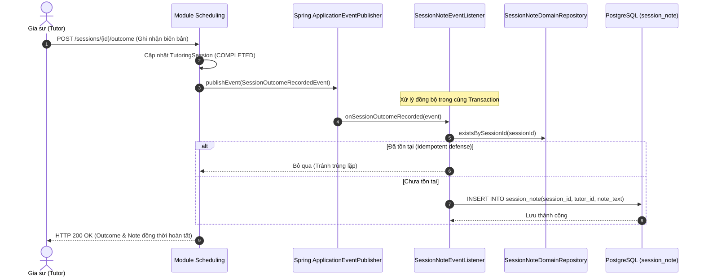

# KẾ HOẠCH HIỆN THỰC HÓA & GIẢI TRÌNH KIẾN TRÚC PHÂN HỆ PROGRESS (TIẾN ĐỘ HỌC TẬP & KẾ HOẠCH BÀI DẠY)
**Tài liệu Kỹ thuật Chuẩn Quốc tế Dành cho Thành viên Dự án & Đánh giá Mã Nguồn (Code Review)**

> **Phiên bản:** 1.0  
> **Phân hệ phụ trách:** `modules/progress` (EduFit Backend & Frontend Integration)  
> **Áp dụng cho:** Nhánh `feat/sprint3-progress-integration` tích hợp vào nền tảng EduFit  
> **Tài liệu đối chiếu:**  
> - [ADR-001: Tech Stack](file:///c:/University/Semester%205/SWP391/Edufit/EduFit/docs/ADR-001-tech-stack.md) & [ADR-002: Multi-Module Architecture](file:///c:/University/Semester%205/SWP391/Edufit/EduFit/docs/ADR-002-multi-module-architecture.md)  
> - [Backend Module Structure Guide (Loại 2 - Clean Architecture & DDD POJO Core)](file:///c:/University/Semester%205/SWP391/Edufit/EduFit/docs/backend-module-structure-guide.md)  
> - [Software Architecture Design Specification (Mục 9 - Progress & Learning Plan API)](file:///c:/University/Semester%205/SWP391/Edufit/EduFit/docs/software-architecture-design-specification.md)  
> - [SRS Edufit (UC5.1, UC5.2, UC5.3, UC5.4; FR-24 đến FR-27; BR-48 đến BR-55)](file:///c:/University/Semester%205/SWP391/Edufit/EduFit/docs/SRS%20Edufit.docx)  
> - [Master Test Plan & In-Development Testing Specification (Mục 7.5)](file:///c:/University/Semester%205/SWP391/Edufit/EduFit/docs/in-development-testing-specification.md)  
> - [V1.06__create_learning_plan_tables.sql](file:///c:/University/Semester%205/SWP391/Edufit/EduFit/backend/app/src/main/resources/db/migration/progress/V1.06__create_learning_plan_tables.sql)

---

## 1. Mục Tiêu & Bối Cảnh (Goal Description)

Phân hệ **Progress (Quản lý Tiến độ Học tập & Kế hoạch Bài giảng)** là "Hệ thống Minh bạch Hóa Sư phạm" (Pedagogical Transparency Engine) của EduFit. Phân hệ đóng vai trò then chốt giúp Phụ huynh và Học sinh trực tiếp theo dõi lộ trình tiến bộ thực tế, đối chiếu giữa mục tiêu đề ra (`LearningGoal`) và kết quả đạt được qua từng buổi dạy kèm.

Phân hệ giải quyết 4 bài toán nghiệp vụ trọng tâm:

1. **Thiết lập & Điều chỉnh Kế hoạch Bài giảng (Learning Plan & Milestones - UC5.1, UC5.2):**
   - Cho phép Gia sư tạo kế hoạch học tập độc quyền cho từng lớp học (`class_id`). Mỗi lớp học chỉ tồn tại **duy nhất một Kế hoạch học tập** (`uk_learning_plan_class`).
   - Kế hoạch bao gồm danh sách các Cột mốc (`Milestone`) có trọng số (`weight` từ 1 đến 5), ngày mục tiêu (`target_date`), và trạng thái tiến độ (`NOT_STARTED`, `IN_PROGRESS`, `ACHIEVED`).
   - Mọi thay đổi về cấu trúc kế hoạch hoặc cột mốc đều được lưu vết kiểm toán tự động trong bảng `plan_history`.

2. **Ghi nhận & Quản lý Nhật ký Buổi học Bất biến (Immutable Session Notes - UC5.3):**
   - Đón nhận sự kiện miền `SessionOutcomeRecordedEvent` từ phân hệ `Scheduling` một cách đồng bộ và tự động tạo bản ghi ghi chú buổi học (`session_note`).
   - Quy tắc bất biến: Mỗi buổi học (`session_id`) chỉ có đúng một ghi chú duy nhất (`uk_session_note_session`). Ghi chú được giới hạn tối đa 5000 ký tự (BR-51).

3. **Thuật toán Tính toán Tiến độ Học tập Định lượng (Quantitative Progress Algorithm - BR-52, BR-53):**
   - Tính toán tỷ lệ phần trăm tiến độ hoàn thành mục tiêu dựa trên trọng số các cột mốc đã đạt (`ACHIEVED`) trên tổng trọng số toàn kế hoạch:
     $$\text{Progress} = \frac{\sum \text{weight}_{\text{ACHIEVED}}}{\sum \text{weight}_{\text{TOTAL}}} \times 100\%$$
   - Khi kế hoạch chưa có cột mốc hoặc cột mốc bằng 0, thuật toán tự động fallback tính toán dựa trên tỷ lệ số buổi học hoàn thành so với cam kết ban đầu.

4. **Bảng Điều khiển Tổng hợp Minh bạch (Progress Dashboard - UC5.4):**
   - Cung cấp góc nhìn Dashboard 360 độ cho Học sinh và Phụ huynh (chỉ Phụ huynh có liên kết `CONFIRMED` mới được phép tra cứu hồ sơ con em - BR-55).
   - Cung cấp góc nhìn lịch sử giảng dạy và thống kê hoàn thành cột mốc cho Gia sư.

---

## 2. Giải Thích Chi Tiết: Từ Định Nghĩa Đến Cơ Chế Hoạt Động

### 2.1. Vòng Đời Kế Hoạch Học Tập & Kiểm Soát Xung Đột (Optimistic Locking)

Kế hoạch học tập có thể được Gia sư chỉnh sửa nhiều lần trong suốt quá trình dạy kèm. Để đảm bảo không xảy ra hiện tượng **Lost Update** khi hai phiên làm việc cùng sửa đổi các cột mốc, bảng `learning_plan` áp dụng cơ chế **Khóa lạc quan (Optimistic Locking)** qua trường `version`:

```
Client (Tutor) ──► PATCH /milestones/{id}/status ──► DB UPDATE WHERE plan_id = ? AND version = ?
                                                               │
                       ┌───────────────────────────────────────┴───────────────────────────────────────┐
                       ▼                                                                               ▼
              [version khớp: Thành công]                                                 [version lệch: Xung đột]
          version = version + 1 -> Commit                              ObjectOptimisticLockingFailureException -> HTTP 409
```

### 2.2. Tích Hợp Hướng Sự Kiện Đồng Bộ: Thu Nhận Session Note (UC5.3, BR-50)



### 2.3. Ma Trận Phân Quyền & Bảo Vệ Biên Giới (Security & IDOR Defense - BR-54, BR-55)

| Vai trò Actor | Tạo / Sửa Kế hoạch | Cập nhật Milestone | Xem Dashboard Học sinh | Xem Ghi chú Buổi học |
| :--- | :---: | :---: | :---: | :---: |
| **Gia sư (Tutor)** | ✅ (Chỉ lớp mình dạy) | ✅ (Chỉ lớp mình dạy) | ❌ | ✅ (Buổi dạy của mình) |
| **Học sinh (Student)** | ❌ (Chỉ đọc) | ❌ (Chỉ đọc) | ✅ (Chỉ bản thân mình) | ✅ (Buổi học của mình) |
| **Phụ huynh (Parent)** | ❌ (Chỉ đọc) | ❌ (Chỉ đọc) | ✅ (Chỉ khi link `CONFIRMED`) | ✅ (Khi link `CONFIRMED`) |
| **Quản trị viên (Admin)**| ❌ | ❌ | ✅ (Mục đích hỗ trợ) | ✅ (Mục đích giám sát) |

---

## 3. Cấu Trúc Lược Đồ Cơ Sở Dữ Liệu (Database Schema)

Lược đồ của module được định nghĩa tại file migration [`V1.06__create_learning_plan_tables.sql`](file:///c:/University/Semester%205/SWP391/Edufit/EduFit/backend/app/src/main/resources/db/migration/progress/V1.06__create_learning_plan_tables.sql):

```mermaid
erDiagram
    class ||--|| learning_plan : "has 1"
    tutoring_session ||--o| session_note : "has 1"
    learning_plan ||--o{ milestone : "contains"
    learning_plan ||--o{ plan_history : "tracks"
    
    learning_plan {
        uuid plan_id PK
        uuid class_id UK "FK -> class(class_id)"
        varchar summary
        int version "Optimistic Locking"
        timestamptz created_at
        timestamptz updated_at
    }
    
    milestone {
        uuid milestone_id PK
        uuid plan_id FK "-> learning_plan"
        varchar title
        text description
        date target_date
        smallint weight "1..5"
        varchar status "NOT_STARTED | IN_PROGRESS | ACHIEVED"
        date achieved_date
        boolean is_archived
        int sort_order
    }
    
    session_note {
        uuid note_id PK
        uuid session_id UK "FK -> tutoring_session"
        uuid tutor_id FK "-> tutor_profile"
        text note_text "max 5000 chars"
        timestamptz created_at
    }
    
    plan_history {
        uuid history_id PK
        uuid plan_id FK
        uuid milestone_id
        varchar action "CREATED | MILESTONE_ADDED | STATUS_CHANGED"
        uuid changed_by
        timestamptz changed_at
    }
```

---

## 4. Kiến Trúc Phân Tầng Chi Tiết (Layered Architecture)

Module `progress` tuân thủ chuẩn Clean Architecture với lõi Domain POJO độc lập:

```
vn.edufit.progress/
├── api/                                  <-- SPI Facade cho các module khác
│   └── ProgressFacade.java
├── domain/                               <-- Lõi Domain thuần túy (POJO)
│   ├── model/                            <-- LearningPlan, Milestone, SessionNote, PlanHistory
│   ├── policy/                           <-- ProgressCalculator (Tính toán tiến độ)
│   └── repository/                       <-- Domain Ports (LearningPlanDomainRepository, ...)
├── application/                          <-- Tầng điều phối Use Case
│   ├── service/                          <-- LearningPlanService, ProgressDashboardService, SessionNoteService
│   └── dto/                              <-- ProgressViews, Commands
├── infra/                                <-- Tầng Adapter hạ tầng
│   ├── persistence/
│   │   ├── entity/                       <-- JPA Entities (LearningPlanJpaEntity, ...)
│   │   ├── repository/                   <-- Spring Data JPA Repositories
│   │   ├── adapter/                      <-- Hiện thực Domain Repository Ports
│   │   └── mapper/                       <-- ProgressMapper (Entity <-> Domain)
│   └── listener/
│       └── SessionNoteEventListener.java <-- Đón nhận Domain Event từ Scheduling
└── web/                                  <-- Tầng REST Controller & DTOs
    ├── ProgressPlanController.java       <-- CRUD Kế hoạch & Milestones
    ├── ProgressDashboardController.java  <-- API Dashboard học sinh/gia sư
    ├── request/                          <-- CreatePlanRequest, UpdateMilestoneStatusRequest
    └── response/                         <-- PlanResponse, ProgressDashboardResponses
```

---

## 5. Danh Sách REST Endpoints (API Specification)

### 5.1. Kế Hoạch Học Tập & Cột Mốc
- **`POST /api/v1/progress/plans`**: Gia sư khởi tạo kế hoạch học tập mới cho lớp học.
  - *Quyền hạn:* `TUTOR` sở hữu lớp học.
  - *Request Body:* `CreatePlanRequest(classId, summary, milestones)`.
  - *Response:* HTTP 201 `PlanResponse`.
- **`GET /api/v1/progress/plans/class/{classId}`**: Tra cứu kế hoạch học tập theo lớp học.
  - *Quyền hạn:* Gia sư của lớp, Học sinh của lớp, hoặc Phụ huynh có liên kết `CONFIRMED`.
- **`PATCH /api/v1/progress/milestones/{milestoneId}/status`**: Cập nhật trạng thái cột mốc (`NOT_STARTED` $\rightarrow$ `IN_PROGRESS` $\rightarrow$ `ACHIEVED`).
  - *Quyền hạn:* `TUTOR` của lớp học.
  - *Request Body:* `UpdateMilestoneStatusRequest(status)`.

### 5.2. Dashboard Tiến Độ & Nhật Ký
- **`GET /api/v1/progress/dashboard/student/{studentId}`**: Lấy tổng quan Dashboard tiến độ học tập của học sinh.
  - *Quyền hạn:* Bản thân `STUDENT` hoặc `PARENT` có liên kết `CONFIRMED`.
  - *Response:* HTTP 200 `StudentProgressDashboardResponse` (Bao gồm danh sách lớp, tỷ lệ hoàn thành %, danh sách cột mốc sắp tới, timeline buổi học).
- **`GET /api/v1/progress/dashboard/tutor/{tutorId}`**: Lấy Dashboard giảng dạy của gia sư.
  - *Quyền hạn:* Bản thân `TUTOR`.
- **`GET /api/v1/progress/sessions/{sessionId}/note`**: Lấy chi tiết nhật ký buổi học.
  - *Quyền hạn:* Các bên liên quan trực tiếp đến buổi học.

---

## 6. Kế Hoạch Kiểm Thử & Kiểm Chứng Tự Động (Quality Gates)

| Nhóm Kiểm Thử | Suite / Lớp Kiểm Thử | Số Test Case | Tiêu Chuẩn Nghiệp Vụ Được Thẩm Định |
| :--- | :--- | :---: | :--- |
| **Domain Policy Unit Test** | `ProgressCalculatorTest` | 13 | Thuật toán tính trọng số milestone, trường hợp biên 0 milestone, fallback tính theo số buổi hoàn thành. |
| **Application Service Test** | `LearningPlanServiceTest` | 5 | Tạo kế hoạch học tập, cập nhật trạng thái milestone, ghi nhận lịch sử kiểm toán `plan_history`. |
| **Dashboard Query Test** | `ProgressDashboardServiceTest` | 3 | Kiểm tra phân quyền truy cập, tính toán danh sách lớp, hydrate dữ liệu hồ sơ. |
| **Event Listener Test** | `SessionNoteEventListenerTest` | 3 | Tính Idempotent chống ghi đè, cắt ngắn text quá 5000 ký tự, xử lý event rỗng. |
| **Controller MockMvc Test** | `ProgressPlanControllerTest`, `ProgressDashboardControllerTest` | 7 | Kiểm thử chuẩn HTTP 200, 201, 400, 403 (IDOR), 404 cho REST API. |
| **Tổng cộng module** | **100% Pass (Exit Code 0)** | **33/33** | **Đảm bảo 0 lỗi biên dịch, không dính lỗi bytecode Eclipse/ECJ.** |
