# KẾ HOẠCH TÁI CẤU TRÚC (REFACTOR PLAN): KHÔNG GIAN VAI TRÒ & MIỀN TÍNH NĂNG ĐÓNG GÓI
# (ROLE-BASED WORKSPACES, SCHEDULING & VERIFICATION REFACTOR PLAN)

> **Mã tài liệu:** EDUFIT-PORTAL-REFACTOR-PLAN-V1.0  
> **Dự án:** EduFit (SWP391 - Semester 5)  
> **Tài liệu tham chiếu:** [ADR-001 (Tech Stack)](../ADR-001-tech-stack.md), [ADR-002 (Multi-Module Architecture)](../ADR-002-multi-module-architecture.md), [Frontend Master Roadmap](../frontend-master-roadmap-and-architecture-plan.md), [Auth Refactor Plan (Đã hoàn thành)](auth_refactor_plan.md)  
> **Công nghệ:** Next.js 16 (App Router), React 19, TypeScript 5, Tailwind CSS v4, Zod, Vitest.  
> **Phạm vi kế hoạch:** Nối tiếp thành công của `auth_refactor_plan.md`, xử lý dứt điểm toàn bộ nợ kỹ thuật còn lại của Phase 1 Demo: xóa bỏ thư mục monolithic `app/dashboard/`, chuyển đổi sang kiến trúc **Role-Based Workspaces (`app/student`, `app/tutor`, `app/parent`, `app/admin`)**, chuẩn hóa `features/verification` và `features/scheduling` theo mô hình **Package-by-Feature (FSD)**.

---

## 1. Goal Description (Mục Tiêu & Bối Cảnh Thực Tế)

Sau khi tái cấu trúc thành công miền xác thực `features/auth` và `app/(auth)/`, codebase hiện tại vẫn còn tồn đọng kiến trúc chắp vá của giai đoạn **Phase 1 Demo PoC** (kế hoạch cũ `frontend-phase1-demo-and-figma-refactor-plan.md`):

1. **Anti-pattern "God Route" tại `app/dashboard/`:**
   * Thay vì phân tách không gian làm việc theo vai trò, người làm trước đã nhồi nhét tất cả màn hình sau đăng nhập vào chung một prefix URL `/dashboard/*`: `/dashboard/schedule`, `/dashboard/verification`, `/dashboard/kyc-queue`, `/dashboard/profile`.
   * Trang `app/dashboard/page.tsx` là một khối khổng lồ đóng vai trò "Role Switcher" chạy câu lệnh `switch (user.role)` để render các view khác nhau, vi phạm nguyên tắc Single Responsibility.
   * Mỗi trang con (`schedule/page.tsx`, `verification/page.tsx`) đều phải tự lặp lại việc kiểm tra session và tự bọc thủ công thẻ `<DashboardShell>`, phá vỡ cơ chế Nested Layouts nguyên bản của Next.js App Router.
2. **Miền `features/verification` và `features/schedule` chưa đạt chuẩn Clean Architecture:**
   * Thư mục `features/schedule/` hiện tại chỉ có 1 component duy nhất, thiếu Public API (`index.ts`), thiếu `types/`, và chưa đồng bộ tên gọi chuẩn `features/scheduling/` theo Master Roadmap Sprint 3.
   * Thư mục `features/verification/` chứa logic nộp bằng cấp (KYC) đang viết thẳng trong JSX component (`UploadCredentialModal.tsx` > 250 dòng), thiếu Zod schemas kiểm định tệp tin và thông tin bằng cấp, thiếu headless hooks, thiếu Public API Gateway (`index.ts`), và có 0 unit test.
3. **Mâu thuẫn với Kiến Trúc Tổng Thể [Frontend Master Roadmap](../frontend-master-roadmap-and-architecture-plan.md):**
   * Master Roadmap quy định rõ ràng cấu trúc phân quyền theo thư mục vai trò: `app/student/`, `app/tutor/`, `app/parent/`, `app/admin/`.

**Mục tiêu của kế hoạch này:**
* **Xóa hoàn toàn** tài liệu tạm thời `frontend-phase1-demo-and-figma-refactor-plan.md`.
* **Xóa bỏ hoàn toàn** thư mục cũ `app/dashboard/` và các trang con bên trong.
* **Xây dựng hệ thống Role Workspaces chuẩn mực:** `app/student/`, `app/tutor/`, `app/parent/`, `app/admin/` với các `layout.tsx` đóng vai trò **Role Guards** và tự động lồng `DashboardShell`.
* **Chuẩn hóa Package-by-Feature** cho `features/scheduling`, `features/verification`, `features/profile`, `features/dashboard` với đầy đủ `index.ts`, `schemas`, `hooks`, `types`.
* Đảm bảo **100% build sạch (0 lỗi TypeScript)** và **100% test Vitest pass**.

---

## 2. Nền Tảng Kiến Trúc: Cơ Chế Role Workspace & Nested Layouts

```mermaid
flowchart TD
    subgraph APP["TẦNG ĐỊNH TUYẾN MỎNG (src/app/)"]
        subgraph STUDENT["app/student/ (Không gian Học sinh)"]
            SLayout["layout.tsx\n(Guard role: STUDENT, Bọc Shell)"]
            SDash["dashboard/page.tsx\n(URL: /student/dashboard)"]
            SProf["profile/page.tsx\n(URL: /student/profile)"]
            SSched["schedule/page.tsx\n(URL: /student/schedule)"]
        end

        subgraph TUTOR["app/tutor/ (Không gian Gia sư)"]
            TLayout["layout.tsx\n(Guard role: TUTOR, Bọc Shell)"]
            TDash["dashboard/page.tsx\n(URL: /tutor/dashboard)"]
            TProf["profile/page.tsx\n(URL: /tutor/profile)"]
            TVerif["verification/page.tsx\n(URL: /tutor/verification)"]
            TSched["schedule/page.tsx\n(URL: /tutor/schedule)"]
        end

        subgraph ADMIN["app/admin/ (Không gian Quản trị viên)"]
            ALayout["layout.tsx\n(Guard role: ADMIN, Bọc Shell)"]
            ADash["dashboard/page.tsx\n(URL: /admin/dashboard)"]
            AKyc["verification-queue/page.tsx\n(URL: /admin/verification-queue)"]
        end

        subgraph PARENT["app/parent/ (Không gian Phụ huynh)"]
            PLayout["layout.tsx\n(Guard role: PARENT, Bọc Shell)"]
            PDash["dashboard/page.tsx\n(URL: /parent/dashboard)"]
            PProf["profile/page.tsx\n(URL: /parent/profile)"]
        end
    end

    subgraph FEATURES["TẦNG NGHIỆP VỤ ĐÓNG GÓI (src/features/)"]
        AuthF["features/auth/\n(Đã chuẩn hóa)"]
        DashF["features/dashboard/\n(index.ts, StudentDashboardView, TutorDashboardView...)"]
        VerifF["features/verification/\n(schemas, hooks, components, api, index.ts)"]
        SchedF["features/scheduling/\n(components, types, index.ts)"]
        ProfF["features/profile/\n(components, index.ts)"]
    end

    SDash --> DashF
    TDash --> DashF
    PDash --> DashF
    ADash --> DashF

    SProf --> ProfF
    TProf --> ProfF
    PProf --> ProfF

    SSched --> SchedF
    TSched --> SchedF

    TVerif --> VerifF
    AKyc --> VerifF
```



### Tại sao kiến trúc này ưu việt hơn cách cũ?
1. **Layout Guard 1 Lần Duy Nhất (Single Point of Defense):** `app/student/layout.tsx` kiểm tra quyền `STUDENT`. Toàn bộ các trang con bên trong (`dashboard`, `profile`, `schedule`) tự động được bảo vệ và tự động nằm trong Sidebar/TopHeader mà **không cần viết lại một dòng code kiểm tra quyền hay bọc Shell nào**!
2. **Loại bỏ Hoàn toàn God Component:** `app/student/dashboard/page.tsx` chỉ có ~10 dòng:
   ```tsx
   import { StudentDashboardView } from "@/features/dashboard";
   export default function StudentDashboardPage() {
     return <StudentDashboardView />;
   }
   ```
3. **Phân chia Trách nhiệm & Git Flow Hoàn hảo:** Mỗi thành viên phụ trách một vai trò chỉ thao tác trong thư mục của vai trò đó, triệt tiêu 100% rủi ro merge conflicts.

---

## 3. User Review Required (Những Thay Đổi Cần Lưu Ý)

> [!IMPORTANT]
> **1. Thay Đổi Cấu Trúc URL Hệ Thống:**
> * URL Dashboard cũ: `/dashboard` $\longrightarrow$ **URL Mới:** `/student/dashboard`, `/tutor/dashboard`, `/parent/dashboard`, `/admin/dashboard`.
> * URL Duyệt KYC cũ: `/dashboard/kyc-queue` $\longrightarrow$ **URL Mới:** `/admin/verification-queue`.
> * URL Nộp KYC cũ: `/dashboard/verification` $\longrightarrow$ **URL Mới:** `/tutor/verification`.
> * URL Hồ sơ cũ: `/dashboard/profile` $\longrightarrow$ **URL Mới:** `/student/profile`, `/tutor/profile`, `/parent/profile`.
> * URL Lịch học cũ: `/dashboard/schedule` $\longrightarrow$ **URL Mới:** `/student/schedule`, `/tutor/schedule`.
>
> **2. Tự Động Điều Hướng Hậu Đăng Nhập:**
> Logic điều hướng trong `useLoginForm.ts` sẽ chuyển hướng đúng vai trò:
> * Học sinh $\rightarrow$ `/student/dashboard`
> * Gia sư $\rightarrow$ `/tutor/dashboard`
> * Phụ huynh $\rightarrow$ `/parent/dashboard`
> * Quản trị viên $\rightarrow$ `/admin/verification-queue` (hoặc `/admin/dashboard`)
>
> **3. Đổi tên Thư mục Feature:**
> Đổi tên `src/features/schedule` $\longrightarrow$ `src/features/scheduling` để đồng bộ chính xác với tên phân hệ Sprint 3 trong Master Roadmap.

---

## 4. Open Questions

> [!NOTE]
> * **Câu hỏi 1 (Tùy chọn tương lai):** Đối với trang Lịch học (`schedule`), Master Roadmap có đề cập tuyến chung `app/(learner)/calendar/page.tsx` cho cả Student và Parent. Trong kế hoạch này, ta tạo `/student/schedule` và `/tutor/schedule` để các role truy cập trực tiếp qua Sidebar hiện tại. Sau này ở Sprint 3 khi làm sâu tính năng Parent-Student Linking, ta có thể mở rộng thêm `(learner)/calendar` mà không ảnh hưởng gì.

---

## 5. Proposed Changes (Chi Tiết Từng Tệp Tin Sẽ Thay Đổi)

### Component 1: Dọn Dẹp Tài Liệu & Xóa Kế Hoạch Phase 1 Demo

#### [DELETE] `docs/refactor/frontend-phase1-demo-and-figma-refactor-plan.md`
Xóa bỏ hoàn toàn file kế hoạch tạm thời này để triệt tiêu nguồn cơn của sự lệch pha kiến trúc.

#### [NEW] `docs/refactor/role_portal_and_features_refactor_plan.md`
Lưu trữ bản kế hoạch kiến trúc chuẩn này trong thư mục tài liệu dự án.

---

### Component 2: Chuẩn Hóa Miền Nghiệp Vụ (Features Layer)

#### 1. Miền Lịch Học: `src/features/scheduling/` (Đổi tên từ `features/schedule/`)
* **[MOVE]** `frontend/src/features/schedule/components/ScheduleCalendarView.tsx` $\longrightarrow$ `frontend/src/features/scheduling/components/ScheduleCalendarView.tsx`
* **[NEW]** `frontend/src/features/scheduling/types/index.ts`:
  Định nghĩa kiểu dữ liệu cho view lịch học: `ScheduleCalendarViewProps`.
* **[NEW]** `frontend/src/features/scheduling/index.ts`:
  Public API Gateway xuất khẩu `ScheduleCalendarView` và types.
* **[DELETE]** Thư mục cũ `frontend/src/features/schedule/`.

#### 2. Miền Xác Minh Bằng Cấp: `src/features/verification/`
* **[NEW]** `frontend/src/features/verification/schemas/kycSchemas.ts`:
  Zod Schema chuẩn hóa:
  * `credentialUploadSchema`: Validate loại tài liệu (`DEGREE`, `TEACHING_LICENCE`, `STUDENT_CARD`, `CERTIFICATE`, `OTHER`), tên trường (`institution`, min 2), năm tốt nghiệp (1970..năm hiện tại), ghi chú (max 500).
  * `kycReviewSchema`: Validate quyết định duyệt (`status`: `VERIFIED` | `REJECTED`), lý do từ chối (bắt buộc khi REJECTED).
  * Helper `validateCredentialFile(file)`: Kiểm tra định dạng (PDF, JPG, PNG) và kích thước (< 10MB) độc lập.
* **[NEW]** `frontend/src/features/verification/types/index.ts`:
  Re-export types suy luận từ Zod và các types từ `services/verification.ts`.
* **[NEW]** `frontend/src/features/verification/hooks/useKycUpload.ts`:
  Headless hook quản lý trạng thái form upload bằng cấp, validate Zod, nộp `FormData` lên server, quản lý danh sách file đính kèm.
* **[NEW]** `frontend/src/features/verification/hooks/useAdminKycQueue.ts`:
  Headless hook quản lý danh sách duyệt KYC của Admin, reload dữ liệu, mở modal review và submit kết quả.
* **[MODIFY]** `frontend/src/features/verification/components/UploadCredentialModal.tsx`:
  Tinh gọn thành Dumb UI, kết nối trực tiếp với `useKycUpload()`.
* **[MODIFY]** `frontend/src/features/verification/components/AdminKycQueueView.tsx`:
  Tinh gọn, kết nối với `useAdminKycQueue()`, loại bỏ dữ liệu demo hardcoded gán cứng khi lỗi mạng.
* **[NEW]** `frontend/src/features/verification/index.ts`:
  Public API Gateway xuất khẩu:
  ```typescript
  export { TutorVerificationBanner } from "./components/TutorVerificationBanner";
  export { UploadCredentialModal } from "./components/UploadCredentialModal";
  export { AdminKycQueueView } from "./components/AdminKycQueueView";
  export { ReviewKycModal } from "./components/ReviewKycModal";
  export { useKycUpload } from "./hooks/useKycUpload";
  export { useAdminKycQueue } from "./hooks/useAdminKycQueue";
  export * from "./schemas/kycSchemas";
  export * from "./types";
  ```

#### 3. Miền Hồ Sơ: `src/features/profile/`
* **[NEW]** `frontend/src/features/profile/index.ts`:
  Public API Gateway xuất khẩu các form:
  ```typescript
  export { StudentProfileForm } from "./components/StudentProfileForm";
  export { TutorProfileForm } from "./components/TutorProfileForm";
  export { ParentProfileForm } from "./components/ParentProfileForm";
  export { AdminProfileForm } from "./components/AdminProfileForm";
  ```

#### 4. Miền Dashboard: `src/features/dashboard/`
* **[NEW]** `frontend/src/features/dashboard/index.ts`:
  Public API Gateway xuất khẩu các View tổng quan:
  ```typescript
  export { StudentDashboardView } from "./components/student/StudentDashboardView";
  export { TutorDashboardView } from "./components/tutor/TutorDashboardView";
  export { ParentDashboardView } from "./components/parent/ParentDashboardView";
  export { AdminDashboardView } from "./components/admin/AdminDashboardView";
  ```

---

### Component 3: Xây Dựng Tầng Định Tuyến Không Gian Vai Trò (`app/` Role Spaces)

#### 1. Không Gian Học Sinh: `frontend/src/app/student/`
* **[NEW]** `frontend/src/app/student/layout.tsx`:
  Role Guard kiểm tra session: Nếu chưa đăng nhập $\rightarrow$ `/login`; nếu không phải `STUDENT` $\rightarrow$ chuyển hướng sang không gian vai trò của họ. Bọc `<DashboardShell role="STUDENT">`.
* **[NEW]** `frontend/src/app/student/dashboard/page.tsx`:
  URL: `/student/dashboard`. Render `<StudentDashboardView />`.
* **[NEW]** `frontend/src/app/student/profile/page.tsx`:
  URL: `/student/profile`. Render `<StudentProfileForm />`.
* **[NEW]** `frontend/src/app/student/schedule/page.tsx`:
  URL: `/student/schedule`. Render `<ScheduleCalendarView role="STUDENT" />`.

#### 2. Không Gian Gia Sư: `frontend/src/app/tutor/`
* **[NEW]** `frontend/src/app/tutor/layout.tsx`:
  Role Guard kiểm tra session: Nếu không phải `TUTOR` $\rightarrow$ chuyển hướng. Bọc `<DashboardShell role="TUTOR">`.
* **[NEW]** `frontend/src/app/tutor/dashboard/page.tsx`:
  URL: `/tutor/dashboard`. Render `<TutorDashboardView />`.
* **[NEW]** `frontend/src/app/tutor/profile/page.tsx`:
  URL: `/tutor/profile`. Render `<TutorProfileForm />`.
* **[NEW]** `frontend/src/app/tutor/verification/page.tsx`:
  URL: `/tutor/verification`. Render trang quản lý nộp bằng cấp KYC của Gia sư.
* **[NEW]** `frontend/src/app/tutor/schedule/page.tsx`:
  URL: `/tutor/schedule`. Render `<ScheduleCalendarView role="TUTOR" />`.

#### 3. Không Gian Phụ Huynh: `frontend/src/app/parent/`
* **[NEW]** `frontend/src/app/parent/layout.tsx`:
  Role Guard kiểm tra session: Guard `PARENT`. Bọc `<DashboardShell role="PARENT">`.
* **[NEW]** `frontend/src/app/parent/dashboard/page.tsx`:
  URL: `/parent/dashboard`. Render `<ParentDashboardView />`.
* **[NEW]** `frontend/src/app/parent/profile/page.tsx`:
  URL: `/parent/profile`. Render `<ParentProfileForm />`.

#### 4. Không Gian Quản Trị Viên: `frontend/src/app/admin/`
* **[NEW]** `frontend/src/app/admin/layout.tsx`:
  Role Guard kiểm tra session: Guard `ADMIN`. Bọc `<DashboardShell role="ADMIN">`.
* **[NEW]** `frontend/src/app/admin/dashboard/page.tsx`:
  URL: `/admin/dashboard`. Render `<AdminDashboardView />`.
* **[NEW]** `frontend/src/app/admin/verification-queue/page.tsx`:
  URL: `/admin/verification-queue`. Render `<AdminKycQueueView />` để duyệt hồ sơ.

---

### Component 4: Xóa Bỏ Hoàn Toàn Tầng `app/dashboard/` Cũ

* **[DELETE]** `frontend/src/app/dashboard/schedule/page.tsx`
* **[DELETE]** `frontend/src/app/dashboard/verification/page.tsx`
* **[DELETE]** `frontend/src/app/dashboard/kyc-queue/page.tsx`
* **[DELETE]** `frontend/src/app/dashboard/profile/page.tsx`
* **[DELETE]** `frontend/src/app/dashboard/page.tsx`
* **[DELETE]** Thư mục `frontend/src/app/dashboard/`

---

### Component 5: Cập Nhật Điều Hướng Toàn Hệ Thống & Shared UI

#### 1. Cập Nhật `frontend/src/shared/ui/Sidebar.tsx`
* Cập nhật `ROLE_NAV_CONFIG`:
  * **STUDENT:**
    * Dashboard: `/student/dashboard`
    * Lịch học tuần: `/student/schedule`
    * Hồ sơ học tập: `/student/profile`
    * Tiến độ học tập: `/student/progress`
  * **TUTOR:**
    * Dashboard: `/tutor/dashboard`
    * Xác minh bằng cấp: `/tutor/verification`
    * Lịch dạy: `/tutor/schedule`
    * Hồ sơ & Môn dạy: `/tutor/profile`
  * **PARENT:**
    * Dashboard: `/parent/dashboard`
    * Lịch học gia đình: `/parent/schedule`
    * Hồ sơ: `/parent/profile`
  * **ADMIN:**
    * Tổng quan: `/admin/dashboard`
    * Duyệt bằng cấp KYC: `/admin/verification-queue`
* Cập nhật logo EduFit href: `href={`/${role.toLowerCase()}/dashboard#dashboard-top`}`.

#### 2. Cập Nhật Post-Auth Navigation trong `features/auth/hooks/useLoginForm.ts`
* Hàm `resolvePostLoginRedirect(user)`:
  * `STUDENT` $\rightarrow$ `/student/dashboard`
  * `TUTOR` $\rightarrow$ `/tutor/dashboard`
  * `PARENT` $\rightarrow$ `/parent/dashboard`
  * `ADMIN` $\rightarrow$ `/admin/verification-queue` (hoặc `/admin/dashboard`)

#### 3. Cập Nhật Onboarding Wizards
* Cập nhật `StudentOnboardingWizard.tsx`: Chuyển hướng tới `/student/dashboard`.
* Cập nhật `TutorOnboardingWizard.tsx`: Chuyển hướng tới `/tutor/dashboard`.
* Cập nhật `ParentOnboardingWizard.tsx`: Chuyển hướng tới `/parent/dashboard`.

---

### Component 6: Kiểm Thử Tự Động (Automated Testing)

#### [NEW] `frontend/src/__tests__/schemas/kycSchemas.test.ts`
* Unit test Zod schemas cho KYC:
  * Test case 1: Validate từ chối khi tên trường dưới 2 ký tự.
  * Test case 2: Validate từ chối khi năm tốt nghiệp ngoài phạm vi hợp lệ.
  * Test case 3: Validate file quá dung lượng 10MB hoặc sai đuôi mở rộng.
  * Test case 4: Validate review modal bắt buộc nhập lý do từ chối khi REJECTED.

---

## 6. Verification Plan (Kế Hoạch Xác Minh)

### 6.1. Automated Tests
Chạy toàn bộ các lệnh kiểm tra từ thư mục `frontend`:

1. **Kiểm tra Type TypeScript:**
   ```bash
   cd frontend
   npm run type-check
   ```
   *Yêu cầu:* Thoát với mã 0 (`Exit code 0`), 0 lỗi Type error.

2. **Chạy Bộ Kiểm Thử Vitest:**
   ```bash
   cd frontend
   npm test
   ```
   *Yêu cầu:* Toàn bộ test suites (bao gồm auth schemas, kyc schemas, availabilitySlotUtils) đều **PASSED 100%**.

3. **Kiểm tra Biên Dịch Build Next.js:**
   ```bash
   cd frontend
   npm run build
   ```
   *Yêu cầu:* Build thành công 100%, Next.js tạo đúng danh sách static/dynamic routes cho:
   * `/student/dashboard`, `/student/profile`, `/student/schedule`
   * `/tutor/dashboard`, `/tutor/profile`, `/tutor/verification`, `/tutor/schedule`
   * `/parent/dashboard`, `/parent/profile`
   * `/admin/dashboard`, `/admin/verification-queue`

### 6.2. Manual Verification (Kiểm Thử Thực Tế)
Khởi động dev server: `npm run dev`

1. **Đăng nhập Học sinh (Quick Login Pills `[Học sinh]`):**
   * Đăng nhập thành công $\rightarrow$ Chuyển hướng tới `http://localhost:3000/student/dashboard`.
   * Menu sidebar hiển thị "Cổng Học Sinh", click "Lịch học tuần" $\rightarrow$ Chuyển tới `/student/schedule`.
   * Cố tình gõ URL `http://localhost:3000/tutor/dashboard` $\rightarrow$ Bị chặn và tự động đưa về `/student/dashboard`.
2. **Đăng nhập Gia sư (Quick Login Pills `[Gia sư]`):**
   * Đăng nhập thành công $\rightarrow$ Chuyển hướng tới `http://localhost:3000/tutor/dashboard`.
   * Click menu "Xác minh bằng cấp" $\rightarrow$ Mở trang `http://localhost:3000/tutor/verification`. Nộp thử giấy tờ xác minh.
3. **Đăng nhập Quản trị viên (Quick Login Pills `[Admin]`):**
   * Đăng nhập thành công $\rightarrow$ Chuyển hướng tới `http://localhost:3000/admin/verification-queue`.
   * Xem hàng đợi duyệt KYC gia sư.
