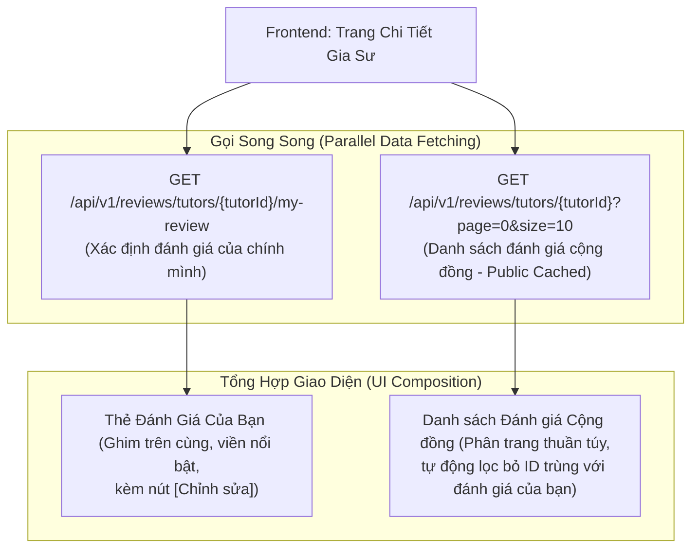
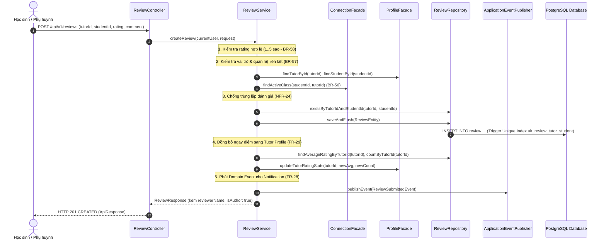

# KẾ HOẠCH HIỆN THỰC HÓA & GIẢI TRÌNH KIẾN TRÚC PHÂN HỆ REVIEW (ĐÁNH GIÁ GIA SƯ)
**Tài liệu Kỹ thuật Chuẩn Quốc tế Dành cho Thành viên Dự án & Đánh giá Mã Nguồn (Code Review)**

> **Phiên bản:** 1.0  
> **Phân hệ phụ trách:** `modules/review` (EduFit Backend & Frontend Feature)  
> **Áp dụng cho:** Nhánh `feature/review` tích hợp vào nền tảng EduFit  
> **Tài liệu đối chiếu:**  
> - [ADR-002: Multi-Module Architecture](file:///c:/University/Semester%205/SWP391/Edufit/EduFit/docs/ADR-002-multi-module-architecture.md)
> - [Backend Module Structure Guide (Loại 1 - Standard / Pragmatic Module)](file:///c:/University/Semester%205/SWP391/Edufit/EduFit/docs/backend-module-structure-guide.md)
> - [Software Architecture Design Specification (Mục 8 - Review API)](file:///c:/University/Semester%205/SWP391/Edufit/EduFit/docs/software-architecture-design-specification.md)
> - [SRS Edufit (UC6.1, UC6.2, BR-56, BR-57, BR-58, BR-59, BR-60, NFR-24, NFR-25)](file:///c:/University/Semester%205/SWP391/Edufit/EduFit/docs/SRS%20Edufit.docx)
> - [Master Test Plan & In-Development Testing Specification (Mục 7.5)](file:///c:/University/Semester%205/SWP391/Edufit/EduFit/docs/in-development-testing-specification.md)

---

## 1. Mục Tiêu & Bối Cảnh (Goal Description)

Phân hệ **Review (Đánh giá & Xếp hạng Gia sư)** là "Hạt nhân Xây dựng Niềm tin Cộng đồng" (Social Proof Engine) của nền tảng EduFit. Phân hệ chịu trách nhiệm thu thập, xác thực, lưu trữ và tổng hợp phản hồi từ người học thực tế để phục vụ 3 mục tiêu chiến lược:

1. **Minh bạch hóa Chất lượng Giảng dạy (Quality Assurance - UC6.1, UC6.2):**
   - Cho phép Học sinh hoặc Phụ huynh đại diện gửi nhận xét chi tiết (10 - 1000 ký tự) và chấm điểm sao (1 - 5 sao) sau khi đã trải nghiệm buổi học thực tế với Gia sư.
   - Bảo đảm nguyên tắc công bằng: **Duy nhất 1 đánh giá cho mỗi cặp Học sinh - Gia sư (BR-57, NFR-24)** để triệt tiêu nạn spam, cày điểm ảo (Review Inflation) hoặc dìm hàng ác ý (Review Bombing).

2. **Cung cấp Trọng số Động cho Thuật toán Gợi ý Gia sư (Discovery & Matching Integration - FR-29):**
   - Tính toán điểm đánh giá trung bình cộng học thuật ($\text{rating\_avg}$) và tổng số lượt đánh giá ($\text{review\_count}$).
   - Đồng bộ ngay lập tức sang bảng `tutor_profile` để cấp dữ liệu thời gian thực cho thuật toán xếp hạng `MatchScorer` và bộ lọc tìm kiếm công khai `Discovery`.

3. **Tối ưu Hóa Trải Nghiệm Người Dùng (Modern Float-to-Top UX):**
   - Cung cấp cơ chế hiển thị định danh minh bạch (hiển thị tên người đánh giá có kiểm soát) nhằm tăng tối đa độ tin cậy cho phụ huynh mới tham khảo, đồng thời bảo vệ tuyệt đối các định danh nội bộ nhạy cảm.
   - Ghim đánh giá của chính người dùng lên đầu danh sách (`GET /tutors/{id}/my-review`), giúp họ dễ dàng theo dõi và chỉnh sửa mà không cần lật tìm qua nhiều trang phân trang.

Mã nguồn tuân thủ nghiêm ngặt **Kiến trúc Đa module Chuẩn Loại 1 (Standard / Pragmatic Module)**: Tầng `application/service/` thao tác trực tiếp với `ReviewEntity`, giao tiếp với các module khác thông qua **Public Facades** và **Domain Events**, hoàn toàn vượt qua 100% quy tắc kiểm định tĩnh của **ArchUnit**.

---

## 2. Giải Thích Chi Tiết: Từ Định Nghĩa Đến Cơ Chế Hoạt Động

### 2.1. Ràng Buộc Độc Nhất 1 Đánh Giá / Cặp (BR-57 & NFR-24)

#### Khái niệm & Rủi ro thực tế:
Trong các nền tảng giáo dục, nguy cơ lớn nhất là phụ huynh/học sinh sau mỗi buổi học lại viết một đánh giá mới hoặc spam hàng loạt đánh giá để kéo điểm gia sư. Ngược lại, khi xảy ra bất đồng, một gia đình có thể dùng cả tài khoản học sinh và tài khoản phụ huynh để đánh giá tiêu cực 2 lần (Double-Penalization).

#### Cơ chế phòng vệ 2 tầng (Two-Tier Integrity Defense):
```
[Client Request: POST /api/v1/reviews]
                  │
                  ▼
┌─────────────────────────────────────────────────────────────┐
│ 1. TẦNG ỨNG DỤNG (Application Layer Check)                 │
│ reviewRepository.existsByTutorIdAndStudentId(...)           │
│ ➔ Bắt sớm lỗi 409 Conflict: REVIEW_ALREADY_EXISTS           │
└────────────────────────┬────────────────────────────────────┘
                         │ (Nếu 2 request đồng thời lọt qua)
                         ▼
┌─────────────────────────────────────────────────────────────┐
│ 2. TẦNG CƠ SỞ DỮ LIỆU (PostgreSQL Database Engine)          │
│ CREATE UNIQUE INDEX uk_review_tutor_student                 │
│   ON review (tutor_id, student_id);                         │
│ ➔ Database chặn đứng Race Condition, ném Unique Violation   │
│ ➔ ReviewService bắt DataIntegrityViolationException         │
└─────────────────────────────────────────────────────────────┘
```

---

### 2.2. Tiến Hóa từ "Ẩn Danh Hoàn Toàn" sang "Minh Bạch Định Danh Có Kiểm Soát" (Điều chỉnh BR-59 & NFR-25)

#### Hạn chế của BR-59 cũ:
Đặc tả ban đầu trong SRS yêu cầu: *"Ẩn danh hoàn toàn: Không hiển thị tên của người đánh giá ra công khai hoặc cho gia sư"*. Tuy nhiên, trong thực tế phát triển sản phẩm:
- Các đánh giá chỉ hiển thị chung chung là *"Học sinh"* hoặc *"Phụ huynh"* tạo cảm giác web "ảo", thiếu minh bạch, phụ huynh mới nghi ngờ hệ thống tự sinh dữ liệu (fake seeded reviews).
- Làm mất đi giá trị xã hội (Social Proof) của việc học sinh thật chia sẻ câu chuyện thành công với gia sư thật.

#### Giải pháp "Minh Bạch Có Kiểm Soát" (Controlled Social Proof):
1. **Hiển thị Tên Thật (Display Name):** Trả về tên hiển thị thực tế (ví dụ: *"Nguyễn Minh Anh"* hoặc *"Chị Thu Hà (Phụ huynh bé Nam)"*) được đồng bộ an toàn từ `ProfileFacade`.
2. **Ẩn Tuyệt Đối Dữ Liệu Nội Bộ Nhạy Cảm (Privacy Guardrails):**
   - **Tuyệt đối không để lộ:** `reviewerUserId` (UUID của tài khoản người dùng), `email`, `phoneNumber`, hoặc mật khẩu.
   - **Thay thế bằng cờ ngữ cảnh `isAuthor: boolean`:** Backend kiểm tra `currentUser` của phiên đăng nhập hiện tại với `reviewerUserId` trong DB. Nếu trùng khớp thì trả `isAuthor = true`. Frontend dựa vào cờ này để bật nút **[Sửa]** mà không cần biết `reviewerUserId` của người khác.
3. **Mở đường cho tính năng tương lai (Future-Proof):** Trả về `studentId` (Public Profile ID của học sinh). Trong tương lai khi phát triển tính năng xem Portfolio học sinh, Frontend chỉ việc gắn link điều hướng mà không cần sửa cấu trúc API.

---

### 2.3. Tối Ưu Hóa Trải Nghiệm Ghim Đánh Giá Của Bản Thân (Float-to-Top / Pinned Review Pattern)

#### Thách thức thiết kế:
Nếu đưa đánh giá của chính người dùng lên đầu danh sách bằng cách can thiệp vào câu lệnh `ORDER BY` của truy vấn phân trang:
- Sẽ phá vỡ tính nhất quán của `Pageable` của Spring Data khi người dùng chuyển sang trang 2, trang 3.
- Gây khó khăn cho việc đánh chỉ mục (Database Indexing) và Cache HTTP vì mỗi người dùng lại có một thứ tự phân trang khác nhau.

#### Kiến trúc 2 Luồng Độc Lập (Dual-Stream Strategy):


---

### 2.4. Đồng Bộ Điểm Đánh Giá Ngay Lập Tức Sang Hồ Sơ Gia Sư (FR-29 & Discovery Sync)

#### Tại sao `tutor_profile` cần lưu sẵn `rating_avg` và `review_count` (Denormalization)?
Trong bảng `tutor_profile`, 2 cột `rating_avg DECIMAL(3,2)` và `review_count INT` được lưu sẵn (Denormalized) và đánh index (`idx_tutor_profile_rating`) để phục vụ hàng ngàn lượt tìm kiếm, lọc và thuật toán matching chạy trong vài mili-giây. Nếu mỗi lần tìm kiếm gia sư hệ thống lại phải chạy `SELECT AVG(rating) FROM review GROUP BY tutor_id`, cơ sở dữ liệu sẽ sụp đổ khi lượng dữ liệu lớn.

#### Cơ chế đồng bộ nguyên tử (Atomic Synchronization):
Khi `ReviewService.createReview` hoặc `ReviewService.updateReview` thực thi:
1. Ghi bản ghi review vào bảng `review`.
2. Tính toán lại `averageRating` và `totalReviews` của gia sư đó.
3. Gọi `profileFacade.updateTutorRatingStats(tutorId, avg, count)` ngay trong **cùng một Transaction (`@Transactional`)**.
4. Phát `ReviewSubmittedEvent` hoặc `ReviewUpdatedEvent` để các module ngầm (như `Notification`) bắt sự kiện bất đồng bộ.

---

### 2.5. Đơn Giản Hóa Ràng Buộc Hủy Liên Kết Phụ Huynh (Điều chỉnh BR-60 theo YAGNI)

- **Đặc tả ban đầu (BR-60):** Nếu tác giả là Phụ huynh nhưng sau này quan hệ liên kết với con bị thu hồi (`REVOKED`), hệ thống chặn quyền sửa review.
- **Quyết định điều chỉnh (Pragmatic Decision):**
  - Đánh giá phản ánh đúng trải nghiệm học tập có thật đã diễn ra trong quá khứ.
  - Việc truy vấn kiểm tra trạng thái liên kết mỗi khi sửa review tạo ra phụ thuộc chéo nặng nề giữa `review` và `connection`.
  - **Quy tắc thống nhất:** Chỉ cần người gửi yêu cầu sửa đúng là tài khoản đã viết đánh giá đó (`review.reviewerUserId.equals(currentUser.userId)`), hệ thống cho phép chỉnh sửa.

---

## 3. Bản Đồ Tích Hợp Đa Phân Hệ (System Architecture & Workflows)

### 3.1. Sơ Đồ Trình Tự Tạo Đánh Giá (Sequence Diagram: Submit Review)



---

### 3.2. Ma Trận Phân Định Trách Nhiệm Giữa Các Module (Module Boundary RACI Matrix)

| Hành động Nghiệp vụ | `review` | `profile` | `connection` | `scheduling` | `notification` |
| :--- | :---: | :---: | :---: | :---: | :---: |
| **Lưu & quản lý bình luận, số sao** | **A / R** | I | I | I | I |
| **Xác thực tồn tại của Học sinh & Gia sư** | C | **A / R** | I | I | I |
| **Lấy tên hiển thị (Display Name)** | C | **A / R** | I | I | I |
| **Xác nhận quan hệ lớp học / buổi học** | C | I | **A / R** | C (Sprint 4) | I |
| **Lưu trữ điểm trung bình để tìm kiếm** | C | **A / R** | I | I | I |
| **Lắng nghe sự kiện gửi thông báo chuông** | C | I | I | I | **A / R** |

*(Ghi chú: A = Accountable/Chịu trách nhiệm chính; R = Responsible/Thực thi; C = Consulted/Tham vấn; I = Informed/Nhận thông báo)*

---

## 4. Giải Phẫu Từng File & Lý Do Tồn Tại (File Anatomy & Architectural Rationale)

```
backend/modules/review/
├── pom.xml                                      # Quản lý dependencies (Chỉ phụ thuộc shared, profile, connection)
└── src/
    ├── main/java/vn/edufit/review/
    │   ├── api/                                 # Public Contract dành cho các module khác (ADR-002)
    │   │   ├── ReviewFacade.java                # Interface công khai: tra cứu điểm, thống kê hàng loạt cho Discovery
    │   │   ├── dto/
    │   │   │   ├── ReviewDto.java               # DTO truyền dữ liệu review ra ngoài
    │   │   │   └── TutorRatingSummaryDto.java   # DTO tóm tắt điểm và số lượng review của gia sư
    │   │   └── event/
    │   │       ├── ReviewSubmittedEvent.java    # Sự kiện miền khi tạo review thành công
    │   │       └── ReviewUpdatedEvent.java      # Sự kiện miền khi sửa review thành công
    │   ├── application/service/
    │   │   ├── ReviewService.java               # Xử lý toàn bộ Use Case UC6.1, UC6.2, BR-56..BR-60
    │   │   └── ReviewFacadeImpl.java            # Hiện thực hóa ReviewFacade, tối ưu hóa truy vấn tổng hợp
    │   ├── infra/persistence/
    │   │   ├── entity/ReviewEntity.java         # JPA Entity ánh xạ bảng CSDL review (Short rating, UUID references)
    │   │   └── repository/ReviewRepository.java # Truy vấn Spring Data JPA, JPQL tính toán AVG/COUNT
    │   └── web/                                 # REST Controller & Web DTOs
    │       ├── ReviewController.java            # Các endpoints /api/v1/reviews
    │       ├── request/
    │       │   ├── CreateReviewRequest.java     # Payload gửi đánh giá (Bean Validation: @Min(1), @Max(5), @Size(10..1000))
    │       │   └── UpdateReviewRequest.java     # Payload sửa đánh giá
    │       └── response/
    │           ├── ReviewResponse.java          # Response trả về (Chứa isAuthor, reviewerName; Ẩn reviewerUserId)
    │           └── TutorRatingSummaryResponse.java # Thống kê chi tiết số lượng sao theo từng mức 1..5
    └── test/resources/testdata/
        └── review-rating-validation.csv         # Tập dữ liệu kiểm thử biên (BVA/EP) chuẩn hóa theo Test Plan
```

---

## 5. User Review Required (Những Điểm Cần Nhóm Thống Nhất Trước Khi Review Code)

> [!IMPORTANT]
> **Điểm 1: Thống nhất chuyển đổi BR-59 (Hiển thị tên thật thay vì ẩn danh hoàn toàn)**
> - Nhóm thống nhất không dùng chuỗi tĩnh `"Học sinh"` / `"Phụ huynh"` mà lấy tên hiển thị thực tế từ `ProfileFacade` để gia tăng độ tin cậy của nền tảng.
> - Bảo mật được bảo đảm bằng cách **không bao giờ trả trường `reviewerUserId` ra bên ngoài**, thay bằng cờ `isAuthor: boolean`.

> [!IMPORTANT]
> **Điểm 2: Đơn giản hóa quy tắc BR-60 cho bản MVP**
> - Cho phép tác giả sửa review của mình mà không cần kiểm tra trạng thái liên kết phụ huynh bị hủy. Điều này giảm sự phụ thuộc phức tạp giữa các module trong giai đoạn hiện tại.

> [!IMPORTANT]
> **Điểm 3: Bổ sung API `GET /api/v1/reviews/tutors/{tutorId}/my-review`**
> - Tách biệt luồng lấy đánh giá cá nhân để ghim lên đầu giao diện, không làm ảnh hưởng đến hiệu năng truy vấn phân trang cộng đồng.

> [!IMPORTANT]
> **Điểm 4: Mở rộng `ProfileFacade` để đồng bộ điểm đánh giá (FR-29)**
> - Thêm phương thức `void updateTutorRatingStats(UUID tutorId, double ratingAvg, int reviewCount)` vào `ProfileFacade` để đảm bảo khi có review mới, điểm gia sư trên trang tìm kiếm lập tức nhảy số.

---

## 6. Open Questions & Lộ Trình Tích Hợp Tương Lai (Future Enhancements)

> [!NOTE]
> **1. Ghép nối với Module `Scheduling` khi hoàn thành (Sprint 4):**
> - Hiện tại, `ReviewService` đang xác thực điều kiện học qua `connectionFacade.findActiveClass(...)` và gán `completedSessions = 1` làm giá trị mặc định (stub).
> - Khi module `scheduling` hoàn thành, đoạn code này sẽ được chuyển đổi sang gọi:
>   `schedulingFacade.getCompletedSessionsCount(studentId, tutorId) >= 1`.
> - Cơ chế hiện tại bảo đảm nhánh `review` có thể chạy độc lập, test pass 100% mà không bị chặn (blocked) bởi tiến độ của `scheduling`.

> [!NOTE]
> **2. Lắng nghe thông báo ở Module `Notification` (Sprint 4):**
> - `ReviewSubmittedEvent` và `ReviewUpdatedEvent` đã được định nghĩa và phát ra sẵn sàng.
> - Khi phân hệ `notification` được cài đặt ở Sprint 4, lập trình viên phụ trách chỉ cần viết `@EventListener` hứng 2 event này để tạo thông báo trong bảng `notification` mà không cần sửa bất kỳ dòng code nào trong `modules/review`.

---

## 7. Đề Xuất Mã Nguồn Chi Tiết (Proposed Changes)

### 7.1. Cập Nhật Public Facade Của Module Profile (`modules/profile`)

#### [MODIFY] `ProfileFacade.java`
*Đường dẫn:* `backend/modules/profile/src/main/java/vn/edufit/profile/api/ProfileFacade.java`
```java
// Bổ sung phương thức đồng bộ điểm đánh giá vào interface công khai
void updateTutorRatingStats(UUID tutorId, double ratingAvg, int reviewCount);

// Bổ sung phương thức lấy tên hiển thị của người dùng (Học sinh hoặc Phụ huynh)
String getDisplayNameByUserId(UUID userId);
```

#### [MODIFY] `ProfileFacadeImpl.java`
*Đường dẫn:* `backend/modules/profile/src/main/java/vn/edufit/profile/application/service/ProfileFacadeImpl.java`
```java
@Override
@Transactional
public void updateTutorRatingStats(UUID tutorId, double ratingAvg, int reviewCount) {
  TutorProfile tutor = tutorProfileRepository.findById(tutorId)
      .orElseThrow(() -> EntityNotFoundException.of("TutorProfile", tutorId));
  tutor.setRatingAvg(BigDecimal.valueOf(ratingAvg).setScale(2, RoundingMode.HALF_UP));
  tutor.setReviewCount(reviewCount);
  tutorProfileRepository.save(tutor);
}
```

---

### 7.2. Cập Nhật DTOs & Controller Module Review (`modules/review`)

#### [MODIFY] `ReviewResponse.java` (Ẩn ID nhạy cảm, thêm cờ `isAuthor`)
*Đường dẫn:* `backend/modules/review/src/main/java/vn/edufit/review/web/response/ReviewResponse.java`
```java
package vn.edufit.review.web.response;

import java.time.Instant;
import java.util.UUID;
import vn.edufit.review.infra.persistence.entity.ReviewEntity;

public record ReviewResponse(
    UUID reviewId,
    UUID tutorId,
    UUID studentId,
    String reviewerName,
    String reviewerType,
    int rating,
    String comment,
    boolean isEdited,
    int completedSessionsAtReview,
    boolean isAuthor,
    Instant createdAt,
    Instant updatedAt
) {
  public static ReviewResponse from(ReviewEntity entity, String reviewerName, boolean isAuthor) {
    return new ReviewResponse(
        entity.getReviewId(),
        entity.getTutorId(),
        entity.getStudentId(),
        reviewerName,
        entity.getReviewerType(),
        entity.getRating(),
        entity.getComment(),
        entity.isEdited(),
        entity.getCompletedSessionsAtReview(),
        isAuthor,
        entity.getCreatedAt(),
        entity.getUpdatedAt()
    );
  }
}
```

#### [MODIFY] `ReviewController.java` (Bổ sung endpoint `/my-review`)
*Đường dẫn:* `backend/modules/review/src/main/java/vn/edufit/review/web/ReviewController.java`
```java
/**
 * Lấy đánh giá của chính người dùng hiện tại đối với một gia sư cụ thể (nếu có).
 * Phục vụ tính năng ghim đánh giá lên đầu trang (Float-to-top UX).
 */
@GetMapping("/tutors/{tutorId}/my-review")
public ResponseEntity<ApiResponse<ReviewResponse>> getMyReviewForTutor(
    @PathVariable("tutorId") UUID tutorId
) {
  CurrentUser currentUser = currentUserProvider.getIfAvailable();
  ReviewResponse response = reviewService.getMyReview(currentUser, tutorId);
  return ResponseEntity.ok(ApiResponse.success(response, "Lấy đánh giá của bạn thành công"));
}
```

#### [MODIFY] `ReviewService.java` (Đồng bộ Profile & Phát Event khi Update)
*Đường dẫn:* `backend/modules/review/src/main/java/vn/edufit/review/application/service/ReviewService.java`
- Trong `createReview`: Gọi `profileFacade.getDisplayNameByUserId(...)` để gán tên thật; sau khi lưu review gọi `syncTutorRating(...)` cập nhật sang `TutorProfile`.
- Trong `updateReview`: Bỏ qua kiểm tra thu hồi liên kết phụ huynh; gọi `syncTutorRating(...)`; phát sự kiện `ReviewUpdatedEvent`.
- Thêm hàm `getMyReview(CurrentUser currentUser, UUID tutorId)`.

---

## 8. Kế Hoạch Kiểm Thử Tham Số Hóa (Data-Driven Test Plan)

### 8.1. Tập Dữ Liệu Kiểm Thử Giá Trị Biên (BVA & Equivalence Partitioning)

#### [NEW] `review-rating-validation.csv`
*Đường dẫn:* `backend/modules/review/src/test/resources/testdata/review-rating-validation.csv`
```csv
testCaseId,ratingValue,commentLength,isValid,expectedErrorCode,description
TC_REV_01,1,50,true,NONE,Đánh giá 1 sao hợp lệ (Biên dưới rating)
TC_REV_02,5,100,true,NONE,Đánh giá 5 sao hợp lệ (Biên trên rating)
TC_REV_03,3,10,true,NONE,Nội dung đúng 10 ký tự (Biên dưới comment)
TC_REV_04,4,1000,true,NONE,Nội dung đúng 1000 ký tự (Biên trên comment)
TC_REV_05,0,50,false,INVALID_RATING,Rating = 0 sao (Dưới biên)
TC_REV_06,6,50,false,INVALID_RATING,Rating = 6 sao (Vượt biên)
TC_REV_07,-1,50,false,INVALID_RATING,Rating số âm
TC_REV_08,5,9,false,VALIDATION_FAILED,Nội dung 9 ký tự (Quá ngắn)
TC_REV_09,5,1001,false,VALIDATION_FAILED,Nội dung 1001 ký tự (Quá dài)
```

### 8.2. Kiểm Thử Độc Nhất Tại Tầng Cơ Sở Dữ Liệu (PostgreSQL Unique Constraint IT)

#### [NEW] `ReviewUniqueConstraintIT.java`
*Đường dẫn:* `backend/modules/review/src/test/java/vn/edufit/review/integration/ReviewUniqueConstraintIT.java`
*Mục đích:* Xác thực rằng ràng buộc `uk_review_tutor_student` trên PostgreSQL từ chối triệt để 2 bản ghi có cùng `(tutor_id, student_id)`, bất kể luồng ứng dụng có bị chạy đua (Race Condition) hay không.

---

## 9. Bộ Câu Hỏi Bảo Vệ Đồ Án Chuyên Sâu (Defense Q&A)

Dưới đây là 4 câu hỏi vấn đáp chuyên sâu mà hội đồng giảng viên phản biện thường đặt ra cho phân hệ Đánh giá & Xếp hạng (Review & Rating System):

> **Q1: "Tại sao nhóm lại áp dụng quy tắc duy nhất 1 review cho mỗi cặp (Tutor, Student) thay vì cho phép đánh giá sau mỗi buổi học như Grab/Shopee?"**  
> **Trả lời chuẩn kiến trúc:**  
> Trong giáo dục và gia sư dạy kèm, mối quan hệ học tập kéo dài nhiều tháng với hàng chục buổi học. Nếu cho phép đánh giá sau mỗi buổi, điểm số của gia sư sẽ bị "lạm phát" (Review Inflation) bởi các học sinh thân quen, hoặc gia sư có thể bị dìm điểm nặng nề nếu một gia đình cố tình đánh giá 1 sao liên tục 10 buổi. Quy tắc **1 review duy nhất/cặp (BR-57)** buộc đánh giá phải mang tính tổng thể, đại diện cho toàn bộ tiến trình học. Hệ thống cung cấp tính năng **chỉnh sửa đánh giá (Flow 6.1.1)** kèm nhãn `(Đã chỉnh sửa)` để người học cập nhật nhận xét khi cảm nhận thay đổi theo thời gian.

> **Q2: "Nếu Phụ huynh và Học sinh cùng lúc mở ứng dụng và bấm 'Gửi đánh giá' tại cùng một tích tắc, hệ thống xử lý tranh chấp đồng thời (Concurrency) như thế nào?"**  
> **Trả lời chuẩn kiến trúc:**  
> Hệ thống áp dụng **cơ chế phòng vệ 2 tầng**:
> 1. Tầng ứng dụng: Service kiểm tra `existsByTutorIdAndStudentId` trước khi ghi.
> 2. Tầng CSDL (Chốt chặn tối hậu): Nhờ có chỉ mục duy nhất `CREATE UNIQUE INDEX uk_review_tutor_student ON review (tutor_id, student_id)`, PostgreSQL quản lý bằng Index Lock ở tầng đĩa. Luồng nào tới trước sẽ ghi thành công; luồng tới sau lập tức bị CSDL từ chối với lỗi vi phạm khóa duy nhất (`DataIntegrityViolationException`).
> 3. Tầng Service bắt ngoại lệ này và chuyển hóa thành mã lỗi thân thiện HTTP 409 `REVIEW_ALREADY_EXISTS`, thông báo rõ ràng cho người gửi thứ hai mà không làm sập giao dịch.

> **Q3: "Tại sao nhóm chọn lưu sẵn `rating_avg` và `review_count` ở bảng `tutor_profile` thay vì mỗi lần tìm kiếm lại `SELECT AVG(rating)` từ bảng `review`?"**  
> **Trả lời chuẩn kiến trúc:**  
> Đây là quyết định thiết kế đánh đổi có chủ đích (**Denormalization for Read Performance**). Tần suất người dùng tìm kiếm, lọc và gợi ý gia sư (Read) cao hơn gấp hàng nghìn lần so với tần suất gửi đánh giá mới (Write). Nếu thực hiện hàm gộp `AVG()` và `COUNT()` trên toàn bộ bảng review mỗi khi gọi API tìm kiếm, hệ thống sẽ gặp hiện tượng thắt cổ chai IO và quét toàn bảng (Full Table Scan). Bằng cách lưu điểm tổng hợp sang `tutor_profile` và đánh chỉ mục B-tree, các câu lệnh tìm kiếm và matching chỉ mất $< 1\text{ms}$. Sự đánh đổi này hoàn toàn an toàn vì việc đồng bộ điểm được bọc trong cùng một Transaction `@Transactional` ngay khi tạo hoặc sửa review (POST-2, FR-29).

> **Q4: "Làm thế nào để hệ thống vừa hiển thị được tên thật của người đánh giá để tăng độ tin cậy cộng đồng (Social Proof), vừa bảo vệ được quyền riêng tư và chống tấn công dò quét mã ID (IDOR)?"**  
> **Trả lời chuẩn kiến trúc:**  
> Hệ thống áp dụng nguyên tắc **phân tách định danh công khai và định danh xác thực**:
> 1. Phơi bày `reviewerName` (Tên hiển thị người dùng) để tăng tính minh bạch cộng đồng.
> 2. Giấu hoàn toàn trường `reviewerUserId` (ID tài khoản bảo mật) khỏi `ReviewResponse`. Kẻ xấu không thể biết tài khoản nào đứng sau đánh giá để thực hiện tấn công dò quét hay khai thác API.
> 3. Để phục vụ việc hiển thị nút "Sửa" trên giao diện của chính tác giả, Backend tự so sánh định danh trong phiên làm việc (`currentUser`) với DB và trả về cờ boolean `isAuthor: true/false`. Phía Client chỉ cần kiểm tra cờ này để bật tắt nút sửa mà không cần phải nắm giữ ID người dùng của người khác.
