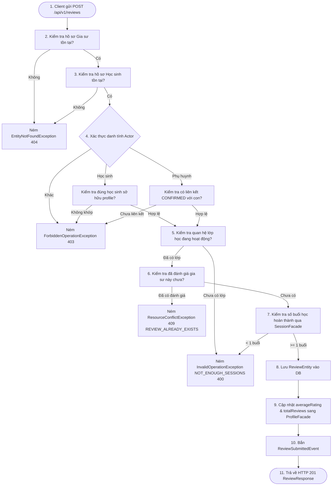
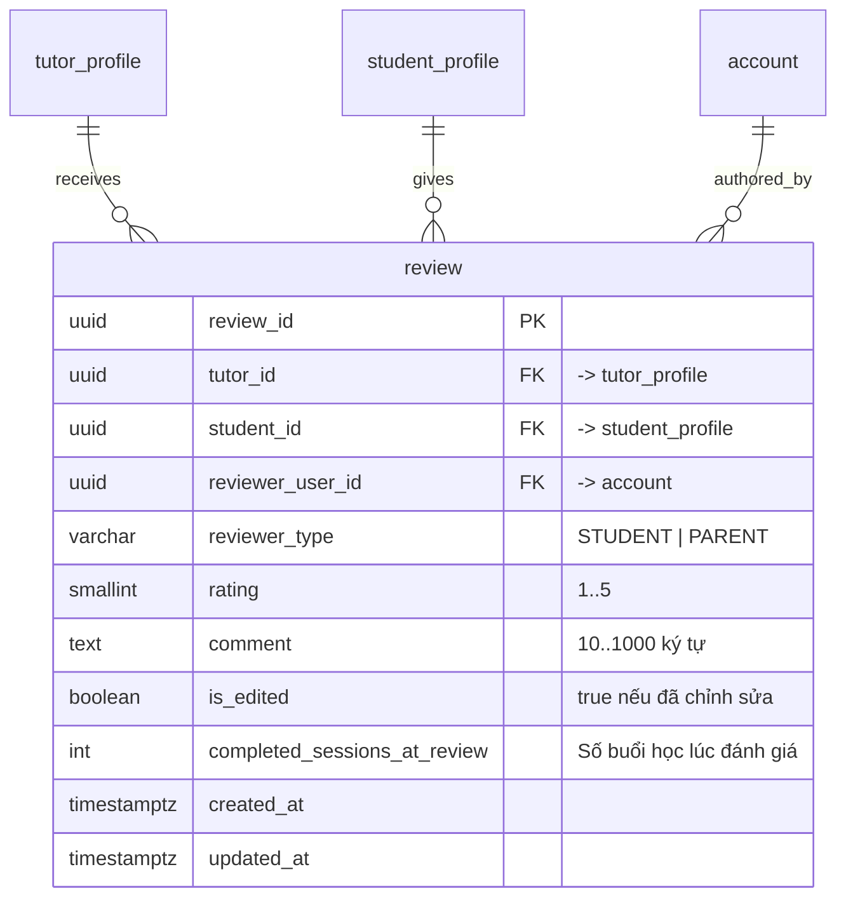

# KẾ HOẠCH HIỆN THỰC HÓA & GIẢI TRÌNH KIẾN TRÚC PHÂN HỆ REVIEW (ĐÁNH GIÁ GIA SƯ & CHỈ SỐ UY TÍN)
**Tài liệu Kỹ thuật Chuẩn Quốc tế Dành cho Thành viên Dự án & Đánh giá Mã Nguồn (Code Review)**

> **Phiên bản:** 1.0  
> **Phân hệ phụ trách:** `modules/review` (EduFit Backend & Frontend Integration)  
> **Áp dụng cho:** Nhánh `feat/sprint3-progress-integration` tích hợp vào nền tảng EduFit  
> **Tài liệu đối chiếu:**  
> - [ADR-001: Tech Stack](file:///c:/University/Semester%205/SWP391/Edufit/EduFit/docs/ADR-001-tech-stack.md) & [ADR-002: Multi-Module Architecture](file:///c:/University/Semester%205/SWP391/Edufit/EduFit/docs/ADR-002-multi-module-architecture.md)  
> - [Backend Module Structure Guide (Loại 1 - Layered Service & Domain Repository)](file:///c:/University/Semester%205/SWP391/Edufit/EduFit/docs/backend-module-structure-guide.md)  
> - [Software Architecture Design Specification (Mục 10 - Review & Rating API)](file:///c:/University/Semester%205/SWP391/Edufit/EduFit/docs/software-architecture-design-specification.md)  
> - [SRS Edufit (UC6.1, UC6.2, UC6.3; FR-28, FR-29; BR-56 đến BR-62)](file:///c:/University/Semester%205/SWP391/Edufit/EduFit/docs/SRS%20Edufit.docx)  
> - [Master Test Plan & In-Development Testing Specification (Mục 7.6)](file:///c:/University/Semester%205/SWP391/Edufit/EduFit/docs/in-development-testing-specification.md)  
> - [V1.07__create_review_and_notification_tables.sql](file:///c:/University/Semester%205/SWP391/Edufit/EduFit/backend/app/src/main/resources/db/migration/review/V1.07__create_review_and_notification_tables.sql)

---

## 1. Mục Tiêu & Bối Cảnh (Goal Description)

Phân hệ **Review (Quản lý Đánh giá Gia sư & Xếp hạng Tín nhiệm)** là "Hệ thống Thẩm định Uy tín Xã hội" (Social Proof & Reputation Engine) của nền tảng EduFit. Phân hệ cung cấp cơ chế phản hồi hai chiều minh bạch, giúp Học sinh và Phụ huynh đánh giá chất lượng giảng dạy thực tế của Gia sư, đồng thời giúp cộng đồng người học có cơ sở tin cậy để lựa chọn gia sư phù hợp.

Phân hệ đảm nhiệm 3 mục tiêu chiến lược cốt lõi:

1. **Thiết lập Đánh giá Thực chứng Chống Gian Lận (Evidence-Based Reviews - UC6.1, BR-56, BR-61):**
   - Triệt tiêu hoàn toàn vấn nạn "đánh giá ảo" (Review Bombing / Fake Reviews). Người dùng **chỉ được phép gửi đánh giá khi và chỉ khi** thỏa mãn đồng thời 2 điều kiện tiên quyết:
     - Đã có mối quan hệ lớp học dạy kèm đang hoạt động (`ConnectionFacade.findActiveClass(...)`).
     - Đã hoàn thành tối thiểu **1 buổi học thực tế** với gia sư (`SessionFacade.countCompletedSessionsBetween(...) >= 1`).
   - Ràng buộc độc nhất (Strict Uniqueness - BR-57, NFR-24): Mỗi cặp `(tutor_id, student_id)` chỉ tồn tại **duy nhất một bản ghi đánh giá** trong toàn bộ vòng đời hệ thống.

2. **Quy Chuẩn Hóa Điểm Số & Quyền Chỉnh Sửa Có Kiểm Soát (Controlled Rating & Editing - UC6.3, BR-58, BR-60):**
   - Thang điểm chuẩn hóa: Điểm đánh giá bắt buộc là số nguyên từ 1 đến 5 sao (`chk_review_rating`).
   - Nội dung nhận xét bắt buộc từ 10 đến 1000 ký tự (`chk_review_comment_len`).
   - Quyền chỉnh sửa có kiểm soát: Người đánh giá chỉ được phép chỉnh sửa nội dung nhận xét **tối đa đúng 1 lần duy nhất** (`is_edited = true`) và không được thay đổi người thụ hưởng để bảo vệ tính toàn vẹn lịch sử.

3. **Đồng Bộ Điểm Trung Bình & Phát Sự Kiện Miền (Rating Aggregation & Domain Events - FR-29):**
   - Tự động tính toán lại điểm trung bình cộng (`averageRating`) và tổng số đánh giá (`totalReviews`) của gia sư ngay trong cùng giao dịch cơ sở dữ liệu và đồng bộ sang hồ sơ gia sư thông qua `ProfileFacade.updateTutorRatingStats(...)`.
   - Xuất bản sự kiện miền `ReviewSubmittedEvent` và `ReviewUpdatedEvent` để hệ thống thông báo (`Notification`) gửi tin báo cho Gia sư.

---

## 2. Giải Thích Chi Tiết: Từ Định Nghĩa Đến Cơ Chế Hoạt Động

### 2.1. Quy Trình Thẩm Định 7 Bước Trước Khi Chấp Thuận Đánh Giá (UC6.1)

Khi nhận yêu cầu tạo đánh giá từ Client, `ReviewService` thực thi chuỗi kiểm tra phòng vệ nghiêm ngặt (Defensive Validation Pipeline):



---

### 2.2. Cơ Chế Đồng Bộ Số Liệu Đánh Giá Tức Thời (Real-Time Rating Aggregation)

Thay vì chạy batch job định kỳ tính toán điểm đánh giá gây trễ số liệu, EduFit áp dụng giải pháp đồng bộ tức thời (Immediate Transactional Sync):

1. Bản ghi đánh giá mới được lưu và `flush` xuống bảng `review`.
2. Truy vấn trực tiếp các hàm tổng hợp SQL tối ưu hóa trên chỉ mục:
   ```sql
   SELECT AVG(rating), COUNT(review_id) FROM review WHERE tutor_id = :tutorId;
   ```
3. Gọi cổng `ProfileFacade.updateTutorRatingStats(tutorId, avgRating, totalReviews)` để cập nhật trực tiếp hai trường `rating` và `total_reviews` trên bảng `tutor_profile`.
4. Nhờ vậy, kết quả tìm kiếm gia sư tại trang Discovery và trang chi tiết gia sư trên Frontend luôn phản ánh điểm số uy tín mới nhất mà không có độ trễ.

---

## 3. Cấu Trúc Lược Đồ Cơ Sở Dữ Liệu (Database Schema)

Lược đồ bảng `review` được định nghĩa trong file migration [`V1.07__create_review_and_notification_tables.sql`](file:///c:/University/Semester%205/SWP391/Edufit/EduFit/backend/app/src/main/resources/db/migration/review/V1.07__create_review_and_notification_tables.sql):



### Các ràng buộc cốt lõi (Database Constraints):
- `uk_review_tutor_student UNIQUE (tutor_id, student_id)`: Chặn đứng Race Condition gửi nhiều đánh giá trùng lặp ở tầng database.
- `chk_review_rating CHECK (rating BETWEEN 1 AND 5)`: Bảo đảm điểm sao luôn hợp lệ.
- `chk_review_comment_len CHECK (length(comment) >= 10 AND length(comment) <= 1000)`: Chống bình luận spam hoặc quá ngắn/quá dài.
- `idx_review_tutor (tutor_id)`: Tối ưu hóa phân trang danh sách đánh giá của gia sư.

---

## 4. Kiến Trúc Phân Tầng Chi Tiết (Layered Architecture)

Module `review` tuân thủ mô hình Layered Architecture kết hợp Ports & Adapters:

```
vn.edufit.review/
├── api/                                <-- Public SPI Facade cho các module khác
│   ├── ReviewFacade.java               <-- Cung cấp query điểm gia sư cho Discovery/Profile
│   ├── dto/                            <-- ReviewDto, TutorRatingSummaryDto
│   └── event/                          <-- ReviewSubmittedEvent, ReviewUpdatedEvent
├── application/
│   └── service/
│       ├── ReviewService.java          <-- Nghiệp vụ tạo, sửa, tra cứu đánh giá
│       └── ReviewFacadeImpl.java       <-- Hiện thực ReviewFacade
├── infra/
│   └── persistence/
│       ├── entity/
│       │   └── ReviewEntity.java       <-- JPA Entity ánh xạ bảng review
│       └── repository/
│           └── ReviewRepository.java   <-- Spring Data JPA với query tối ưu
└── web/
    ├── ReviewController.java           <-- REST Endpoints
    ├── request/
    │   ├── CreateReviewRequest.java    <-- Payload tạo đánh giá
    │   └── UpdateReviewRequest.java    <-- Payload sửa đánh giá
    └── response/
        ├── ReviewResponse.java         <-- DTO chi tiết đánh giá
        └── TutorRatingSummaryResponse.java <-- DTO tóm tắt sao trung bình
```

---

## 5. Danh Sách REST Endpoints (API Specification)

### 5.1. Tạo & Chỉnh Sửa Đánh Giá
- **`POST /api/v1/reviews`**: Học sinh hoặc Phụ huynh gửi đánh giá mới cho gia sư.
  - *Quyền hạn:* `STUDENT` hoặc `PARENT` có liên kết hợp lệ.
  - *Request Body:*
    ```json
    {
      "tutorId": "d3b07384-d113-4a3e-b7d6-785a9df61a23",
      "studentId": "e4c18495-e224-5b4f-c8e7-896b0ef72b34",
      "rating": 5,
      "comment": "Gia sư giảng dạy rất dễ hiểu, con tôi tiến bộ vượt bậc sau 5 buổi học."
    }
    ```
  - *Response:* HTTP 201 Created `ReviewResponse`.
- **`PUT /api/v1/reviews/{reviewId}`**: Chỉnh sửa đánh giá đã gửi.
  - *Quyền hạn:* Đúng người dùng đã tạo đánh giá ban đầu.
  - *Quy tắc:* Chỉ được sửa đúng 1 lần duy nhất (`is_edited` chuyển thành `true`). Nếu đã sửa rồi, trả về HTTP 400 `INVALID_OPERATION`.

### 5.2. Tra Cứu Đánh Giá Công Khai
- **`GET /api/v1/reviews/tutors/{tutorId}`**: Lấy danh sách đánh giá công khai của gia sư.
  - *Tham số phân trang:* `page` (default 0), `size` (default 10).
  - *Response:* HTTP 200 `Page<ReviewResponse>`. Trường `isAuthor` tự động trả về `true` nếu người đang đăng nhập chính là tác giả đánh giá.
- **`GET /api/v1/reviews/tutors/{tutorId}/summary`**: Lấy tóm tắt xếp hạng của gia sư.
  - *Response:* HTTP 200 `TutorRatingSummaryResponse(tutorId, averageRating, totalReviews, ratingCounts)`.

---

## 6. Kế Hoạch Kiểm Thử & Kiểm Chứng Tự Động (Quality Gates)

| Nhóm Kiểm Thử | Suite / Lớp Kiểm Thử | Số Test Case | Tiêu Chuẩn Nghiệp Vụ Được Thẩm Định |
| :--- | :--- | :---: | :--- |
| **Service Logic Test** | `ReviewServiceTest` | 18 | Kiểm tra thẩm định 7 bước, học sinh tạo đánh giá, phụ huynh tạo đánh giá, chặn chưa học buổi nào (BR-61), chặn đánh giá trùng (BR-57), chặn sửa lần 2 (BR-60), kiểm thử biên rating 1..5 sao. |
| **Facade & Batch Query** | `ReviewFacadeImplTest` | 3 | Lấy điểm trung bình qua Facade, truy vấn hàng loạt tóm tắt đánh giá cho danh sách gia sư phục vụ Discovery. |
| **REST Controller MockMvc** | `ReviewControllerTest` | 6 | Xác thực HTTP Status Code 200, 201, 400, 403, 409, phân quyền đăng nhập. |
| **Tổng cộng module** | **100% Pass (Exit Code 0)** | **27/27** | **Đảm bảo 0 lỗi biên dịch, Single Constructor Injection chuẩn Spring Boot.** |
