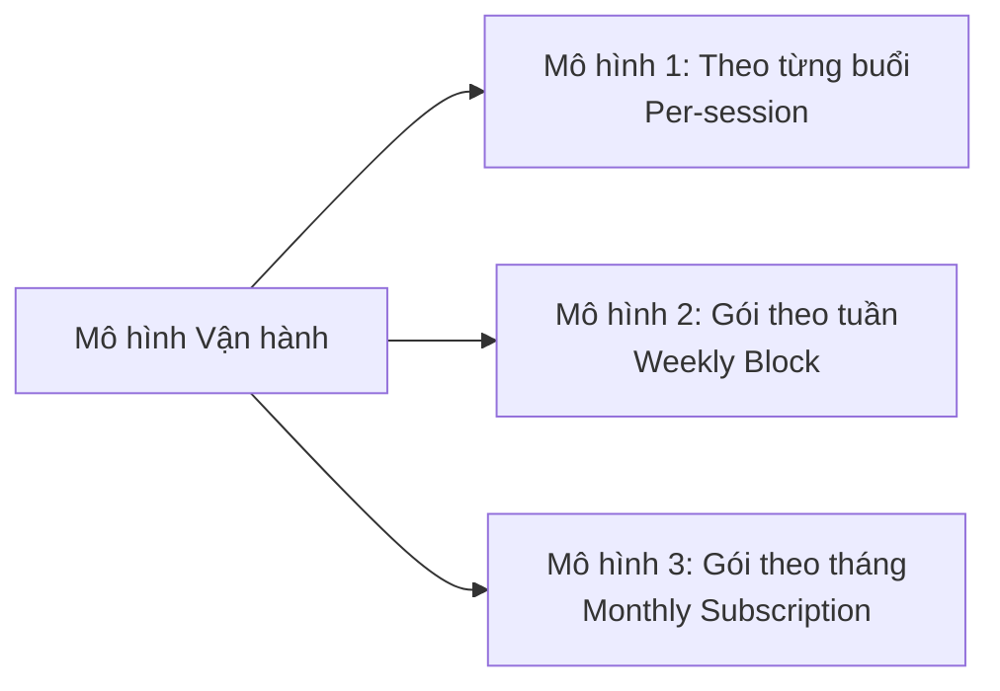
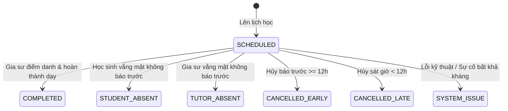
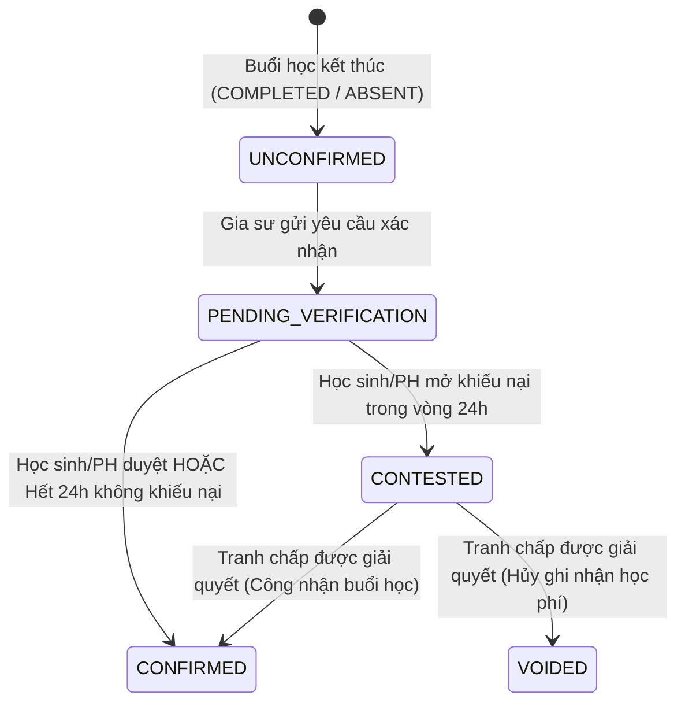
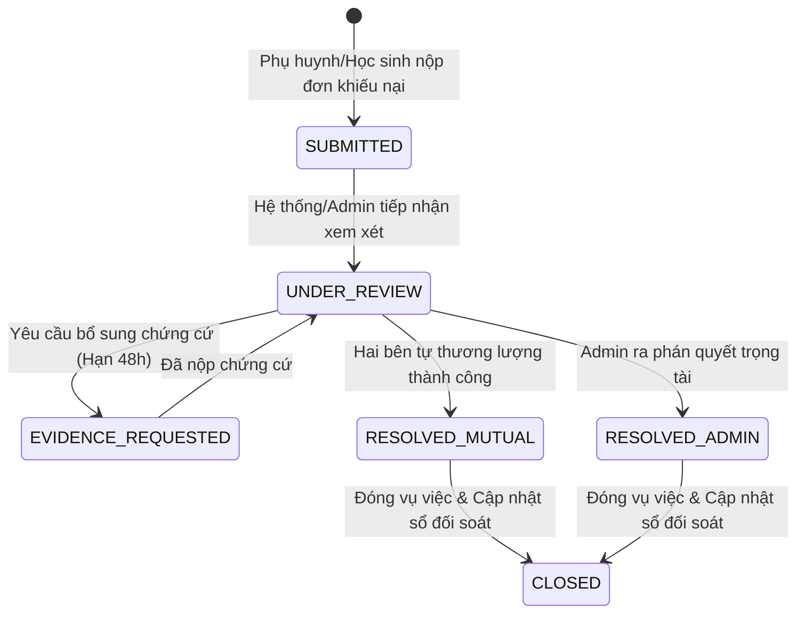

# Đặc tả Nghiệp vụ Quản lý Học phí & Giải quyết Tranh chấp
## (Tuition Policy & Dispute Specification)

- **Mã tài liệu:** SPEC-M3-TUITION-01
- **Phiên bản:** 1.0.0 (Research Specification)
- **Tác giả:** Thành viên 3 (Nghiên cứu nghiệp vụ & Lịch sử gia sư)
- **Ngày lập:** 18/10/2026
- **Trạng thái:** **TÀI LIỆU NGHIÊN CỨU & ĐỀ XUẤT (PROPOSED — CHỜ HỘI ĐỒNG / TEAM DUYỆT)**
- **Nhánh phụ trách:** `fix/tutor-navigation-and-payment-stubs`
- **Mục tiêu:** Định hình mô hình quản lý học phí, xác nhận buổi học, quy chế khiếu nại và cơ chế đối soát minh bạch giữa Phụ huynh, Học sinh và Gia sư, đồng thời phân định ranh giới pháp lý và kỹ thuật theo quyết định Jira D5.

---

## 1. Bối cảnh & Nguyên tắc cốt lõi

### 1.1. Hiện trạng kiến trúc và Quyết định Jira D5
- **Quyết định D5 (Đã chốt):** Dự án EduFit **không tích hợp cổng thanh toán trực tuyến (payment gateway), không giữ tiền trung gian (escrow) và không cung cấp ví điện tử (wallet)** trong phạm vi triển khai hiện tại.
- **Phương thức thanh toán hiện hành:** Học phí được thỏa thuận giữa Gia sư và Học sinh/Phụ huynh thông qua bước kết nối và được thanh toán **trực tiếp** giữa hai bên (tiền mặt hoặc chuyển khoản ngân hàng ngoài hệ thống).
- **Hệ quả kỹ thuật:** 
  - Mọi trường giá học phí trên hồ sơ Gia sư (`hourlyRate`) chỉ là mức giá chào dạy tham khảo, không đại diện cho số dư hay công nợ trên hệ thống.
  - Hệ thống EduFit không có quyền tự động trừ tiền, giam tiền, giải ngân hay tự động hoàn tiền (auto-refund) của người dùng.

### 1.2. Mục đích của đề án nghiên cứu
Mặc dù hệ thống không trực tiếp giữ tiền, nhu cầu thực tế của người dùng và yêu cầu từ tài liệu SRS (UC4.5, UC5.5) đòi hỏi nền tảng phải cung cấp:
1. **Nhật ký giảng dạy & đối soát minh bạch (Reconciliation Journal):** Giúp hai bên ghi nhận số buổi đã học, trạng thái điểm danh và ghi chú học tập để làm căn cứ thanh toán trực tiếp.
2. **Quy chế bảo vệ quyền lợi hai bên (Safeguards):** Bảo vệ phụ huynh khi gia sư vắng mặt hoặc dạy không đủ thời gian; bảo vệ gia sư khi đã hoàn thành buổi dạy nhưng phụ huynh chối bỏ nghĩa vụ.
3. **Cơ chế khiếu nại chuẩn hóa (Dispute Workflow):** Kênh tiếp nhận và phân giải bất đồng dựa trên bằng chứng minh bạch trước khi hai bên quyết định thanh toán hoặc chấm dứt hợp đồng dạy học.

---

## 2. Ma trận Chủ thể & Thẩm quyền (Stakeholders & Authority Matrix)

| Chủ thể | Quyền hạn trong quản lý học phí | Trách nhiệm và Bằng chứng | Giới hạn thẩm quyền |
|---|---|---|---|
| **Học sinh (Student)** | - Xác nhận kết quả điểm danh sau buổi học. - Gửi phản hồi/khiếu nại nếu gia sư vắng mặt hoặc kết thúc sớm. - Xem nhật ký học phí cá nhân. | - Tham gia buổi học đúng giờ. - Cung cấp ảnh chụp màn hình/bằng chứng khi có sự cố. | Không trực tiếp can thiệp vào thỏa thuận tài chính nếu tài khoản bị giám sát bởi Phụ huynh. |
| **Phụ huynh (Parent)** | - Đại diện pháp lý và tài chính cho Học sinh liên kết. - Xác nhận bảng đối soát học phí định kỳ. - Mở khiếu nại chính thức (Formal Dispute). | - Thanh toán học phí trực tiếp cho Gia sư theo bảng đối soát đã xác nhận. - Cung cấp chứng từ chuyển khoản khi đối soát. | Nếu liên kết Phụ huynh - Học sinh bị thu hồi (`REVOKED`), Phụ huynh mất quyền xem chi tiết các buổi học phát sinh sau thời điểm thu hồi. |
| **Gia sư (Tutor)** | - Điểm danh và ghi nhận kết quả buổi học (`COMPLETED`, `ABSENT`). - Viết ghi chú buổi dạy (Session Note). - Gửi yêu cầu xác nhận học phí buổi dạy. | - Thực hiện buổi dạy đúng lịch và kế hoạch học tập. - Lưu trữ nhật ký cuộc gọi/bài tập làm minh chứng hoàn thành buổi học. | Không được tự ý xác nhận học phí thay cho Học sinh/Phụ huynh. Không có quyền thu tiền qua ứng dụng. |
| **Quản trị viên (Admin)** | - Trọng tài phân giải tranh chấp khi hai bên không đạt được thỏa thuận. - Khóa/cảnh cáo tài khoản vi phạm chính sách trung thực. - Xuất biên bản đối soát điện tử. | - Đánh giá khách quan dựa trên chứng cứ do hai bên cung cấp và dữ liệu nhật ký hệ thống (`audit_log`). | Không giữ tiền nên không thực hiện lệnh hoàn tiền tài chính; chỉ xác lập kết luận vi phạm và cập nhật trạng thái buổi học trên hệ thống. |

---

## 3. Đánh giá Mô hình Thanh toán & Đối soát (Tuition Models)

### 3.1. So sánh ba mô hình vận hành

| Tiêu chí | Mô hình 1: Theo từng buổi (Per-session) *(Khuyến nghị)* | Mô hình 2: Gói theo tuần (Weekly Block) | Mô hình 3: Gói theo tháng (Monthly) |
|---|---|---|---|
| **Cơ chế tính** | Học phí phát sinh và xác nhận ngay sau khi mỗi buổi học kết thúc. | Tổng hợp số buổi trong tuần (ví dụ: Chủ nhật hàng tuần chốt sổ). | Thu trước hoặc chốt công nợ vào ngày cuối tháng dựa trên tổng số buổi đã dạy. |
| **Rủi ro tài chính** | **Rất thấp:** Nếu có tranh chấp, tranh chấp chỉ giới hạn trong giá trị của duy nhất 1 buổi học. | **Trung bình:** Rủi ro tranh chấp trong phạm vi 2–4 buổi học. | **Cao:** Rủi ro gia sư bỏ dạy giữa chừng hoặc phụ huynh chậm trả số tiền lớn. |
| **Độ phức tạp UI/UX** | **Đơn giản, minh bạch:** Mỗi buổi học có trạng thái rõ ràng (`Xác nhận` / `Khiếu nại`). | Cần màn hình tổng kết tuần và xử lý các buổi bị hoãn dời sang tuần sau. | Cần nghiệp vụ tính bù trừ (pro-rata), xử lý bảo lưu, hoàn hủy phức tạp. |
| **Mức độ phù hợp với EduFit (Không Escrow)** | **Tối ưu nhất:** Phù hợp hoàn hảo với mô hình hai bên tự thanh toán trực tiếp sau mỗi buổi hoặc dồn thanh toán cuối tuần dựa trên nhật ký. | Khá phù hợp: Phù hợp với các lớp cố định 3 buổi/tuần. | Không khả thi trong giai đoạn hiện tại do thiếu cổng thanh toán tự động giữ tiền bảo chứng. |

### 3.2. Chuẩn hóa thuật ngữ tài chính (Tránh nhầm lẫn)
1. **Giá chào dạy (`Hourly Rate`):** Đơn giá mỗi giờ được công khai trên hồ sơ gia sư (ví dụ: 200.000 đ/giờ).
2. **Học phí thỏa thuận (`Agreed Tuition`):** Đơn giá được hai bên thống nhất tại bước tạo lớp học (ví dụ: 300.000 đ / buổi 90 phút).
3. **Học phí phát sinh (`Accrued Tuition`):** Tổng số tiền tương ứng với các buổi dạy đã diễn ra nhưng chưa được đối soát.
4. **Học phí đã xác nhận (`Confirmed Tuition`):** Học phí của các buổi học đã được học sinh/phụ huynh bấm xác nhận hoặc đã qua thời hạn khiếu nại 24h.
5. **Học phí đang tranh chấp (`Disputed Tuition`):** Khoản tiền của buổi học đang trong quy trình khiếu nại, tạm thời chưa ghi nhận vào bảng đối soát hoàn tất.

---

## 4. Vòng đời Trạng thái & Mô hình Dữ liệu Nghiệp vụ

### 4.1. Vòng đời Trạng thái Buổi học (Session Outcome Lifecycle)
Trạng thái buổi học thuộc module `scheduling` phản ánh việc buổi học có diễn ra hay không, tách biệt hoàn toàn với trạng thái thanh toán.

### 4.2. Vòng đời Xác nhận Học phí Buổi dạy (Tuition Confirmation Lifecycle)
Mỗi buổi học sau khi kết thúc sẽ sinh ra một bản ghi xác nhận học phí đi kèm:

### 4.3. Vòng đời Khiếu nại (Dispute Case Lifecycle)

---

## 5. Ma trận Tình huống Điểm danh & Xử lý Tranh chấp

| Tình huống buổi học | Trạng thái buổi học | Nghĩa vụ Học phí (Đề xuất) | Trách nhiệm chứng minh | Hướng xử lý trên Sổ đối soát |
|---|---|---|---|---|
| **Dạy học bình thường** | `COMPLETED` | 100% học phí thỏa thuận | Gia sư nộp ghi chú buổi học (`noteText`), học sinh xác nhận. | Ghi nhận vào công nợ cần thanh toán. |
| **Gia sư vắng mặt không phép (Tutor No-show)** | `TUTOR_ABSENT` | **0% học phí** (Không tính phí) | Học sinh báo cáo; Gia sư không có bằng chứng đã mở lớp. | Hủy buổi trên sổ đối soát; ghi nhận 1 gậy vi phạm vào hồ sơ uy tín gia sư. |
| **Học sinh vắng mặt không phép (Student No-show)** | `STUDENT_ABSENT` | **Đề xuất: 50% - 100% học phí** (Cần team duyệt) | Gia sư cung cấp bằng chứng đã chờ trong phòng học >= 15 phút. | Bù đắp chi phí thời gian cho gia sư. Gia sư có quyền miễn phí cho học sinh vì lý do ốm đau. |
| **Gia sư hủy lịch trước >= 12h** | `CANCELLED_EARLY` | **0% học phí** | Hệ thống ghi nhận timestamp hủy lịch. | Xóa buổi học, tự động gợi ý lịch học bù. Không áp dụng chế tài. |
| **Gia sư hủy lịch sát giờ (< 12h)** | `CANCELLED_LATE` | **0% học phí + Đề xuất cảnh cáo** | Hệ thống ghi nhận timestamp hủy lịch. | Buổi học bị hủy; nếu vi phạm >= 3 lần/tháng, tạm ẩn hồ sơ khỏi tìm kiếm. |
| **Học sinh hủy lịch trước >= 12h** | `CANCELLED_EARLY` | **0% học phí** | Hệ thống ghi nhận timestamp hủy lịch. | Buổi học bị hủy, sắp xếp học bù miễn phí. |
| **Học sinh hủy lịch sát giờ (< 12h)** | `CANCELLED_LATE` | **Đề xuất: 30% - 50% học phí** (Cần team duyệt) | Hệ thống ghi nhận timestamp hủy lịch. | Hỗ trợ chi phí chuẩn bị giáo án cho gia sư. |
| **Lỗi mạng / Bất khả kháng** | `SYSTEM_ISSUE` | **0% học phí** | Cả hai bên báo cáo sự cố kỹ thuật. | Lên lịch dạy bù toàn bộ thời lượng buổi học mà không tính thêm phí. |

---

## 6. Đặc tả Cơ chế "Cửa sổ Khiếu nại 24h" (24-Hour Dispute Window)

> [!IMPORTANT]
> Đây là **Đề xuất nghiệp vụ mới** nhằm giải quyết mâu thuẫn giữa việc cần chốt công nợ nhanh và quyền phản ánh của học sinh. Cơ chế này cần được Product Owner và Hội đồng nghiệm thu phê chuẩn trước khi áp dụng vào code.

### 6.1. Quy tắc vận hành
1. **Mốc kích hoạt (Trigger Point):** Bắt đầu đếm ngược ngay khi Gia sư bấm nút `Hoàn thành buổi học & Điểm danh` trên hệ thống.
2. **Thời hạn hiệu lực:** Đúng **24 giờ** (1.440 phút) theo múi giờ chuẩn Việt Nam (`Asia/Ho_Chi_Minh`, UTC+7).
3. **Quyền hạn trong cửa sổ:**
   - Học sinh hoặc Phụ huynh có thể bấm `Xác nhận hài lòng` (kết thúc sớm cửa sổ, chuyển ngay sang trạng thái `CONFIRMED`).
   - Học sinh hoặc Phụ huynh có thể bấm `Gửi khiếu nại buổi học` (chặn việc chuyển trạng thái và mở quy trình tranh chấp).
4. **Hành vi tự động đóng (Auto-Confirm):** Nếu sau 24 giờ kể từ thời điểm gia sư cập nhật mà Học sinh/Phụ huynh không có bất kỳ phản hồi nào, hệ thống tự động coi như buổi học đã diễn ra hợp lệ và chuyển trạng thái xác nhận học phí thành `CONFIRMED`.
5. **Ngoại lệ mở lại sau 24h:** Chỉ Admin mới có quyền mở lại khiếu nại quá hạn 24h nếu Phụ huynh chứng minh được lý do bất khả kháng (tai nạn, sự cố đường truyền diện rộng có xác nhận).

---

## 7. Chính sách Đề xuất Hoàn trả & Phạt vi phạm (Chưa phê duyệt)

Bảng so sánh các phương án xử lý hoàn/phạt để Team và Hội đồng lựa chọn:

| Phương án | Nội dung chi tiết | Ưu điểm | Nhược điểm / Rủi ro | Trạng thái phê duyệt |
|---|---|---|---|---|
| **Phương án A (Khuyến nghị cho D5): Không phạt tiền, chỉ chế tài uy tín** | - Không thu tiền phạt giữa hai bên. - Gia sư vi phạm bị giảm điểm uy tín, tụt hạng tìm kiếm hoặc đình chỉ tài khoản. - Học sinh vi phạm bị hạn chế gửi yêu cầu tìm gia sư mới. | - Hoàn toàn đồng nhất với D5 (hệ thống không can thiệp tiền bạc). - Không phát sinh tranh chấp pháp lý phức tạp. | Gia sư có thể chịu thiệt thòi về thời gian nếu học sinh thường xuyên bỏ buổi sát giờ. | **ĐỀ XUẤT CHÍNH (PROPOSED)** |
| **Phương án B: Bù trừ buổi dạy (Make-up Sessions)** | - Buổi học sinh hủy sát giờ vẫn tính phí 100% nhưng gia sư có nghĩa vụ bù 50% thời lượng trong buổi tiếp theo. - Buổi gia sư hủy sát giờ thì gia sư phải dạy bù miễn phí thêm 1 buổi ngắn. | - Đảm bảo khối lượng kiến thức cho học sinh. - Công bằng tương đối về quyền lợi. | Khó kiểm soát việc thực hiện dạy bù nếu hai bên không tự giác ghi nhận. | **PHƯƠNG ÁN DỰ PHÒNG** |
| **Phương án C: Phạt tiền mặt trực tiếp (Financial Penalty)** | - Áp dụng tỷ lệ phạt 30% - 50% học phí trừ/cộng vào lần chuyển khoản tiếp theo. | - Răn đe mạnh mẽ hành vi bùng lịch. | Không khả thi khi không có ví escrow trung gian. EduFit không thể ép buộc chuyển khoản. | **KHÔNG KHẢ THI (REJECTED)** |

---

## 8. Quy trình Giải quyết Khiếu nại & Lưu trữ Bằng chứng

### 8.1. Các bước thực hiện (Step-by-step Flow)
1. **Bước 1: Tiếp nhận khiếu nại (Filing):** Phụ huynh/Học sinh chọn lý do khiếu nại (Gia sư vắng mặt / Dạy thiếu giờ / Thái độ không đúng mực / Khác), nhập mô tả chi tiết và tải lên tối đa 3 ảnh minh chứng.
2. **Bước 2: Phản hồi từ Gia sư (Tutor Response):** Gia sư nhận thông báo và có **24 giờ** để đưa ra giải trình hoặc chấp nhận hủy buổi.
3. **Bước 3: Tự thương lượng (Mutual Settlement):** Hệ thống khuyến khích hai bên tự thỏa thuận (ví dụ: chuyển thành buổi dạy bù). Nếu hai bên đồng thuận, vụ việc đóng lại.
4. **Bước 4: Phán quyết Admin (Arbitration):** Nếu sau 48 giờ không tự hòa giải được, vụ việc chuyển lên hàng đợi của Admin. Admin căn cứ vào lịch sử điểm danh, thời gian phòng học và minh chứng để đưa ra phán quyết cuối cùng trên hệ thống.
5. **Bước 5: Cập nhật sổ đối soát & Đóng vụ việc:** Kết quả phán quyết được cập nhật tức thì vào sổ đối soát học phí của lớp học.

### 8.2. Tiêu chuẩn Bằng chứng & Bảo vệ Dữ liệu Cá nhân (PII)
- Bằng chứng hợp lệ: Ảnh chụp màn hình tin nhắn thỏa thuận, ảnh màn hình phòng học trực tuyến có hiển thị đồng hồ hệ thống, biên bản làm việc có xác nhận hai bên.
- Bảo mật thông tin: Mọi bằng chứng chỉ hiển thị giữa Gia sư phụ trách, Học sinh/Phụ huynh của lớp học và Admin. Tuyệt đối không công khai ra ngoài. Không lưu trữ thông tin thẻ ngân hàng hay mật khẩu người dùng.

---

## 9. Ma trận Truy vết & Xung đột Tài liệu (Traceability & Conflict Matrix)

| Yêu cầu gốc | Tài liệu nguồn | Hiện trạng xung đột với D5 | Giải pháp trong Đặc tả này |
|---|---|---|---|
| **UC4.5: Quản lý Thanh toán & Hoàn tiền** | SRS Edufit.docx | SRS cũ mô tả cổng thanh toán trực tuyến, giữ tiền ký quỹ và hoàn tiền tự động vào thẻ. | Ghi nhận D5 đã bãi bỏ escrow. Thay thế bằng "Nhật ký xác nhận học phí và đối soát chuyển khoản trực tiếp". |
| **UC5.5: Lịch sử Giảng dạy của Gia sư** | SRS Edufit.docx | SRS yêu cầu hiển thị thu nhập kiếm được sau mỗi buổi học. | Tách bạch: Thu nhập hiển thị là "Học phí đã đối soát", ghi rõ là số liệu tham chiếu giữa hai bên, không phải số dư ví trong app. |
| **BR-55: Quy chế hủy lịch học** | SRS Edufit.docx | Quy định phạt tiền hủy lịch sát giờ. | Chuyển thành chế tài điểm uy tín (Phương án A) và hỗ trợ bù buổi (Phương án B); không chế tài phạt tiền tự động. |
| **Mục 3.1: Core Research** | edufit_work_breakdown_plan.md | Yêu cầu nghiên cứu cơ chế giải ngân, khiếu nại 24h và phạt hủy lịch. | Toàn bộ cơ chế 24h và phạt hủy được định nghĩa chi tiết tại Mục 6 và Mục 7 dưới dạng **Đề xuất có phân loại minh bạch**. |

---

## 10. Bảng Đăng ký Quyết định (Decision Register)

| Mã | Quyết định | Phân loại | Căn cứ / Rationale |
|---|---|---|---|
| **DEC-01** | Không tích hợp cổng thanh toán trực tuyến và không giữ tiền trung gian trong phiên bản hiện tại. | **ĐÃ CHỐT (APPROVED)** | Jira D5, quyết định kiến trúc SADS của nhóm. |
| **DEC-02** | Xây dựng sổ đối soát học phí theo mô hình từng buổi (Per-session), cho phép tổng hợp theo tuần/tháng. | **ĐỀ XUẤT (PROPOSED)** | Giảm thiểu rủi ro tranh chấp, phù hợp nhất với mô hình tự chuyển khoản trực tiếp. |
| **DEC-03** | Áp dụng Cửa sổ Khiếu nại 24h tự động đóng nếu không có phản hồi từ người học. | **CHỜ DUYỆT (PENDING REVIEW)** | Đảm bảo quyền lợi gia sư không bị ngâm công nợ vô thời hạn. |
| **DEC-04** | Thay thế chế tài phạt tiền hủy lịch bằng chế tài trừ điểm uy tín và hạn chế tính năng. | **CHỜ DUYỆT (PENDING REVIEW)** | Phù hợp năng lực pháp lý và kỹ thuật hiện tại của nền tảng. |
| **DEC-05** | Phụ huynh mất quyền xem chi tiết đối soát các buổi học mới nếu liên kết gia đình bị hủy. | **ĐÃ CHỐT (APPROVED)** | Bảo vệ quyền riêng tư của học sinh theo phân hệ IAM & Family Link. |

---

## 11. Các Kịch bản Tính toán Minh họa (Illustrative Scenarios)

### Kịch bản 1: Lớp học diễn ra thuận lợi trọn vẹn
- **Lớp học:** Toán 12 (Gia sư Nguyễn Văn B - Học sinh Trần C). Đơn vị thỏa thuận: 250.000 đ/buổi (90 phút).
- **Thực tế:** Tháng 10/2026 diễn ra 8 buổi học. Cả 8 buổi đều được gia sư điểm danh `COMPLETED`, học sinh xác nhận trong vòng 24h.
- **Kết quả đối soát trên hệ thống:**
  - Tổng số buổi hợp lệ: 8 buổi.
  - Tổng học phí đã xác nhận: `8 * 250.000 = 2.000.000 đ`.
  - Trạng thái sổ: `ĐÃ XÁC NHẬN TOÀN BỘ`.
  - Hành động tiếp theo: Phụ huynh chuyển khoản trực tiếp 2.000.000 đ vào tài khoản ngân hàng của Gia sư. Hai bên bấm "Đã hoàn tất thanh toán tháng 10".

### Kịch bản 2: Có 1 buổi học sinh vắng mặt không báo trước
- **Thực tế:** Buổi thứ 4, học sinh C quên lịch, gia sư B vào phòng chờ 20 phút không thấy học sinh. Gia sư ghi nhận `STUDENT_ABSENT`.
- **Áp dụng chính sách (Theo đề xuất Phương án B):**
  - Buổi 4 ghi nhận học phí 50% = 125.000 đ để hỗ trợ thời gian của gia sư.
  - Gia sư cam kết dạy thêm 30 phút trong buổi 5 để bù kiến thức.
  - Học sinh bấm đồng ý thỏa thuận trong cửa sổ 24h.
- **Kết quả đối soát:**
  - 7 buổi hoàn thành (1.750.000 đ) + 1 buổi vắng có thỏa thuận (125.000 đ) = 1.875.000 đ.

### Kịch bản 3: Gia sư vắng mặt và phát sinh khiếu nại
- **Thực tế:** Buổi thứ 6, gia sư B bận đột xuất nhưng không báo trước, sau đó lại bấm điểm danh `COMPLETED` nhầm.
- **Quy trình khiếu nại:**
  - Học sinh C gửi khiếu nại trong vòng 24h: "Gia sư không vào lớp".
  - Gia sư B nhận thông báo, kiểm tra và thừa nhận nhầm lẫn, chọn "Chấp nhận khiếu nại".
- **Kết quả đối soát:**
  - Hệ thống tự động chuyển trạng thái buổi 6 thành `VOIDED` (0 đ).
  - Điểm tín nhiệm của gia sư B bị trừ 0.2 sao nội bộ do điểm danh sai.

---

## 12. Khuyến nghị Kỹ thuật cho Giai đoạn Triển khai Tương lai (Backlog)

1. **Giai đoạn tiếp theo (Khi có quyết định mở rộng):**
   - Bổ sung bảng `tuition_reconciliation_journal` lưu trữ các bản ghi đối soát lớp học theo từng tháng.
   - Bổ sung bảng `tuition_dispute` lưu trữ lịch sử bằng chứng và trao đổi hòa giải.
2. **Không làm trong nhánh fix hiện tại:**
   - Không tạo migration Flyway cho bảng thanh toán tiền mặt.
   - Không tích hợp SDK cổng thanh toán như VNPay hay MoMo.
   - Nhánh `fix/tutor-navigation-and-payment-stubs` chỉ cam kết tài liệu đặc tả này và các trang điều hướng thông tin "Sắp ra mắt".
