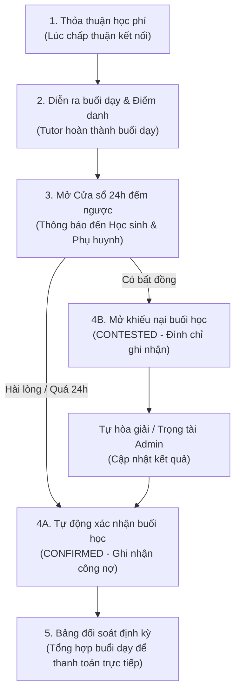

# Đề xuất Thiết kế Luồng Màn hình Quản lý Học phí & Đối soát
## (Tuition Wireframe & Screen Flow Proposal)

- **Mã tài liệu:** FLOW-M3-TUITION-02
- **Tài liệu gốc đi kèm:** [tuition-policy-and-dispute-specification.md](tuition-policy-and-dispute-specification.md)
- **Ngày lập:** 18/10/2026
- **Trạng thái:** **MÔ PHỎNG THIẾT KẾ ĐỀ XUẤT (PROPOSED WIREFRAME — CHƯA CODE GIAO DỊCH)**
- **Nhánh:** `fix/tutor-navigation-and-payment-stubs`

---

## 1. Tổng quan Kiến trúc Luồng Người dùng (End-to-End User Flow)



---

## 2. Chi tiết Thiết kế Giao diện từng Bước (Screen Specifications)

### Màn hình 1: Nhật ký Học phí Buổi dạy (Phía Học sinh & Phụ huynh)
- **Vị trí đề xuất tương lai:** `/student/tuition` hoặc tab trong `/parent/billing`.
- **Mô tả bố cục:**
  - **Thẻ tổng quan (Summary Cards):**
    - Tổng học phí đã hoàn thành trong tháng: `2.250.000 đ` (9 buổi).
    - Học phí đang chờ xác nhận (trong 24h): `250.000 đ` (1 buổi).
    - Trạng thái thanh toán trực tiếp: `Đã đối soát 8/9 buổi`.
  - **Bảng danh sách buổi học (Session List Table):**
    - Cột 1: Ngày học & Khung giờ (VD: `18/10/2026, 19:30 - 21:00`).
    - Cột 2: Gia sư & Môn học (VD: `Thầy Hoàng Nam - Toán 12`).
    - Cột 3: Trạng thái điểm danh (`Đã học`, `Học sinh vắng`, `Gia sư hủy`).
    - Cột 4: Học phí dự tính (`250.000 đ`).
    - Cột 5: Trạng thái xác nhận:
      - Badge xanh lá: `Đã xác nhận` (kèm mốc thời gian).
      - Badge hổ phách đếm ngược: `Chờ xác nhận (Còn 14h 25m)`.
    - Cột 6: Hành động:
      - Nút `Xem ghi chú buổi dạy` (mở Modal xem nhận xét của gia sư).
      - Nút `Xác nhận nhanh` (màu xanh lá).
      - Nút `Khiếu nại` (màu đỏ nhạt, chỉ hiện trong 24h).

---

### Màn hình 2: Hộp thoại Khiếu nại Buổi học (Dispute Modal)
- **Kích hoạt:** Khi Học sinh hoặc Phụ huynh bấm nút `Khiếu nại` tại một buổi học trong hạn 24h.
- **Thành phần giao diện:**
  ```text
  +-----------------------------------------------------------------------+
  | KHIẾU NẠI BUỔI HỌC — Toán 12 (18/10/2026)                            [X]|
  +-----------------------------------------------------------------------+
  | Lưu ý: Khiếu nại sẽ tạm hoãn ghi nhận học phí buổi này trên sổ đối   |
  | soát để hai bên cùng làm rõ.                                          |
  |                                                                       |
  | Lý do khiếu nại (*):                                                  |
  | [ (o) Gia sư không vào lớp / vắng mặt                               ] |
  | [ ( ) Gia sư kết thúc buổi học sớm hơn thời lượng quy định          ] |
  | [ ( ) Thái độ giảng dạy hoặc chất lượng không đúng thỏa thuận       ] |
  | [ ( ) Lý do khác...                                                 ] |
  |                                                                       |
  | Mô tả chi tiết sự việc (*):                                           |
  | +-------------------------------------------------------------------+ |
  | | Gia sư vào trễ 25 phút và rời phòng học sớm lúc 20:45...          | |
  | +-------------------------------------------------------------------+ |
  |                                                                       |
  | Tải lên ảnh minh chứng (Tối đa 3 ảnh):                                |
  | [ + Tải ảnh chụp màn hình phòng học hoặc tin nhắn ]                   |
  |                                                                       |
  | [ Hủy bỏ ]                                      [ Gửi khiếu nại ]     |
  +-----------------------------------------------------------------------+
  ```

---

### Màn hình 3: Màn hình Phản hồi của Gia sư (Tutor Dispute Response)
- **Kích hoạt:** Gia sư nhận thông báo khi có buổi học bị khiếu nại.
- **Thành phần:**
  - Hiển thị thông tin lý do và ảnh bằng chứng do học sinh cung cấp.
  - Ba lựa chọn xử lý nhanh cho Gia sư:
    1. **Đồng ý hủy tính phí:** Chấp nhận không tính tiền buổi này, chuyển trạng thái thành `VOIDED` mà không cần qua Admin.
    2. **Đề xuất dạy bù:** Gửi tin nhắn đề xuất học bù 45 phút vào buổi kế tiếp.
    3. **Gửi giải trình lên Admin:** Cung cấp ảnh chụp lịch sử cuộc gọi/màn hình chứng minh đã dạy đủ giờ.

---

### Màn hình 4: Bảng Đối soát Định kỳ & Xuất Biên nhận Mô phỏng
- **Vị trí đề xuất:** Thẻ `Bảng kê đối soát học phí` tại trang thanh toán của Phụ huynh và Gia sư.
- **Tính năng:**
  - Bộ lọc chọn Tháng / Năm (VD: `Tháng 10/2026`).
  - Danh sách bảng kê gồm:
    - Tổng số buổi cam kết: 8.
    - Số buổi thực dạy: 8.
    - Số buổi học sinh vắng có tính phí theo thỏa thuận: 0.
    - Số buổi được miễn phí / hủy: 1.
    - **Tổng số tiền cần thanh toán trực tiếp:** `2.000.000 đ`.
  - Nút bấm chức năng:
    - `Xuất bảng kê PDF / In ấn`: Tạo bản PDF định dạng trang nhã để phụ huynh lưu trữ hoặc gửi qua Zalo.
    - `Đánh dấu đã chuyển khoản (Phụ huynh)`: Ghi nhận ngày giờ phụ huynh đã chuyển tiền trực tiếp ngoài ngân hàng.
    - `Xác nhận đã nhận đủ tiền (Gia sư)`: Chốt sổ tháng đó thành trạng thái `ARCHIVED`.

---

## 3. Kịch bản Kiểm thử Chấp nhận (Acceptance Scenarios)

### Kịch bản 1: Tự động chốt học phí khi hết hạn 24 giờ
- **Given:** Gia sư hoàn thành buổi dạy lúc 20:00 ngày 18/10/2026 và bấm điểm danh `COMPLETED`.
- **When:** Đến 20:01 ngày 19/10/2026, học sinh và phụ huynh không có thao tác bấm xác nhận hay khiếu nại.
- **Then:**
  - Hệ thống tự động chuyển trạng thái xác nhận từ `PENDING_VERIFICATION` sang `CONFIRMED`.
  - Buổi học được cộng vào tổng số tiền của bảng đối soát tháng hiện tại.
  - Huy hiệu (badge) đếm ngược biến mất, thay bằng nhãn "Tự động xác nhận sau 24h".

### Kịch bản 2: Khiếu nại hợp lệ ngăn chặn ghi nhận học phí
- **Given:** Buổi dạy đang trong trạng thái `PENDING_VERIFICATION`.
- **When:** Phụ huynh gửi form khiếu nại kèm hình ảnh minh chứng gia sư vắng mặt lúc còn 2 giờ đếm ngược.
- **Then:**
  - Trạng thái lập tức chuyển sang `CONTESTED`.
  - Số tiền của buổi học bị trừ ra khỏi mục "Học phí đã xác nhận" trên bảng đối soát.
  - Gia sư nhận được thông báo chuông và có 24 giờ để gửi phản hồi.

---

## 4. Tuyên bố Giới hạn Phạm vi Kỹ thuật (Scope Boundary)

- Toàn bộ các thiết kế giao diện trên là **đặc tả nghiên cứu cho giai đoạn phát triển tiếp theo**.
- Nhánh `fix/tutor-navigation-and-payment-stubs` hiện tại **không tạo các component có nút bấm giao dịch giả mạo**.
- Thay vào đó, nhánh này giải quyết bài toán giao diện trước mắt bằng **3 trang thông tin "Sắp ra mắt" minh bạch** (theo Nhiệm vụ 3.2), hướng dẫn người dùng hiểu rõ cơ chế tự thỏa thuận và thanh toán trực tiếp ngoài hệ thống.
