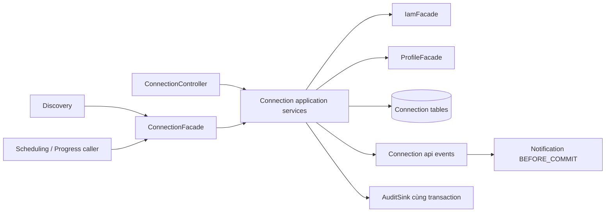
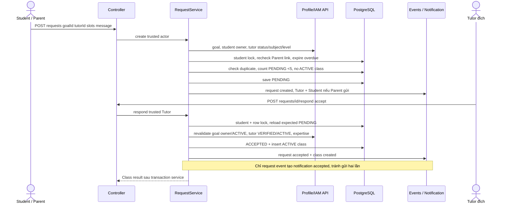

# Kế Hoạch Triển Khai & Tái Cấu Trúc Kiến Trúc Chi Tiết: Phân Hệ Backend Connection & Engagement (EduFit)

- **Trạng thái:** Đang thực hiện Phase 0 trên `feat/connection`; chưa bắt đầu refactor Phase 1. Kết quả tại [báo cáo Phase 0](../../docs/connection/phase0-validation.md).
- **Ngày đối chiếu:** 11/10/2026.
- **Workspace thực thi duy nhất:** `C:/Users/ASUS/Desktop/EduFit/EduFit`. Mọi code, test, docs và task Connection thực hiện tại đây trên nhánh `feat/connection`, theo yêu cầu cập nhật của người dùng.
- **Baseline đã audit trước đó:** `feat/connection` tại `43e7461` — `feat(connection): implement parent links and tutor requests`. Checkout `EduFit-connection` chỉ là nơi đọc baseline trong lượt audit cũ, không còn là workspace thực thi.
- **Trạng thái lúc chuyển tài liệu:** folder `EduFit` vẫn ở `feat/discovery`, HEAD `dd9068e` và có 3 file code dirty đã liệt kê ở mục 0.4. Chỉ chuyển/sắp xếp tài liệu, chưa switch branch, merge, code, commit hoặc push.
- **Tài liệu task đi kèm:** [todo.md](todo.md). Đây là bộ plan thay thế cho mô tả hiện trạng đã cũ trong `docs/connection/connection-implementation-plan.md`.
- **Mẫu cấu trúc:** `D:/backend_discovery_implementation_plan.md` (mục 0–9) và `tasks/plan.md`, `tasks/todo.md` của Discovery trong cùng repo (phase, task, checkpoint, một task một commit và push).
- **Nguồn nghiệp vụ:** [SRS](../../docs/SRS%20Edufit.docx), UC3.1–UC3.5, BR-26–38, FR-12–15, NFR-07/11/15/16; [SADS](../../docs/software-architecture-design-specification.md); [ADR-002](../../docs/ADR-002-multi-module-architecture.md), Decision 2, 3a, 3b; [module guide](../../docs/backend-module-structure-guide.md); [sprint plan](../../docs/master_sprint_plan_and_ai_learning_framework.md); [test specification](../../docs/in-development-testing-specification.md); [flow hiện tại](../../docs/connection/connection-module-flow.md).
- **Nguồn schema:** `backend/app/src/main/resources/db/migration/connection/V1.04__create_connection_and_class_tables.sql`, `V1.09__allow_relink_after_revocation.sql`, migration notification V1.07 và audit V1.08.

Tài liệu Discovery được dùng làm mẫu độ sâu, cấu trúc và quy trình, không phải lệnh thực thi. Không sao chép workaround mở quyền Parent, công thức matching hoặc yêu cầu tạo `domain/` sang Connection. Những hướng dẫn commit/push dưới đây áp dụng khi thực hiện từng task refactor, không có nghĩa code đã được sửa hay đã push trong lần bàn giao plan này.

**Vị trí chính thức sau review:** `tasks/connection/plan.md` và `tasks/connection/todo.md`. Không ghi Connection vào `tasks/plan.md` / `tasks/todo.md`, vì hai đường dẫn đó đã được Discovery commit và có execution notes cần bảo toàn. Cấu trúc nội dung/quy trình vẫn theo Discovery; namespace riêng tránh add/add hoặc ghi đè tài liệu khi tích hợp.

**Tổ chức tài liệu:** Toàn bộ docs riêng của Connection ở `docs/connection/`, ảnh/diagram ở `docs/connection/assets/`; SRS/SADS/ADR và docs dùng chung vẫn ở `docs/`. Đã chuyển flow, implementation plan cũ và SVG hiện có vào folder này; bản implementation cũ chỉ là tài liệu lịch sử, plan thực thi mới là hai file trong `tasks/connection/`.

**Trước khi bắt đầu code:** T00 phải bảo toàn 3 thay đổi Discovery đang dở bằng checkpoint/snapshot riêng thuộc Discovery, không stage chúng vào Connection. Nhánh `feat/connection` hiện đang gắn với checkout cũ `EduFit-connection`; phải giải phóng attachment nhánh ở checkout đó sau khi kiểm tra sạch/bảo toàn dữ liệu, rồi mới switch folder `EduFit` sang `feat/connection`. Không dùng `--ignore-other-worktrees`, không để cùng branch được sửa ở hai folder, không xóa folder/worktree trong lượt chuyển tài liệu này. T00a/T00b tích hợp base sau khi branch đã được chuẩn bị tại folder `EduFit`.

**Cập nhật thực thi T00:** Bước bảo toàn/switch trên đã hoàn tất; folder EduFit đang ở `feat/connection`, checkout cũ detached. Fetch mới đưa main lên `6755121` (PR14): có conflict Flyway script test và upstream mặc định `jacoco.haltOnFailure=false`. Mục 0.4–0.5 giữ evidence snapshot lúc audit trước; áp dụng SHA/kết quả mới tại report Phase 0 khi thực thi T00a. Giữ cấu hình upstream, đồng thời chạy strict verify với `-Djacoco.haltOnFailure=true` để báo coverage gap; không hạ ngưỡng hay tuyên bố default success là gate pass.

## 0. Ghi chú tái cấu trúc từ nhánh hiện tại (Refactor Delta & Audit Notes)

### 0.1. Phần đã có và cần giữ

Connection hiện có controller với 10 routes, `ConnectionService implements ConnectionFacade`, 5 entity và 5 repository. Có mời liên kết hai chiều, quota 10 lần thử/giờ kể cả email không tồn tại, TTL invitation 14 ngày, cooldown 7 ngày, request 7 ngày, quyền Parent qua link CONFIRMED, kiểm tra goal/tutor/subject/level, giới hạn 5 request PENDING, accept tạo class, optimistic version và PostgreSQL advisory/row locks.

V1.09 **đã** thay unique toàn bộ cặp Parent–Student bằng partial unique CONFIRMED và thêm version/quota. Notification và audit **đã** có JPA sink. Không lập task tạo lại các phần này như từ skeleton. `ConnectionServiceTest` có 8 test trong source; con số này là kiểm kê, không phải kết quả chạy lại test.

### 0.2. Sai lệch và khoảng trống phải xử lý

| Hiện trạng đã đọc từ source | Rủi ro / phần cần làm | Task |
| --- | --- | --- |
| `ConnectionService` gom invitation/link/request/class/quota/native SQL | Khó review transaction và quyền; tách use case từng bước có regression | T03–T07 |
| Entity/repository cùng nằm trực tiếp dưới `infra/persistence` | Chuẩn hóa package; giữ table/column và JPQL hợp lệ | T02 |
| Controller nhận JPA entity và gọi Profile/IAM trong `stream` inbox | Web biết persistence, nguy cơ N+1 theo số request; chuyển DTO và batch vào application | T04, T18, T19 |
| Mutator entity accept/decline/cancel/revoke gán trạng thái trực tiếp | Caller mới có thể bỏ qua guard; kiểm tra expected status tại điểm chuyển | T08 |
| `Instant.now()` ở nhiều nơi | Khó test đúng thời điểm expiry/cooldown/quota; inject `Clock`, chụp một `now` mỗi thao tác | T08 |
| Expire chỉ khi người dùng đọc/ghi, chưa có scheduled job | Thiếu FR-13, bản ghi nằm PENDING vô hạn nếu không ai truy cập | T16, T17 |
| `noRollbackFor = ResourceConflictException.class` trên nhiều write method | Có thể commit thay đổi trước conflict; phải phân biệt expire cần lưu và accept cần rollback | T09, T22 |
| Create/cancel request chưa báo Student khi Parent thao tác; cancel chưa báo Tutor | Thiếu FR-12; revoke bởi Admin hiện chỉ báo Parent, thiếu Student | T13–T17 |
| Gọi `NotificationSink` trực tiếp; không có public transition events | Thiếu contract event của module theo ADR; chuyển từng use case, không gửi trùng | T10–T17 |
| Inbox thiếu `deadline` dù `ConnectionGoalDto` đã có | Thiếu dữ liệu goal trong BR-37; bổ sung field theo cách tương thích | T18 |
| Slot chỉ kiểm tra chuỗi không rỗng/≤100 ký tự; reason reject chưa chặn >300 | Chưa kiểm tra lịch thực sự; phải chốt định dạng và tương thích dữ liệu cũ | T01, T13 |
| Accept request kiểm tra goal ACTIVE/chuyên môn nhưng không so lại goal.studentId với request.studentId | Thiếu invariant tại thời điểm accept; thêm test dữ liệu thay đổi/bất nhất | T14 |
| `AuditSink` chỉ lưu actor/action/target/reason, chưa có snapshot hai tài khoản | FR-15 cần cả hai account/time/reason; giữ bằng dữ liệu audit có cấu trúc | T12 |
| Cooldown trả generic success giống email lạ | SRS UC3.1.E2 cho phép báo thời điểm mời lại khi đã biết decline; chỉ trả metadata cho lịch sử thuộc actor | T11 |
| Chỉ có 8 Mockito tests trong module, lock đang mock | Chưa chứng minh race, atomic save, filter bảo mật HTTP hoặc PostgreSQL constraints | T20–T22 |
| ArchitectureTest ở checkout này dùng `vn.edufit.modules.*` khác package thật | Có thể pass rỗng; thêm rule đúng package, kiểm tra số class được import | T23 |
| Nhánh Connection chưa có đầy đủ Discovery refactor mới nhất | Tích hợp phụ thuộc có kiểm soát, không tạo `connection -> discovery` | T00, T24 |

Đây là các phát hiện tĩnh. N+1, race và transaction là rủi ro cần đo/tái hiện, không khẳng định đã xảy ra trên production.

### 0.3. Before & After Refactor Mapping

Các đường dẫn Java dưới đây tương đối với `backend/modules/connection/src/main/java/vn/edufit/connection/`.

| Trước | Sau | Hành động |
| --- | --- | --- |
| `api/ConnectionFacade.java` | cùng đường dẫn | KEEP hai signature và nested `ActiveClassView` để không gãy caller |
| `application/ConnectionService.java` | `application/service/{LinkInvitationService,ParentStudentLinkService,ConnectionRequestService,ConnectionQueryService,ConnectionFacadeImpl}.java` | SPLIT theo use case, xóa service cũ sau khi chuyển hết caller |
| native SQL `lock(String)` trong service | `application/port/ConnectionLock.java`, `infra/locking/PostgresConnectionLock.java` | EXTRACT kỹ thuật; giữ cùng transaction |
| quota trong service | `application/service/InvitationQuotaService.java` | EXTRACT, giữ quota bền trong DB và khóa theo actor |
| 5 entity tại `infra/persistence/*.java` | `infra/persistence/entity/*.java` | MOVE; giữ tên Java hiện tại, không đổi schema chỉ vì đổi package |
| 5 repository tại `infra/persistence/*Repository.java` | `infra/persistence/repository/*Repository.java` | MOVE; sửa imports và entity name trong JPQL nếu cần |
| DTO record lồng trong controller | `web/request/*.java`, `web/response/*.java` | EXTRACT; giữ JSON field/type cũ |
| service trả JPA entity ra controller | `application/dto/*Result.java`, `*Command.java`, mapper trong application | REFACTOR; web chỉ map HTTP DTO |
| string status rải rác | `application/policy/ConnectionTransitions.java` + status types phù hợp | NEW guard tập trung, persistence vẫn lưu giá trị cũ |
| chưa có | `api/event/LinkInvitationChangedEvent.java`, `ParentStudentLinkChangedEvent.java`, `ConnectionRequestChangedEvent.java`, `TutoringClassCreatedEvent.java` | NEW public event typed theo từng aggregate |
| chưa có | `application/service/ConnectionExpiryService.java`, `infra/scheduling/ConnectionExpiryJob.java` | NEW expiry batch/job |
| `ConnectionServiceTest.java` | test theo service + controller + integration tại app | SPLIT/MODIFY; giữ đủ 8 kịch bản cũ |
| lookup Profile/IAM từng item | bổ sung batch methods ở public API của hai module và implementation/repository do chủ module sở hữu | MODIFY; Connection không query chéo bảng bằng repo của module khác |
| `AuditSink.record(...)` | giữ API cũ, thêm structured audit input cho revoke | ADD theo cách tương thích; sửa adapter audit trong task riêng |
| V1.04/V1.09 | giữ nguyên; migration mới chỉ khi cần snapshot audit/index | KEEP/ADD; không viết lại migration đã chạy |

### 0.4. Kết quả kiểm tra với main và các nhánh sau fetch

Đã chạy `git fetch origin --prune` thành công trong lượt review này. Dùng `git merge-tree --write-tree --name-only` mô phỏng Git three-way merge trên **committed refs**, không checkout/merge/reset nhánh làm việc. Tree object do phép mô phỏng tạo không thay đổi HEAD/index/worktree. Kết quả bên dưới là xung đột văn bản ở đúng SHA đã kiểm tra, không phải chứng nhận compile/runtime và không bảo đảm các commit tương lai không conflict.

| Nhánh được đối chiếu | SHA đã fetch / đọc | Kết quả merge với Connection `43e7461` | Kết luận cho plan |
| --- | --- | --- | --- |
| `origin/main` | `4eaa333f646404567c8ebe0630778731d35513a0` | Không conflict văn bản; main có 2 commit chưa nằm trên Connection | T00a cập nhật main trước refactor; giữ JaCoCo gate mới |
| `origin/feat/discovery` | `dd9068e0a14b0e480d1823eab37bc82041166fe5` | **3 file conflict** liệt kê dưới đây | T00b tích hợp trước T01, không chờ T24 |
| `origin/feature/profile` | `1f648df93b179a12a9a9542dbd7cd3ce9c7e82df` | Không conflict; tip đã là ancestor của Connection | Không merge lại nhánh Profile cũ; giữ các phần Profile mới trên Discovery |
| `origin/feature/iam-architecture` | `c7524000e549028a17a3f07895d9b64688051544` | Không conflict; phần khác lịch sử là merge commit, không có delta file so với merge-base -> tip | Không chọn IAM cũ ghi đè IAM facade đang dùng |
| `origin/feature/storage-verification` | `32724a51ab48f119b574483f77739b6906d857ce` | Không conflict; tip đã là ancestor của Connection | Verification hiện không chặn merge; shared audit API mới phải tương thích |
| local `feature/verification` | `6ca316582073fcf9d92db2c9a40349b84009f977` | Không conflict; ancestor cũ hơn | Đây là local branch, không phải remote Verification mới nhất |
| `origin/feature/frontend-auth` (kiểm tra bổ sung) | `6bfb4c4fecef38c2fa54fee1f3e0b84e95de048a` | Conflict `backend/app/src/test/java/vn/edufit/db/FlywayMigrationScriptTest.java` | Không tích hợp frontend trong scope; nếu tích hợp sau phải giữ kiểm tra V1.09 và migrations mới |
| `origin/feature/backend-schedule` (consumer bổ sung) | `cfa9a8f1e3d3112e61d818b51b794dc6d176ffc8` | Không conflict văn bản | Chưa coi Scheduling đã dùng Connection thật: adapter đang mock |

Ba conflict với Discovery:

1. `backend/modules/connection/src/test/java/vn/edufit/connection/ConnectionServiceTest.java` — add/add. Discovery đã chép prerequisite Connection ở commit `38042a0` và bổ sung parameterized confirmed-link test; giữ 8 scenarios cũ **và** 5 invocation mới, không chọn nguyên ours/theirs rồi mất coverage.
2. `backend/modules/profile/src/main/java/vn/edufit/profile/application/service/ProfileFacadeImpl.java` — content. Giữ constructor/wiring đầy đủ của Discovery (availability, goal slots, education catalog, candidate limit), giữ search/detail/bounded candidate/catalog methods và cả `findGoalForConnection` / `tutorTeaches`. Không khôi phục full-scan API đã xóa ở `7bb9705`.
3. `backend/modules/profile/src/test/java/vn/edufit/profile/ProfileFacadeImplTest.java` — content. Hợp nhất mocks/constructor mới và tất cả tests Connection + Discovery; không sửa constructor về bản Connection cũ để làm test pass.

Mô phỏng `origin/main + origin/feat/discovery` không conflict văn bản. Thứ tự đề xuất khi thực thi: **T00 docs -> T00a main -> T00b Discovery có resolution -> baseline tích hợp -> T01 trở đi**. Mỗi prerequisite là một commit riêng và push, không force/rebase lịch sử đã chia sẻ; không merge feature vào main. T00b ghi base SHA và kiểm tra lại merge-tree sau T00a vì merge-base đã thay đổi.

Checkout Discovery đang có 3 file dirty: `TutorMatchingService.java`, `DiscoveryController.java`, `iam/api/AccountStatus.java` (diff hiện tại chủ yếu formatting). Các thay đổi chưa commit không nằm trong remote ref/mô phỏng; không copy, reset hoặc stage chúng. Nếu muốn tích hợp những thay đổi này cần nguồn commit riêng; lần review hiện tại không khẳng định đã kiểm chứng chúng.

### 0.5. Xung đột ngữ nghĩa dù Git có thể merge sạch

| Điểm coupling thực tế | Sửa plan / thời điểm bắt buộc |
| --- | --- |
| `MatchingWorkflowPostgresTest` của Discovery import và `@Import(ConnectionService.class)`, quét package persistence của Connection | T02 cập nhật scan package nếu cần; **T03 chuyển fixture sang `ConnectionFacadeImpl` ngay khi tách facade**; T07 xóa service cũ không để test compile gãy; chạy Discovery transaction regression trong cùng task |
| `ArchitectureBoundaryTest.production_import_contains_expected_layers` assert tên `vn.edufit.connection.application.ConnectionService` | **T07 đổi expected class sang facade/service mới cùng commit xóa class**, giữ các assertion Discovery khác; không chờ T23 |
| `FlywayMigrationIT` Discovery assert đúng 9 migration; script/transaction fixtures cũng phụ thuộc schema | Mọi task thêm migration (T12a/T19 nếu có) cập nhật manifest/count assertions liên quan **cùng commit**, test upgrade từ V1.09 + clean DB; không trì hoãn tới T22 |
| `ProfileFacadeImpl` constructor có nhiều caller test trực tiếp, gồm `MatchingCandidatesPostgresTest` | T18a ưu tiên tái sử dụng repository đã inject; nếu thêm dependency phải sửa tất cả constructor callers cùng commit, không bỏ test bounded candidates |
| `main` thêm JaCoCo 0.8.12, LINE >=80% và BRANCH >=80%, check ở `verify`; tip thực thi mặc định `haltOnFailure=false` | T00a giữ cấu hình upstream và chạy strict verify `-Djacoco.haltOnFailure=true`; không dùng default success để đánh dấu coverage đạt. Full reactor baseline failures ghi riêng |
| IAM đã có `IamClockConfig.clock()` với `@ConditionalOnMissingBean`; Scheduling có fallback Clock tương tự | T08 tái sử dụng Clock hiện có, test override bằng fixed Clock. Không thêm bean Clock unconditional gây ambiguity; context test chỉ có một candidate |
| IAM enum thật là `ACTIVE` / `DEACTIVATED`, không có `SUSPENDED` | Tests dùng `DEACTIVATED` cho account bị vô hiệu hóa; không mở rộng enum/schema IAM trong Connection refactor |
| Handler Connection/Discovery hiện đã map `RATE_LIMIT_EXCEEDED` -> HTTP **429** | T01/T21 ghi 429 là baseline đúng; conflict còn lại 409. Không để plan mơ hồ chọn 409 cho quota |
| Scheduling branch có `MockConnectionValidationAdapter`, default `use-mock-connection=true`, kiểm tra IDs khác null | T24 chỉ báo consumer contract, không báo E2E dùng DB thật. Production adapter là hạng mục bàn giao Scheduling riêng; cần kiểm tra `classId` và profile IDs, vì Javadoc port đang gọi tutorId/studentId là account IDs |
| Notification listener phụ thuộc Connection public events | Chỉ thêm `notification -> connection`; giữ `connection -> shared/profile/iam`, không thêm dependency ngược. Audit overload giữ caller cũ; không xóa shared sinks dùng nơi khác |

### 0.6. Đối chiếu chuẩn thực hiện của Discovery

Đã đối chiếu cả tài liệu Discovery gốc lẫn execution plan thực tế ở `dd9068e`, không chỉ tiêu đề: có audit delta/before-after, nguồn nghiệp vụ, ranh giới/file anatomy, sequence flows, quyết định/open questions, proposed changes, verification, Q&A, requirement mapping, phase/checkpoint, acceptance và dependency từng task, commit + push + SHA evidence. Bản cuối bổ sung prerequisite integration sớm, migration/test wiring cùng commit và task con bắt buộc thay vì để tới lúc làm mới chia.

Khác biệt có chủ đích: Connection theo ADR service + JPA; notification record bắt buộc dùng BEFORE_COMMIT cùng DB transaction, còn Discovery có observer AFTER_COMMIT cho matching event. Không thay đổi semantics event Discovery để ép giống Connection. Hai bộ tài liệu dùng namespace riêng để bảo toàn lịch sử Discovery.

## 1. Mục tiêu & bối cảnh kỹ thuật (Goal Description)

Connection quản lý consent giữa Parent và Student, yêu cầu học giữa Student và Tutor, và tạo Engagement (bảng `class`) để Scheduling/Progress tiếp tục làm việc. Refactor phải vừa giữ hành vi đang đúng vừa hoàn thiện UC3.1–3.5, không chỉ chuyển thư mục.

Kết quả mong muốn:

1. HTTP adapter mỏng; application sở hữu authorization, orchestration, DTO và transaction; persistence không lộ qua web/public API.
2. Consent và quyền Parent được kiểm tra trên server cho từng student; revoke không xóa request/class/session/note của Student.
3. Mọi transition có guard, thời điểm kiểm tra nhất quán, khóa phù hợp và unique constraint làm hàng rào cuối.
4. Expiry tự động, notification đủ người nhận và audit Admin revoke đủ dữ liệu, có kiểm thử rollback thật.
5. Mỗi task có phạm vi nhỏ, tiêu chí rõ, test phù hợp, review diff, một commit và push ngay; có evidence để review như Discovery.

Ngoài phạm vi: UI/frontend, thuật toán matching, triển khai scheduling/progress, end-class lifecycle mới, đổi toàn bộ kiến trúc IAM/Profile, merge main hoặc deploy. Tích hợp Discovery chỉ kiểm chứng caller hiện có; Scheduling chưa có implementation thì kiểm chứng facade contract, không báo E2E scheduling hoàn tất.

## 2. Giải thích chi tiết: định nghĩa, cơ chế và kiến trúc

### 2.1. Connection là gì và sở hữu dữ liệu nào?

| Dữ liệu | Chủ sở hữu | Ý nghĩa |
| --- | --- | --- |
| `link_invitation` | Connection | Lời mời; chưa cấp quyền |
| `parent_student_link` | Connection | Consent CONFIRMED hoặc lịch sử REVOKED |
| `connection_request` | Connection | Yêu cầu thuộc Student; `sent_by_user_id` ghi người thao tác |
| `class` | Connection | Engagement ACTIVE được tạo khi Tutor accept |
| `connection_invite_quota` | Connection | Số lần thử gửi lời mời trong cửa sổ một giờ |
| Account/role/status/email | IAM | Tra qua `IamFacade`, không import account entity |
| Student/tutor/goal/subject/level | Profile | Tra qua `ProfileFacade`, không map JPA association xuyên module |
| Notification | Notification | Ghi từ transition event trong cùng transaction |
| Audit | Platform audit | Ghi Admin revoke cùng transaction; dữ liệu append-only |

### 2.2. Ma trận quyền (NFR-07)

| Thao tác | Student | Parent | Tutor | Admin |
| --- | --- | --- | --- | --- |
| Mời tài khoản đối diện | Có, account ACTIVE | Có, account ACTIVE | Không | Không |
| Accept/decline lời mời | Chỉ người nhận | Chỉ người nhận | Không | Không |
| Withdraw lời mời | Chỉ người gửi | Chỉ người gửi | Không | Không |
| Xem link/lời mời | Scope của mình | Scope của mình | Không | Lookup link phục vụ revoke qua API riêng |
| Revoke | Link của chính mình | Không | Không | Có, reason bắt buộc |
| Create/list/cancel request | Student sở hữu | Student có link CONFIRMED hiện tại | Chỉ list inbox của mình | Không mở quyền ngầm |
| Accept/reject request | Không | Không | Tutor đích, account ACTIVE | Không |

Actor lấy từ `CurrentUser` do security context cung cấp. Không tin role/userId client gửi. Phân biệt `studentUserId` (account) và `studentId` (profile), tương tự Tutor. Kiểm tra account ACTIVE qua security và public IAM contract tại entry points cần thiết; test filter thật với suspended account, không chỉ mock role.

Parent đã gửi request trước revoke: request vẫn thuộc Student, Student có thể hủy và Tutor vẫn có thể phản hồi nếu các điều kiện còn hợp lệ. Parent mất quyền đọc/hủy ngay ở request tiếp theo; không tự động hủy request/class cũ. Race create/cancel và revoke dùng cùng student lock; đối với đọc, kiểm tra quyền trong transaction trước khi lấy DTO, không cache quyền qua nhiều request. Request đang xử lý trước khi revoke commit không được diễn giải là khả năng thu hồi dữ liệu đã trả trước đó.

### 2.3. Bảng chuyển trạng thái và thời gian

| Aggregate | Từ | Sang | Điều kiện / side effect |
| --- | --- | --- | --- |
| Invitation | PENDING | ACCEPTED | Recipient, chưa hết hạn, role đối diện/ACTIVE; tạo đúng một link CONFIRMED |
| Invitation | PENDING | DECLINED | Recipient; respondedAt và reinviteAfter = now + 7 ngày |
| Invitation | PENDING | WITHDRAWN | Inviter; không tạo link |
| Invitation | PENDING | EXPIRED | now >= expiresAt; job hoặc guard on-access; báo sender |
| Link | CONFIRMED | REVOKED | Student sở hữu/Admin có reason; lưu actor/time; báo đúng người |
| Request | PENDING | ACCEPTED | Tutor đích, còn hạn, goal ACTIVE thuộc đúng Student, tutor VERIFIED/ACTIVE và khớp subject+level; tạo class ACTIVE |
| Request | PENDING | REJECTED | Tutor đích; reason optional ≤300 ký tự |
| Request | PENDING | CANCELLED | Student hoặc Parent có link hiện tại; báo Tutor và Student nếu Parent hủy |
| Request | PENDING | EXPIRED | now >= expiresAt; báo sender, recipient theo ma trận notification |
| Class | chưa có | ACTIVE | Cùng transaction với request accept |

Terminal state không chuyển lại PENDING; relink tạo invitation/link mới. Retry sau terminal không tạo thêm side effect; trả conflict với trạng thái hiện tại theo contract đã chốt. Không thêm trạng thái `CLOSED` vì schema không hỗ trợ: nếu invitation cũ PENDING gặp link đã tồn tại, đề xuất đóng bằng WITHDRAWN (system closure) và reason trong event, ghi rõ trong contract T01.

Inject `Clock` UTC, dùng `Instant` trong lưu trữ. Invitation 14 ngày, request 7 ngày; tại chính deadline coi là expired. Quota giữ cửa sổ cố định 1 giờ từ lần khởi tạo/reset hiện tại, không tự gọi đó là sliding window. Lần thứ 11 bị chặn, đúng thời điểm +1h được reset. Các con số là đề xuất trong SRS nhưng đã được code hiện tại sử dụng, nên giữ để tránh đổi hành vi ngoài refactor.

### 2.4. Atomicity, concurrency và expiry

Giữ PostgreSQL advisory transaction lock, row lock và `@Version`; mỗi loại giải quyết một bài toán. Student lock bảo vệ invariant tổng 5 PENDING và phối hợp revoke/create/cancel/accept. Pair lock (hai UUID được sắp ổn định) bảo vệ invitation hai chiều; quota lock theo actor bảo vệ 10 lần thử/giờ. Tách native SQL khỏi service qua adapter, vẫn dùng transaction hiện tại, không mở transaction khác để khóa.

Thứ tự khóa phải được ghi trong T05 và dùng chung giữa endpoint/job: quota trước pair ở invite; khi accept invitation cần cả student và pair thì student trước pair, cuối cùng row; request/revoke dùng student rồi row. Không có luồng giữ pair rồi mới xin student. Resolve ID sơ bộ trước khóa được phép, nhưng phải reload/revalidate sau khóa. Batch job lấy IDs theo thứ tự ổn định rồi xử lý transaction ngắn cho từng item hoặc chunk nhỏ, không giữ nhiều student locks trái thứ tự.

Không dùng mock lock để kết luận đồng thời an toàn. Integration test dùng ít nhất hai connection/transaction độc lập và barrier, kiểm tra dữ liệu sau commit. DB partial unique invitation PENDING, link CONFIRMED, request PENDING và class ACTIVE cùng unique `connection_request_id` vẫn là hàng rào cuối.

Thay `noRollbackFor` rộng bằng kết quả nghiệp vụ typed: service có thể chuyển EXPIRED và trả kết quả conflict để transaction commit; controller map sang exception/HTTP **sau khi service proxy đã kết thúc transaction**. Các lỗi accept/save class/notification/audit phải rollback toàn bộ. Nếu tham gia outer transaction, phải tôn trọng outer commit/rollback; test riêng, không giả định service return tức DB đã commit. Constraint exception không được bắt rồi tiếp tục ghi trong transaction đã rollback-only; map lỗi ở boundary ngoài transaction.

Job chạy theo cấu hình (đề xuất mỗi 60 giây), batch đề xuất 100, có index expiry nếu EXPLAIN chứng minh cần. Job không thay thế guard khi read/write: dữ liệu quá hạn bị coi là EXPIRED ngay cả giữa hai lần quét. Hai instance/job và user race chỉ một transition thành công, một bộ notification/event. Job có log số scanned/expired/failed và duration; retry lần sau an toàn, không log email/message/reason.

### 2.5. Notification, event và audit

Public event mang `eventId`, `aggregateId`, `actorUserId` (nullable nếu system expiry), `studentId` khi có, old/new status, `occurredAt`, cùng IDs tối thiểu cần resolve recipient. Không đưa email, message hay admin reason vào event rộng rãi. Event publish một lần tại transition thành công, không publish khi request bị từ chối trước mutation.

Notification bắt buộc ghi cùng transaction theo FR-12 và NFR-11: dùng listener transaction `BEFORE_COMMIT` trong Notification gọi writer nội bộ; lỗi lưu notification làm rollback nghiệp vụ. Không dùng AFTER_COMMIT để ghi notification bắt buộc rồi tuyên bố all-or-nothing. Side effect bên ngoài DB, nếu có sau này, chạy AFTER_COMMIT; event nội bộ hiện tại không phải durable outbox và không cam kết exactly-once delivery qua crash. Test fail lúc flush/commit và listener delay; chỉ `verify(publishEvent)` là chưa đủ.

| Transition | Người nhận bắt buộc |
| --- | --- |
| Invitation created | Invited account |
| Invitation accepted/declined | Inviter |
| Invitation expired | Inviter |
| Student revoke link | Parent |
| Admin revoke link | Parent và Student; không lộ reason |
| Request created | Tutor; thêm Student nếu Parent gửi |
| Request accepted/rejected | Student; thêm Parent gửi nếu còn link CONFIRMED và khác Student |
| Request cancelled | Tutor; thêm Student nếu Parent hủy |
| Request expired | Sender theo FR-13 nếu còn quyền; Student luôn được biết nếu sender là Parent đã revoke; Tutor nhận trạng thái hết hạn theo FR-12 |

Quyền Parent cũng áp dụng khi xem notification cũ: notification có `studentId` phải kiểm tra link hiện tại ở API đọc. Phần UC6.3 nếu chưa có API thì ghi rõ dependency chưa hoàn tất; không tuyên bố thu hồi quyền E2E chỉ bằng event. Cần kiểm tra convention type và schema notification trước khi thêm type mới.

Admin revoke audit lưu actor/time/linkId, parentUserId, studentId, studentUserId và reason bằng structured metadata/snapshot. Giữ `AuditSink.record` hiện tại cho caller khác, thêm overload/input type; nếu schema cần JSONB metadata, thêm migration mới trong platform, không sửa V1.08. Audit write cùng transaction revoke, audit failure rollback. Không dùng event public chứa reason để thay thế audit bền vững.

### 2.6. Query, privacy và slot validation

Inbox Tutor chỉ có request ID/status/expiry, goal type/subject/level/**deadline**, desired slots, message, senderRole; không trả contact, email, parent profile hoặc goals khác. Metadata lấy bằng batch facade theo tập goal IDs/sender IDs; Profile/IAM tự query bảng sở hữu. Xử lý goal/account thiếu bằng contract rõ (record an toàn có metadata unavailable hoặc lỗi dữ liệu được kiểm soát), không để một lookup thiếu ném exception giữa stream mà lộ dữ liệu còn lại.

Routes list hiện có vẫn trả list để giữ client. Đề xuất thêm routes `/parent-student/invitations/page`, `/parent-student/links/page`, `/requests/page` với response phân trang ổn định `(createdAt DESC, id DESC)`; mặc định 20/max 100. Không lặng lẽ cắt list cũ hoặc đổi list thành Page. Route Admin lookup mới chỉ phục vụ UC3.3, bắt buộc ADMIN và lọc email server-side, response tối thiểu; hợp đồng chốt T01.

`desiredSlots: List<String>` là contract hiện tại. Chưa có grammar chuẩn trong source đã đọc. T01 phải chốt định dạng chính thức và inventory dữ liệu cũ; đề xuất định dạng `MONDAY 18:00-19:00`, day hợp lệ, start < end, interval nửa mở, không trùng; không kiểm tra availability scheduling như đặt lịch thật. Không siết parser khiến dữ liệu legacy không đọc được: giữ reader cũ, áp dụng writer version/normalizer theo quyết định tương thích đã duyệt. Nếu đổi sang object JSON thì phải có API/migration task riêng, không tự làm trong T13.

## 3. Bản đồ tích hợp đa phân hệ & workflows

### 3.1. Ranh giới module



Dependency một chiều `discovery -> connection -> profile/iam`; Connection không gọi Discovery. Notification phụ thuộc public event API của Connection, Connection không phụ thuộc Notification implementation. Wiring app đưa listener và sinks vào cùng context. Public facade trả DTO/boolean, không web DTO hay JPA entity; giữ `hasConfirmedParentLink(UUID, UUID)` và `findActiveClass(UUID, UUID)`.

### 3.2. Mời và xác nhận liên kết

```mermaid
sequenceDiagram
  actor U as Parent hoặc Student
  participant C as Controller
  participant I as InvitationService
  participant P as Profile/IAM API
  participant DB as PostgreSQL
  participant N as Notification listener
  U->>C: POST invite targetEmail
  C->>I: invite trusted actor
  I->>DB: quota lock + consume attempt
  I->>P: resolve ACTIVE opposite-role account
  I->>DB: pair lock, expire old, check cooldown/link/pending
  I->>DB: create PENDING invitation
  I->>N: publish created, persist BEFORE_COMMIT
  I-->>C: generic result (cả khi account không phù hợp)
  U->>C: recipient POST respond accept
  C->>I: respond actor, invitationId
  I->>DB: student then pair then row lock, reload
  I->>P: revalidate role/status/student
  I->>DB: ACCEPTED + CONFIRMED link
  I->>N: accepted event, persist BEFORE_COMMIT
  Note over I,DB: Tất cả cùng transaction; lỗi bất kỳ rollback
```

### 3.3. Revoke link

Student/Admin -> controller -> link service -> student lock -> row lock -> kiểm tra owner/reason -> REVOKED -> audit nếu Admin -> event -> notification Parent, thêm Student nếu Admin -> commit. Request Parent kế tiếp kiểm tra facade trả false. Không cascade delete dữ liệu học tập; relink bắt đầu bằng invitation mới.

### 3.4. Request và tạo class



### 3.5. Expiry không có người dùng truy cập

Scheduler -> lấy batch ID quá hạn -> gọi bean expiry service qua Spring proxy -> lock/reload PENDING -> EXPIRED -> event -> notification -> commit. Batch sau tiếp tục từ trạng thái DB; không dùng self-invocation để giả định `@Transactional` có tác dụng. Access guard dùng chung logic transition, tránh expiry hai cách khác nhau.

## 4. Giải phẫu cấu trúc thư mục & từng file

```text
backend/modules/connection/src/main/java/vn/edufit/connection/
  api/
    ConnectionFacade.java                    giữ signature hiện tại
    event/                                   4 transition event types
  application/
    dto/                                     command/result nội bộ, không HTTP annotations
    port/ConnectionLock.java                  transaction-scoped locking port
    policy/ConnectionTransitions.java         guard nhỏ, không domain entity graph mới
    service/
      LinkInvitationService.java              UC3.1/3.2
      InvitationQuotaService.java             quota persistent, cùng transaction
      ParentStudentLinkService.java           UC3.3 + quyền student/link
      ConnectionRequestService.java           UC3.4/3.5 + class creation
      ConnectionQueryService.java             scoped queries + batch hydration
      ConnectionFacadeImpl.java               read contract cho module khác
      ConnectionExpiryService.java            shared expiry transition/batches
  infra/
    locking/PostgresConnectionLock.java       native advisory SQL tập trung
    scheduling/ConnectionExpiryJob.java       trigger cấu hình được
    persistence/entity/                      5 JPA entities hiện có
    persistence/repository/                  5 repositories + queries nhỏ
  web/
    ConnectionController.java                CurrentUser, validation, DTO mapping
    request/                                 Invite/Respond/Revoke/Create/RequestRespond
    response/                                Invitation/Link/Request/TutorInbox/Class
```

Không tạo tầng `domain/` chỉ để giống cây Discovery: ADR-002 Decision 3a ghi rõ Connection dùng service + JPA. Policy guard thuần nhỏ chỉ để tránh lặp, không tạo entity/domain mapping đôi.

File ngoài Connection được tác động có giới hạn:

- `profile/api/ProfileFacade.java`, DTO và implementation/repository: batch goal metadata; giữ API matching của Discovery.
- `iam/api/IamFacade.java`, DTO và implementation/repository: batch sender metadata, account status cần thiết.
- `notification/ConnectionNotificationListener.java` (mới): recipient rules, writes cùng transaction; sink hiện có giữ cho caller khác.
- `platform/shared/.../audit/AuditSink.java`, structured input; `platform/audit`: snapshot persistence.
- `app/config`: Clock/scheduling/security wiring, không mở anonymous Connection routes.
- `app/src/test`: PostgreSQL/Flyway/transaction/race/security integration; architecture rule đúng package.
- `app/.../db/migration`: chỉ file version mới nếu cần, chọn version sau khi kiểm tra base Discovery và migration toàn reactor.

## 5. Những điểm cần review trong bản plan

Đây là đề xuất để người dùng review; không chặn việc hoàn thiện hai tài liệu. Khi triển khai, T01 phải ghi quyết định cuối trước task phụ thuộc.

1. Giữ kiến trúc service + JPA theo ADR thay vì tạo domain riêng.
2. Notification chuyển sang event listener BEFORE_COMMIT để vừa theo ADR vừa giữ atomic DB writes; không dùng AFTER_COMMIT cho dữ liệu bắt buộc.
3. Giữ routes/field cũ, bổ sung deadline và routes page/Admin lookup; không đổi response envelope ngầm.
4. Grammar slots và hỗ trợ legacy phải chốt sau inventory; chưa coi chuỗi bất kỳ là lịch hợp lệ.
5. Cooldown chỉ tiết lộ thông tin đã nằm trong lịch sử của actor; email lạ/sai role/inactive/self vẫn phản hồi generic cùng shape.
6. Parent mất link không làm mất quyền Student với request cũ; notification Parent phải được scope lại theo link hiện tại.

## 6. Open Questions & quyết định mặc định

| Điểm | Bằng chứng hiện tại | Hướng xử lý đề xuất / task |
| --- | --- | --- |
| Mâu thuẫn module guide/ADR về domain | ADR Decision 3a chỉ định Connection KHÔNG domain | Theo ADR; đồng bộ docs ở T25 |
| Plan cũ nói test TTL 48 giờ | Test spec hiện đã ghi 14 ngày; SRS/code cùng 14 ngày | Không lặp lại mâu thuẫn cũ; T00 xác nhận trên base thực thi |
| Slots strings chưa có grammar | DTO/schema List<String>/JSONB, test có `Tue 19:00` | T01 inventory và chốt writer/parser legacy; T13 phụ thuộc quyết định này |
| Existing CONFIRMED link khi accept invitation cũ | SRS yêu cầu đóng invitation, schema không có CLOSED | Đề xuất WITHDRAWN + system-closure event reason; chốt T01 |
| Một lớp nhiều goal | SRS còn mở, schema class chỉ một goal | Giữ một goal/class; không mở multi-goal trong refactor |
| Notification read API có lọc link sau revoke chưa? | Checkout đã có writer, chưa có bằng chứng E2E UC6.3 | T15 xác minh; nếu thiếu, ghi dependency cụ thể và chưa tick quyền E2E |
| Base tích hợp Discovery mới nhất | Đã fetch và mô phỏng: 3 file conflict với `dd9068e` | T00a cập nhật main, T00b resolve Discovery trước T01; T24 chỉ kiểm chứng cuối |

## 7. Đề xuất mã nguồn và thay đổi chi tiết (Proposed Changes)

### 7.1. Public facade và application DTO

Giữ interface hiện tại; `ConnectionFacadeImpl` chỉ dùng repository/query nội bộ, read-only và không biết web. `hasConfirmedParentLink` là internal predicate, caller phải dùng actor tin cậy của mình. `findActiveClass` là internal lookup, không biến thành public HTTP route bỏ authorization. Giữ nested record để tránh breaking import; chuyển sang `api/dto` chỉ khi có task migration caller riêng.

Command/result tách khỏi request/response annotations. Query service có output riêng cho learner và Tutor; controller không gọi Profile/IAM, không nhận entity, không `ApiResponse<?>` cho logic mapping nội bộ. HTTP có thể vẫn khác shape theo role vì đó là contract hiện tại, phải có JSON snapshot tests.

### 7.2. Guard và transaction result

Pseudocode định hướng, không phải implementation đã compile:

```java
// Inject Clock. Entity mutators/policy reject illegal transitions.
Instant now = clock.instant();
locks.lockStudent(studentId);
var request = requests.lockById(id).orElseThrow(...);
authorize(actor, request);
if (request.isPending() && !request.expiresAt().isAfter(now)) {
  request.expire(now);
  events.publishEvent(expiredEvent(request, now));
  return TransitionResult.expired(request.id());
}
requirePending(request);
// accept path: revalidate, accept + create class + publish; all rollback on failure
```

Controller map `TransitionResult.expired` sau khi transactional call trả về. Không ném conflict ngay trong transaction rồi dùng `noRollbackFor` cho tất cả ResourceConflict. Preserve Spring proxy khi tách services; test nested transaction và deferred constraint failure.

### 7.3. Persistence và migration

Di chuyển 10 file persistence theo task nhỏ; không đổi @Table/@Column. Queries quota/pending dùng COUNT/EXISTS thay load toàn bộ chỉ để `.size()`. Invitation cooldown query theo pair+inviter và thời điểm, không cần hydrate toàn bộ lịch sử. Expiry candidates bounded; list page count query tính vào query budget.

Giữ V1.04/V1.09 và toàn bộ constraints. Migration mới chỉ cho structured audit/index cần thiết, có upgrade từ DB đã có dữ liệu, clean install, Flyway validate và Hibernate validate. Trước thêm version phải kiểm kê migrations trong cả base Discovery/Connection; không cố định version chưa kiểm tra. Rollback schema không bằng cách xóa migration đã deploy; forward fix, backup/restore được ghi trong bàn giao.

### 7.4. Notification consumer

```java
@TransactionalEventListener(phase = TransactionPhase.BEFORE_COMMIT)
public void onRequestChanged(ConnectionRequestChangedEvent event) {
  // Resolve recipients through public APIs; persist notification in current tx.
  // Exactly one accepted-notification source; class-created event does not duplicate it.
}
```

Không bật fallback execution ngoài transaction cho event nghiệp vụ. Sink direct của Connection chỉ xóa khi tất cả publishers đã chuyển và test tương đương pass. Listener không gọi Connection write service tạo vòng lặp event; query facade đọc scope khi cần. Audit revoke gọi port riêng trong cùng transaction, không biến thành async best-effort.

### 7.5. Test và cleanup

Mỗi bug/behavior thêm test chứng minh trước sửa, mỗi move có regression phù hợp; không viết test chỉ soi package string mà không import class thật. Xóa `ConnectionService` cũ sau khi scan caller toàn backend; giữ shared sinks nếu module khác dùng. Docs cũ cập nhật T25 để không còn mô tả skeleton hoặc expiry chỉ on-access.

## 8. Kế hoạch kiểm thử tham số hóa & tự động (Verification Plan)

### 8.1. Unit/parameterized

- Mọi cặp state/action: PENDING hợp lệ; terminal không đổi; timestamp/expiry boundary -1ns, đúng hạn, +1ns.
- Invitation hai chiều; wrong role/self/inactive/unknown email cùng generic response; cooldown đúng 7 ngày, không lộ pair khác; quota 10/11/reset giờ và attempt email lạ.
- Quyền Student/Parent/Tutor/Admin, owner/non-owner, link CONFIRMED/REVOKED/missing; nhầm account ID/profile ID phải fail.
- Slots invalid day/time/order/duplicate, legacy read; message 500/501; reason 300/301, Admin blank reason.
- Goal đúng owner/ACTIVE, tutor VERIFIED/ACTIVE và subject+level; max 5, expired không chiếm quota; active class chặn request.
- Notification recipient matrix đầy đủ; event payload không PII; replay terminal không tạo side effect.

### 8.2. REST/security

MockMvc qua filter chain thật cho 10 routes cũ và routes mới: 401/403, validation, UUID malformed, boolean accept bị thiếu (không tự coi là false), ApiResponse/error mapping và role-specific JSON. Rate limit hiện tại là **429**, resource conflict là **409**; giữ đúng shared handler và T01 contract. Account không hoạt động dùng enum **DEACTIVATED**, không tạo SUSPENDED. Kiểm tra không lộ contact/Parent data/admin reason. Controller tests không thay thế service authorization tests.

### 8.3. PostgreSQL/Flyway/transaction/race

- Clean DB và upgrade V1.04 -> V1.09 -> migrations mới, dữ liệu REVOKED/CONFIRMED/JSONB tồn tại; không checksum mismatch.
- Accept invitation + link; accept request + class + notification; Admin revoke + audit + notification: success cùng commit, injected failure/flush failure/outer rollback không còn dữ liệu nửa vời.
- Double invite đối chiều, quota 10/11 đồng thời; double accept invitation; accept vs decline/withdraw/expire; relink sau revoke.
- Create request thứ 5/6 đồng thời ở Tutor khác nhau; accept vs cancel/expiry; accept hai lần chỉ một class; revoke vs Parent create/cancel.
- Notification listener BEFORE_COMMIT rollback behavior; AFTER_COMMIT observer chỉ chạy sau outer commit, không chạy khi rollback. Không gọi observer là durable event store.
- Pending history/expiry job nhiều batch, restart, hai instance và user race; test chuyển EXPIRED vẫn persist khi HTTP trả conflict, nhưng accept failure rollback.

### 8.4. Query count, architecture, integration

Đo query với 1/20/100 request. Batch hydration không tăng linearly theo N; count/security/expiry queries được ghi riêng, không tuyên bố cố định 3 queries như Search Discovery. OSIV false, serialization không phát query. EXPLAIN và số liệu p95 trên dataset/env có ghi nhận, không bịa SLA từ Discovery.

ArchUnit target `vn.edufit.connection..` và package thật của modules; assert có class trong mỗi nhóm. Cấm web -> infra, application -> web, public API -> JPA/web và xuyên module vào non-api; assert không cycle. Negative probe vi phạm tạm phải làm rule fail, rồi bỏ trước commit.

Discovery integration: Parent confirmed match thành công, revoke thì request sau bị chặn, Student vẫn match goal của mình. Scheduling consumer hoặc contract fixture đọc đúng ACTIVE class; không viết feature Scheduling để test Connection.

### 8.5. Lệnh dự kiến

Chạy từ `backend/`, kiểm tra JDK/Maven/PostgreSQL trước. Máy hiện có `JAVA_HOME` trỏ Java 8 trong khi repo yêu cầu Java 21; đã xác nhận có `C:/Program Files/Java/jdk-21.0.10`. T00 chọn JDK 21 cho **process chạy Maven**, ghi `mvnw.cmd -version`; không sửa setting toàn máy. Ưu tiên wrapper có sẵn và dùng reactor `-am` để không dựa dependency SNAPSHOT cũ. Test selector/pattern chỉ dùng sau khi test class đã có, kiểm tra report để tránh pass rỗng.

```powershell
./mvnw.cmd -version
./mvnw.cmd -pl modules/connection -am test -B -ntp
./mvnw.cmd -pl modules/profile,modules/iam,modules/notification,platform/audit -am test -B -ntp
./mvnw.cmd -pl app -am test -B -ntp
# *IT không tự chạy bởi Surefire defaults: gọi tường minh khi chưa cấu hình Failsafe.
./mvnw.cmd -pl app -am test '-Dtest=FlywayMigrationIT,MatchingWorkflowPostgresTest,DiscoveryReadPostgresTest' '-Dsurefire.failIfNoSpecifiedTests=false' -B -ntp
./mvnw.cmd -pl modules/connection -am verify -B -ntp
./mvnw.cmd verify -B -ntp
git diff --check
```

Nếu project cấu hình integration ở profile/Failsafe, T00 phải ghi lệnh thực tế và report tương ứng; không giả định `*IT` đã chạy qua `mvn test`. Docker/DB unavailable là kiểm tra chưa chạy, không skip rồi đánh dấu pass. Chỉ chạy full reactor tại checkpoint phù hợp; mỗi task chạy focused suite và affected callers.

Lệnh selector dùng `failIfNoSpecifiedTests=false` chỉ để dependency modules trong reactor không fail vì không có class app; bắt buộc app report có đúng ba classes với executed >0 và skipped=0. Coverage check kế thừa main chạy ở `verify`, tối thiểu LINE/BRANCH 80%; không override `argLine` làm mất JaCoCo agent, không disable gate. Full reactor failures baseline ngoài Connection phải ghi module/counter, không dùng chúng để che regression mới hoặc tuyên bố full verify pass.

## 9. Bộ câu hỏi bảo vệ đồ án chuyên sâu (Defense Q&A)

**Vì sao không copy domain của Discovery?** Discovery có công thức độc lập nên domain thuần cần thiết; ADR-002 chỉ định Connection dùng service + JPA. Connection vẫn có guard/state tests, transaction và concurrency tests đúng rủi ro mà không tạo entity mapping đôi.

**Invitation khác link thế nào?** Invitation PENDING chưa cấp quyền. Chỉ recipient accept tạo link CONFIRMED cùng transaction. Kiểm tra role Parent đơn thuần không chứng minh consent.

**Vì sao có lock rồi vẫn cần unique index?** Advisory lock bảo vệ invariant nhiều hàng như max 5; row lock bảo vệ item; unique index ngăn writer khác bỏ qua lock tạo trùng. Chứng minh bằng race test PostgreSQL, không phải Mockito.

**Revoke có xóa request do Parent tạo không?** Không. Student sở hữu request/engagement và dữ liệu học tập. Revoke chỉ kết thúc quyền Parent; request cũ được Student/Tutor tiếp tục xử lý.

**Vì sao notification BEFORE_COMMIT?** SRS yêu cầu ghi thông báo cùng thao tác. Listener ghi DB trong transaction hiện tại, failure rollback; AFTER_COMMIT phù hợp side effect ngoài DB nhưng không bảo đảm atomic record. Event trong RAM không có bảo đảm durable delivery qua crash.

**Expiry có cần job nếu đã check lúc accept?** Có. Guard ngăn hành động quá hạn ngay lập tức; job đáp ứng FR-13 khi không có người truy cập, giải phóng pending status và thông báo sender.

**Refactor xong được chứng minh bằng gì?** Coverage UC/BR/FR -> task, regression HTTP, test PostgreSQL atomicity/race/Flyway, query count/OSIV, ArchUnit không pass rỗng, Discovery integration và SHA commit/push từng task. Checklist xanh mà chưa có evidence không được coi hoàn tất.

## Phụ lục A. Ánh xạ yêu cầu -> task

| Yêu cầu / hạng mục theo mẫu Discovery | Task |
| --- | --- |
| Baseline thực tế, before/after, giữ phần tốt | T00, T00a, T00b, T02–T07 |
| BR-26–29 consent/invite/TTL/cooldown | T08, T11, T16, T20, T22 |
| BR-30–31 revoke/relink/data ownership | T12, T15, T20, T22, T24 |
| BR-32–36 quyền request/goal/limits/expiry/cancel | T13–T17, T20–T22 |
| BR-37 privacy inbox | T18–T21 |
| BR-38 class đúng một/consumer contract | T14, T22, T24 |
| FR-12 notification | T10–T17, T22 |
| FR-13 scheduled expiry | T16, T17, T22 |
| FR-14 tracking/list/history | T04, T18, T19, T21 |
| FR-15 audit Admin | T12, T22 |
| NFR-07 server authorization/ACTIVE | T11–T15, T21, T24 |
| NFR-11 atomic writes | T09–T17, T22 |
| NFR-15 concurrency | T05, T08, T16, T17, T22 |
| NFR-16 privacy/quota | T05, T11, T21, T22 |
| Public facade/DTO/event + implementation | T03, T04, T10, T24 |
| Persistence packages và migrations | T02, T12, T19, T22 |
| Query/OSIV/architecture/cleanup | T18, T19, T23, T24 |
| API docs/flow/diagram/Q&A/report | T01, T25 |
| Task nhỏ, checkpoint, commit + push sau mỗi task | T00–T25 + T00a/T00b; nhóm lớn thực thi task con bắt buộc theo todo.md mục 6 |

## Phụ lục B. Definition of Done

- Tất cả yêu cầu ở phụ lục A có task/evidence, không còn quyết định ngầm ảnh hưởng quyền hay dữ liệu.
- Không đổi routes/field cũ ngoài contract ghi rõ; không import nội bộ module khác; không thêm dependency cycle.
- Unit/HTTP/DB/transaction/race/migration/architecture/integration chạy thực tế; report nêu passed/failed/skipped/not-run riêng.
- Không sửa migrations đã chạy; không mất lịch sử REVOKED, request/class/student ownership.
- Docs đồng bộ final code, diagram đúng transaction/event, số đo có dataset và môi trường.
- Mỗi task một commit code + tests + checklist, push xác nhận upstream đúng SHA; không tự merge main.
